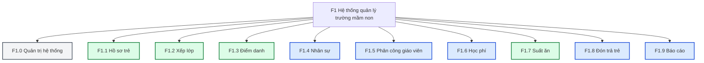

# Sơ đồ phân rã chức năng (BFD) toàn hệ thống

Tài liệu này ghép đủ ba cấp của BFD: cấp 1 là hệ thống, cấp 2 là nền tảng `F1.0` và 9 nhánh nghiệp vụ, cấp 3 là 43 chức năng lá `F1.x.y`. Mã và tên chức năng giữ nguyên theo [mục 8.1 của khảo sát](../../survey/README.md). Công việc chính bên trong từng chức năng lá của TV2 ở [BFD phần TV2](bfd-tv2.md). Truy vết `YC-*`, `QT-*` của từng chức năng lá ở [ma trận truy vết](../traceability.md).

## 1. Cấp 1 và cấp 2

Màu xám là nền tảng dùng chung do TV1 đặc tả, màu xanh lá là nhánh của TV1, màu xanh dương là nhánh của TV2.

| Nhánh cấp 2 | Thành viên | Số chức năng lá | Hệ thống con chính | Use case |
| --- | --- | ---: | --- | --- |
| F1.0 Quản trị hệ thống | Dùng chung, TV1 đặc tả | 3 | Ban giám hiệu | UC-01, UC-02, UC-03 |
| F1.1 Hồ sơ trẻ | TV1 | 5 | Văn phòng | UC-11, UC-16 |
| F1.2 Xếp lớp | TV1 | 4 | Văn phòng | UC-12, UC-17 |
| F1.3 Điểm danh | TV1 | 4 | Giáo viên | UC-13, UC-14 |
| F1.4 Nhân sự | TV2 | 4 | Văn phòng | UC-04 |
| F1.5 Phân công giáo viên | TV2 | 4 | Văn phòng, Giáo viên | UC-05 |
| F1.6 Học phí | TV2 | 5 | Kế toán | UC-02 (F1.6.1), UC-06, UC-07 |
| F1.7 Suất ăn | TV1 | 4 | Bếp, Giáo viên | UC-15, UC-18 |
| F1.8 Đón trả trẻ | TV2 | 6 | Giáo viên, Văn phòng | UC-08, UC-09 |
| F1.9 Báo cáo | TV2 | 4 | Mọi hệ thống con, Ban giám hiệu | UC-10 |
| **Tổng** | | **43** | | **18 UC** |

## 2. BFD đầy đủ ba cấp

```mermaid
flowchart LR
    F1["F1 Hệ thống quản lý trường mầm non"]

    F1 --> F10["F1.0 Quản trị hệ thống"]
    F10 --> F101["F1.0.1 Quản lý tài khoản, vai trò và phân quyền trực"]
    F10 --> F102["F1.0.2 Quản lý danh mục dùng chung"]
    F10 --> F103["F1.0.3 Cấu hình khung giờ vận hành, bữa ăn và mốc chốt"]

    F1 --> F11["F1.1 Hồ sơ trẻ"]
    F11 --> F111["F1.1.1 Tiếp nhận, đối chiếu trùng và duyệt hồ sơ trẻ"]
    F11 --> F112["F1.1.2 Theo dõi bổ sung giấy tờ và bàn giao danh sách chờ xếp lớp"]
    F11 --> F113["F1.1.3 Cập nhật nhân thân, giám hộ chính và lịch sử hồ sơ"]
    F11 --> F114["F1.1.4 Quản lý ủy quyền cố định nhận trẻ"]
    F11 --> F115["F1.1.5 Đề nghị, ghi nhận và xác nhận lưu ý chăm sóc"]

    F1 --> F12["F1.2 Xếp lớp"]
    F12 --> F121["F1.2.1 Xếp lớp ban đầu và quản lý danh sách chờ"]
    F12 --> F122["F1.2.2 Chuyển lớp và giữ lịch sử hai đầu"]
    F12 --> F123["F1.2.3 Quản lý nghỉ dài ngày, bảo lưu, thôi học và quay lại"]
    F12 --> F124["F1.2.4 Tra cứu danh sách theo ngày, đối chiếu hồi tố và tổng hợp sĩ số"]

    F1 --> F13["F1.3 Điểm danh"]
    F13 --> F131["F1.3.1 Tạo bảng điểm danh và tự động ghi nhận nghỉ dài ngày"]
    F13 --> F132["F1.3.2 Tiếp nhận lượt đón, trả, xác minh vắng và chốt theo các mốc có hiệu lực"]
    F13 --> F133["F1.3.3 Đề nghị và duyệt điều chỉnh chuyên cần sau khóa"]
    F13 --> F134["F1.3.4 Tổng hợp, khóa kỳ và xuất chuyên cần"]

    F1 --> F14["F1.4 Nhân sự"]
    F14 --> F141["F1.4.1 Lập hồ sơ nhân sự"]
    F14 --> F142["F1.4.2 Quản lý bằng cấp, chứng chỉ, giấy tờ"]
    F14 --> F143["F1.4.3 Ghi nhận biến động nhân sự"]
    F14 --> F144["F1.4.4 Tra cứu và xuất danh sách nhân sự"]

    F1 --> F15["F1.5 Phân công giáo viên"]
    F15 --> F151["F1.5.1 Lập phương án phân công"]
    F15 --> F152["F1.5.2 Duyệt phân công"]
    F15 --> F153["F1.5.3 Đơn nghỉ ngắn ngày và phân công dạy thay"]
    F15 --> F154["F1.5.4 Tra cứu lịch sử và tổng hợp ca"]

    F1 --> F16["F1.6 Học phí"]
    F16 --> F161["F1.6.1 Quản lý biểu phí và miễn giảm"]
    F16 --> F162["F1.6.2 Lập bảng phải thu"]
    F16 --> F163["F1.6.3 Thu tiền và in biên lai"]
    F16 --> F164["F1.6.4 Điều chỉnh và hoàn tiền"]
    F16 --> F165["F1.6.5 Theo dõi công nợ"]

    F1 --> F17["F1.7 Suất ăn"]
    F17 --> F171["F1.7.1 Lập và duyệt thực đơn theo ngày, bữa"]
    F17 --> F172["F1.7.2 Thông báo thực đơn tuần, đối chiếu dị ứng và ghi lịch về sớm"]
    F17 --> F173["F1.7.3 Chốt danh sách và số suất ăn theo bữa"]
    F17 --> F174["F1.7.4 Điều chỉnh suất sau chốt và đối chiếu giao nhận"]

    F1 --> F18["F1.8 Đón trả trẻ"]
    F18 --> F181["F1.8.1 Ghi nhận báo nghỉ"]
    F18 --> F182["F1.8.2 Đón trẻ và chuyển lượt đón sang NV03"]
    F18 --> F183["F1.8.3 Xác minh và duyệt nhận trẻ hộ"]
    F18 --> F184["F1.8.4 Trả trẻ"]
    F18 --> F185["F1.8.5 Tra cứu đón trả"]
    F18 --> F186["F1.8.6 Hủy lượt giao nhận ghi nhầm"]

    F1 --> F19["F1.9 Báo cáo"]
    F19 --> F191["F1.9.1 Lập và ghi chú báo cáo"]
    F19 --> F192["F1.9.2 Gửi báo cáo"]
    F19 --> F193["F1.9.3 Xem, phản hồi, duyệt"]
    F19 --> F194["F1.9.4 Tổng hợp toàn trường"]

    classDef shared fill:#f3f4f6,stroke:#4b5563,stroke-width:2px
    classDef tv1 fill:#dcfce7,stroke:#15803d,stroke-width:2px
    classDef tv2 fill:#dbeafe,stroke:#1d4ed8,stroke-width:2px
    class F10 shared
    class F11,F12,F13,F17 tv1
    class F14,F15,F16,F18,F19 tv2
```

## 3. Danh mục chức năng lá

| Mã | Chức năng lá | Thực hiện / duyệt | Use case |
| --- | --- | --- | --- |
| F1.0.1 | Quản lý tài khoản, vai trò và phân quyền trực | Ban giám hiệu. | UC-01 |
| F1.0.2 | Quản lý danh mục dùng chung | Ban giám hiệu lập và duyệt. Văn phòng lập danh mục lớp. | UC-02 |
| F1.0.3 | Cấu hình khung giờ vận hành, bữa ăn và mốc chốt | Ban giám hiệu. | UC-03 |
| F1.1.1 | Tiếp nhận, đối chiếu trùng và duyệt hồ sơ trẻ | Văn phòng lập. Ban giám hiệu duyệt. | UC-11 |
| F1.1.2 | Theo dõi bổ sung giấy tờ và bàn giao danh sách chờ xếp lớp | Văn phòng. | UC-11 |
| F1.1.3 | Cập nhật nhân thân, giám hộ chính và lịch sử hồ sơ | Văn phòng. Hiệu trưởng duyệt sửa ngày sinh, giám hộ chính. | UC-16 |
| F1.1.4 | Quản lý ủy quyền cố định nhận trẻ | Văn phòng. | UC-16 |
| F1.1.5 | Đề nghị, ghi nhận và xác nhận lưu ý chăm sóc | Giáo viên đề nghị. Văn phòng ghi. Phó hiệu trưởng chuyên môn xác nhận. | UC-16 |
| F1.2.1 | Xếp lớp ban đầu và quản lý danh sách chờ | Văn phòng lập. Ban giám hiệu duyệt. | UC-17 |
| F1.2.2 | Chuyển lớp và giữ lịch sử hai đầu | Văn phòng lập. Ban giám hiệu duyệt. | UC-12 |
| F1.2.3 | Quản lý nghỉ dài ngày, bảo lưu, thôi học và quay lại | Văn phòng lập. Ban giám hiệu duyệt. | UC-17 |
| F1.2.4 | Tra cứu danh sách theo ngày, đối chiếu hồi tố và tổng hợp sĩ số | Văn phòng. | UC-12, UC-17 |
| F1.3.1 | Tạo bảng điểm danh và tự động ghi nhận nghỉ dài ngày | Giáo viên. | UC-13 |
| F1.3.2 | Tiếp nhận lượt đón, trả, xác minh vắng và chốt theo các mốc có hiệu lực (mặc định 07:30, 08:30, 09:00) | Giáo viên. Hệ thống tự chốt theo mốc. | UC-13 |
| F1.3.3 | Đề nghị và duyệt điều chỉnh chuyên cần sau khóa | Giáo viên đề nghị. Ban giám hiệu hoặc người được phân quyền duyệt. | UC-14 |
| F1.3.4 | Tổng hợp, khóa kỳ và xuất chuyên cần | Giáo viên. | UC-13 |
| F1.4.1 | Lập hồ sơ nhân sự | Văn phòng lập. Ban giám hiệu xác nhận. | UC-04 |
| F1.4.2 | Quản lý bằng cấp, chứng chỉ, giấy tờ | Văn phòng. | UC-04 |
| F1.4.3 | Ghi nhận biến động nhân sự | Văn phòng ghi. Ban giám hiệu xác nhận. | UC-04 |
| F1.4.4 | Tra cứu và xuất danh sách nhân sự | Văn phòng. Ban giám hiệu xem. | UC-04 |
| F1.5.1 | Lập phương án phân công | Người phân công (Văn phòng). | UC-05 |
| F1.5.2 | Duyệt phân công | Ban giám hiệu. | UC-05 |
| F1.5.3 | Đơn nghỉ ngắn ngày và phân công dạy thay | Giáo viên gửi đơn. Người phân công xếp dạy thay. Ban giám hiệu duyệt. | UC-05 |
| F1.5.4 | Tra cứu lịch sử và tổng hợp ca | Người phân công. Giáo viên xem lịch mình. Ban giám hiệu xem. | UC-05 |
| F1.6.1 | Quản lý biểu phí và miễn giảm | Kế toán lập. Ban giám hiệu duyệt. | UC-02 |
| F1.6.2 | Lập bảng phải thu | Kế toán lập. Ban giám hiệu duyệt. | UC-06 |
| F1.6.3 | Thu tiền và in biên lai | Kế toán. | UC-07 |
| F1.6.4 | Điều chỉnh và hoàn tiền | Kế toán lập. Ban giám hiệu duyệt. | UC-07 |
| F1.6.5 | Theo dõi công nợ | Kế toán. Ban giám hiệu xem. | UC-07 |
| F1.7.1 | Lập và duyệt thực đơn theo ngày, bữa | Bếp lập. Ban giám hiệu duyệt. | UC-18 |
| F1.7.2 | Thông báo thực đơn tuần, đối chiếu dị ứng và ghi lịch về sớm | Giáo viên. | UC-18 |
| F1.7.3 | Chốt danh sách và số suất ăn theo bữa | Giáo viên chốt. Bếp nhận số chốt. | UC-15 |
| F1.7.4 | Điều chỉnh suất sau chốt và đối chiếu giao nhận | Giáo viên đề nghị. Bếp xác nhận và giao. | UC-15 |
| F1.8.1 | Ghi nhận báo nghỉ | Giáo viên (lớp mình) hoặc Văn phòng. | UC-08 |
| F1.8.2 | Đón trẻ và chuyển lượt đón sang NV03 | Giáo viên phụ trách lớp hoặc nhân sự trực được cấp quyền. | UC-08 |
| F1.8.3 | Xác minh và duyệt nhận trẻ hộ | Giáo viên hoặc nhân sự trực xác minh. Ban giám hiệu hoặc người được giao quyền duyệt. | UC-09 |
| F1.8.4 | Trả trẻ | Giáo viên phụ trách lớp hoặc nhân sự trực được cấp quyền. | UC-09 |
| F1.8.5 | Tra cứu đón trả | Giáo viên (lớp mình). Văn phòng (toàn trường). Ban giám hiệu. | UC-08, UC-09 |
| F1.8.6 | Hủy lượt giao nhận ghi nhầm | Giáo viên phụ trách lớp hoặc người đã ghi. Ban giám hiệu hoặc người được giao duyệt hủy lượt trả. | UC-08, UC-09 |
| F1.9.1 | Lập và ghi chú báo cáo | Người lập ở mọi hệ thống con. | UC-10 |
| F1.9.2 | Gửi báo cáo | Người lập. | UC-10 |
| F1.9.3 | Xem, phản hồi, duyệt | Ban giám hiệu. | UC-10 |
| F1.9.4 | Tổng hợp toàn trường | Ban giám hiệu. | UC-10 |

## 4. Luồng liên phân hệ chính giữa các nhánh

BFD chỉ thể hiện quan hệ phân rã. Bảng dưới đây tóm tắt các luồng dữ liệu đã chốt giữa các nhánh. Bên nhận chỉ đọc dữ liệu đã chốt. Chi tiết điều kiện và cách xử lý khi dữ liệu đổi ở phần 5 của [ma trận truy vết](../traceability.md).

| Từ | Đến | Dữ liệu | Quy tắc |
| --- | --- | --- | --- |
| F1.0 | Mọi nhánh | Tài khoản, quyền, danh mục dùng chung, mốc giờ có hiệu lực | QT-DT-05, QT-XL-01, QT-PC-03 |
| F1.1 | F1.2 | Hồ sơ đã duyệt, cùng mã trẻ | QT-HS-03 |
| F1.1 | F1.6, F1.8 | Định danh, giám hộ chính, ủy quyền cố định nhận trẻ | QT-HS-04, QT-HS-05, QT-DT-04 |
| F1.1 | F1.7 | Lưu ý dị ứng, chế độ ăn, cảnh báo chờ xác nhận | QT-HS-06 |
| F1.2 | F1.3, F1.5, F1.6, F1.8 | Lớp đang hoạt động, sĩ số, diện đi học theo ngày | QT-PC-01, QT-HP-02, QT-HP-06 |
| F1.4 | F1.5, F1.0 | Nhân sự đủ điều kiện đứng lớp, biến động khóa và mở tài khoản | QT-NS-02, QT-NS-03 |
| F1.5 | F1.3, F1.7, F1.8 | Giáo viên phụ trách lớp theo ngày, gồm dạy thay | QT-PC-06, QT-DT-05 |
| F1.8 | F1.3 | Lượt đón là nguồn duy nhất của `Có mặt`, báo nghỉ là căn cứ xác minh | QT-DT-01, QT-DT-07 |
| F1.8 | F1.7 | Báo nghỉ, giờ về thực tế | QT-SA-04 |
| F1.3 | F1.7 | Danh sách có mặt theo mốc chốt bữa sáng, bản bàn giao buổi sáng | QT-SA-01 |
| F1.3 | F1.6 | Số ngày `Có mặt` đã khóa, treo và gỡ treo đối soát | QT-DD-07, QT-HP-05 |
| Mọi nhánh | F1.9 | Số liệu đã chốt của từng bộ phận | QT-BC-02, QT-BC-04 |

## 5. Đối chiếu checklist

| Tiêu chí | Yêu cầu | Kết quả |
| --- | --- | --- |
| Số nhánh cấp 2 | ≥6 cho nhóm, ≥3 mỗi thành viên | 9 nhánh nghiệp vụ và nền tảng F1.0. TV1 có 4 nhánh (F1.1, F1.2, F1.3, F1.7), TV2 có 5 nhánh (F1.4, F1.5, F1.6, F1.8, F1.9). |
| Chức năng lá | Mỗi nhánh có chức năng lá | 43 chức năng lá: F1.0 có 3, TV1 có 17, TV2 có 23. |
| Truy vết sang use case | Mỗi chức năng lá có use case | Cả 43 chức năng lá đều thuộc ít nhất một trong 18 use case (mục 3). |
| Luồng liên phân hệ TV1↔TV2 | ≥2 | TV1 → TV2: F1.1 → F1.6, F1.8. F1.2 → F1.5, F1.6, F1.8. F1.3 → F1.6. TV2 → TV1: F1.5 → F1.3, F1.7. F1.8 → F1.3, F1.7. |
