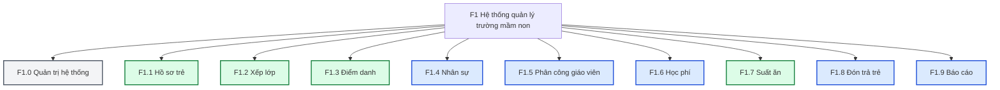
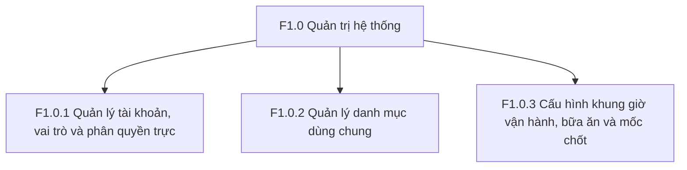
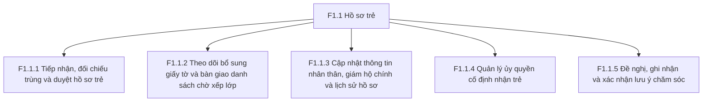
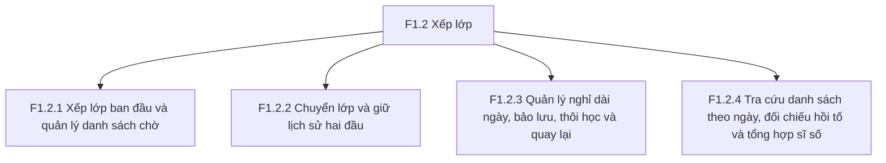
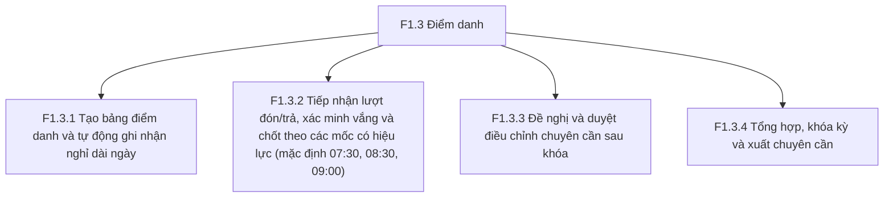
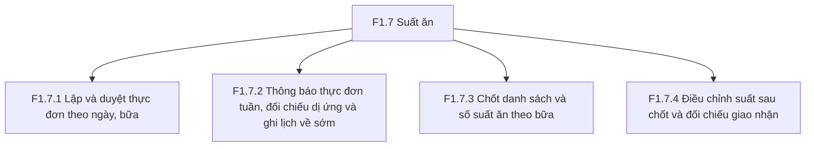

# Sơ đồ phân rã chức năng (BFD) phần TV1

TV1 phụ trách bốn nhánh nghiệp vụ và 17 chức năng lá. Tài liệu trình bày thêm ba chức năng lá của nền tảng dùng chung F1.0 do TV1 đặc tả. Xem [BFD toàn hệ thống](bfd-toan-he-thong.md) và [BFD phần TV2](bfd-tv2.md) để đối chiếu phạm vi toàn nhóm.

Mã và tên chức năng theo [mục 8.1 của khảo sát](../../survey/README.md). Công việc trong mỗi hàng diễn giải chức năng lá ở cấp 3 của BFD. Các quy tắc liên phân hệ đầy đủ nằm trong [ma trận truy vết](../traceability.md).

## 1. Vị trí trong BFD toàn hệ thống

Các nhánh màu xanh lá do TV1 phụ trách. Màu xám biểu thị nền tảng dùng chung, màu xanh dương biểu thị phần TV2.

## 2. F1.0 Quản trị hệ thống (Nền tảng dùng chung)

| Mã | Chức năng lá | Công việc chính | Thực hiện / duyệt | YC, QT | Use Case |
| --- | --- | --- | --- | --- | --- |
| F1.0.1 | Quản lý tài khoản, vai trò và phân quyền trực | Gắn tài khoản với hồ sơ nhân sự. Cấp quyền theo vai trò và phạm vi, tách quyền trực giao nhận, duyệt ngoại lệ và duyệt hủy lượt trả. Theo dõi khóa/mở tài khoản theo ngày hiệu lực của biến động NV04. | Ban giám hiệu. | YC-NS-05, NFR-01, NFR-02, QT-NS-03, QT-PC-06, QT-DT-05, QT-DT-07 | [UC-01](../use-cases/uc-01-quan-ly-tai-khoan-va-phan-quyen.md) |
| F1.0.2 | Quản lý danh mục dùng chung | Lập và duyệt danh mục năm học, lớp, ca, định mức, loại báo cáo, biểu phí và miễn giảm. Danh mục đã phát sinh giao dịch được cập nhật bằng phiên bản có hiệu lực mới. | Ban giám hiệu lập và duyệt. Văn phòng lập danh mục lớp. Kế toán lập biểu phí, miễn giảm. | YC-XL-01, YC-HP-01, YC-BC-05, NFR-04, NFR-08, QT-XL-01, QT-HP-01, QT-HP-02, QT-HP-03, QT-PC-03, QT-DD-01, QT-BC-06 | [UC-02](../use-cases/uc-02-quan-ly-danh-muc-dung-chung.md) |
| F1.0.3 | Cấu hình khung giờ vận hành, bữa ăn và mốc chốt | Thiết lập bữa ăn, định mức khẩu phần, khung đón/trả, mốc bàn giao, mốc khóa chuyên cần và giờ chốt theo bữa. | Ban giám hiệu. | YC-SA-03, YC-DT-04, YC-DD-02, NFR-04, NFR-06, NFR-08, QT-DD-03, QT-DD-07, QT-SA-04, QT-DT-06, QT-HP-02 | [UC-03](../use-cases/uc-03-cau-hinh-moc-gio-va-bua-an.md) |

**Liên phân hệ**

- NV04 → F1.0.1. Biến động nhân sự là căn cứ nhắc khóa hoặc mở tài khoản. F1.0.1 cung cấp quyền trực theo lớp/thời gian và quyền duyệt riêng cho NV08.
- F1.0.2 → NV02, NV03, NV05, NV06, NV09. Biểu phí và miễn giảm thuộc F1.6.1, được đặc tả cùng UC-02. UC-06 đọc bản đã duyệt.
- F1.0.3 → NV03, NV07, NV08. Các nghiệp vụ sử dụng cấu hình có hiệu lực theo ngày.

## 3. F1.1 Hồ sơ trẻ (NV01)

| Mã | Chức năng lá | Công việc chính | Thực hiện / duyệt | YC, QT | Use Case |
| --- | --- | --- | --- | --- | --- |
| F1.1.1 | Tiếp nhận, đối chiếu trùng và duyệt hồ sơ trẻ | Tiếp nhận đăng ký, đối chiếu hồ sơ trùng và trẻ quay lại, trình duyệt đợt tiếp nhận. | Văn phòng lập. Ban giám hiệu duyệt. | YC-HS-01, YC-HS-02, QT-HS-01, QT-HS-02 | [UC-11](../use-cases/uc-11-tiep-nhan-ho-so-tre.md) |
| F1.1.2 | Theo dõi bổ sung giấy tờ và bàn giao danh sách chờ xếp lớp | Theo dõi giấy tờ thiếu và lịch hẹn bổ sung. Bàn giao hồ sơ đủ điều kiện cho xếp lớp với cùng mã trẻ. | Văn phòng. | YC-HS-01, YC-HS-02, QT-HS-01, QT-HS-02, YC-HS-03, QT-HS-03 | [UC-11](../use-cases/uc-11-tiep-nhan-ho-so-tre.md) |
| F1.1.3 | Cập nhật thông tin nhân thân, giám hộ chính và lịch sử hồ sơ | Cập nhật nhân thân và giám hộ chính, lưu lịch sử thay đổi và trình duyệt các sửa đổi theo quyền. | Văn phòng. Hiệu trưởng duyệt sửa ngày sinh, giám hộ chính. | YC-HS-04, QT-HS-04 | [UC-16](../use-cases/uc-16-cap-nhat-ho-so-va-luu-y-cham-soc.md) |
| F1.1.4 | Quản lý ủy quyền cố định nhận trẻ | Ghi thời hạn ủy quyền cố định, lưu mốc hết hiệu lực theo Đến ngày + 1, xử lý thu hồi sớm và che CCCD theo quyền. | Văn phòng. | YC-HS-05, QT-HS-05 | [UC-16](../use-cases/uc-16-cap-nhat-ho-so-va-luu-y-cham-soc.md) |
| F1.1.5 | Đề nghị, ghi nhận và xác nhận lưu ý chăm sóc | Tiếp nhận đề nghị của Giáo viên, ghi lưu ý và trình xác nhận chuyên môn. Chuyển cảnh báo chờ xác nhận khi có lưu ý ảnh hưởng chế độ ăn. | Giáo viên đề nghị. Văn phòng ghi. Phó hiệu trưởng chuyên môn xác nhận. | YC-HS-06, QT-HS-06 | [UC-16](../use-cases/uc-16-cap-nhat-ho-so-va-luu-y-cham-soc.md) |

**Liên phân hệ**

- F1.1.2 → NV02, NV09. Bàn giao hồ sơ đủ điều kiện cho xếp lớp và cấp số liệu tuyển sinh cho báo cáo.
- F1.1.3 → NV06. Cấp thông tin định danh và giám hộ chính ở chế độ chỉ đọc.
- F1.1.3, F1.1.4 → NV08. UC-09 kiểm tra giám hộ chính đã xác nhận và ủy quyền còn hiệu lực tại giờ giao, kiểm tra lại khi lưu.
- F1.1.5 → NV07. Cấp lưu ý dị ứng, chế độ ăn và cảnh báo chờ xác nhận.

## 4. F1.2 Xếp lớp (NV02)

| Mã | Chức năng lá | Công việc chính | Thực hiện / duyệt | YC, QT | Use Case |
| --- | --- | --- | --- | --- | --- |
| F1.2.1 | Xếp lớp ban đầu và quản lý danh sách chờ | Xếp trẻ từ hồ sơ đủ điều kiện vào lớp phù hợp nhóm tuổi, ngày hiệu lực và trần sĩ số. Theo dõi trẻ chờ có chỗ và kiểm tra cảnh báo định mức giáo viên. | Văn phòng lập. Ban giám hiệu duyệt. | YC-XL-01, YC-XL-02, QT-XL-01, QT-XL-02, QT-XL-04 | [UC-17](../use-cases/uc-17-xep-lop-va-bien-dong-si-so.md) |
| F1.2.2 | Chuyển lớp và giữ lịch sử hai đầu | Kiểm tra lớp đích và trình duyệt chuyển lớp. Kết thúc phân lớp cũ và mở phân lớp mới trong cùng giao dịch, giữ lịch sử cả hai đầu. | Văn phòng lập. Ban giám hiệu duyệt. | YC-XL-02, YC-XL-03, NFR-05, QT-XL-01, QT-XL-02, QT-XL-03, QT-XL-04, QT-XL-05 | [UC-12](../use-cases/uc-12-chuyen-lop.md) |
| F1.2.3 | Quản lý nghỉ dài ngày, bảo lưu, thôi học và quay lại | Ghi và duyệt nghỉ dài ngày, bảo lưu, thôi học hoặc quay lại theo ngày hiệu lực. Kiểm tra chỗ và định mức khi xếp trẻ quay lại. | Văn phòng lập. Ban giám hiệu duyệt. | YC-XL-01, YC-XL-02, QT-XL-01, QT-XL-02, QT-XL-04 | [UC-17](../use-cases/uc-17-xep-lop-va-bien-dong-si-so.md) |
| F1.2.4 | Tra cứu danh sách theo ngày, đối chiếu hồi tố và tổng hợp sĩ số | Tra danh sách lớp theo ngày, hậu kiểm các ngày chịu ảnh hưởng khi cập nhật hồi tố và lập bảng sĩ số đầu kỳ, tăng, giảm, cuối kỳ. | Văn phòng. | YC-XL-03, YC-XL-04, QT-XL-04, QT-XL-05, YC-XL-02, NFR-05, QT-XL-01, QT-XL-02, QT-XL-03 | [UC-12](../use-cases/uc-12-chuyen-lop.md), [UC-17](../use-cases/uc-17-xep-lop-va-bien-dong-si-so.md) |

**Liên phân hệ**

- F1.2.4 → NV03, NV05, NV06, NV08. Cung cấp lớp, sĩ số và diện đi học theo ngày. NV02 kiểm tra cảnh báo định mức của lớp đích từ NV05.
- F1.2.2, F1.2.4 → NV03, NV06, NV09. Hồi tố kích hoạt hậu kiểm chuyên cần và đối soát học phí. UC-10 nhận số liệu sĩ số và xử lý báo cáo bị ảnh hưởng theo trạng thái.
- F1.2.3 → UC-07. Khi trẻ thôi học, Kế toán xử lý số dư có và chênh lệch tiền ăn theo quy tắc học phí.

## 5. F1.3 Điểm danh (NV03)

| Mã | Chức năng lá | Công việc chính | Thực hiện / duyệt | YC, QT | Use Case |
| --- | --- | --- | --- | --- | --- |
| F1.3.1 | Tạo bảng điểm danh và tự động ghi nhận nghỉ dài ngày | Tạo bảng theo lớp và ngày dựa trên danh sách có hiệu lực, kiểm tra quyền theo phân công và tự ghi nghỉ dài ngày đã xác nhận. | Giáo viên. | YC-DD-01, YC-DD-05, QT-DD-01, QT-DD-06 | [UC-13](../use-cases/uc-13-chot-chuyen-can.md) |
| F1.3.2 | Tiếp nhận lượt đón/trả, xác minh vắng và chốt theo các mốc có hiệu lực (mặc định 07:30, 08:30, 09:00) | Nhận lượt đón/trả và báo nghỉ. Dùng lượt đón chưa hủy làm căn cứ duy nhất của Có mặt, dùng báo nghỉ để xác minh vắng. Chốt theo cấu hình có hiệu lực. | Giáo viên. Hệ thống tự chốt theo mốc. | YC-DD-02, QT-DD-02, QT-DD-05 | [UC-13](../use-cases/uc-13-chot-chuyen-can.md) |
| F1.3.3 | Đề nghị và duyệt điều chỉnh chuyên cần sau khóa | Lập đề nghị khi phát sinh căn cứ từ mốc khóa hoặc có hồi tố cần xử lý. Người có quyền duyệt kiểm tra căn cứ và lưu giá trị trước/sau, kết quả đã khóa được giữ đến khi duyệt. | Giáo viên đề nghị. Ban giám hiệu hoặc người được phân quyền duyệt. | YC-DD-03, YC-DD-05, QT-DD-01, QT-DD-02, QT-DD-03, QT-DD-05, QT-DD-07 | [UC-14](../use-cases/uc-14-dieu-chinh-chuyen-can-sau-khoa.md) |
| F1.3.4 | Tổng hợp, khóa kỳ và xuất chuyên cần | Tổng hợp, khóa kỳ, xuất số liệu và chỉ ra ngày chưa khóa hoặc đề nghị chờ duyệt ảnh hưởng đối soát. | Giáo viên. | YC-DD-04, YC-DD-05, QT-DD-04, QT-DD-07 | [UC-13](../use-cases/uc-13-chot-chuyen-can.md) |

**Liên phân hệ**

- NV02, NV05 → F1.3.1. Dùng danh sách lớp và phân công/dạy thay theo ngày.
- NV08 → F1.3.2, F1.3.3. Phát sinh hoặc hủy lượt đón trước mốc khóa cập nhật trực tiếp hoặc tính lại. Từ mốc khóa chuyển đề nghị sang UC-14. Lượt trả cung cấp giờ về thực tế.
- F1.3.2, F1.3.3 → NV07. Cấp dữ liệu theo mốc chốt bữa và bàn giao sáng. Điều chỉnh ảnh hưởng bữa đã chốt được xử lý bằng đề nghị điều chỉnh suất riêng.
- F1.3.3, F1.3.4 → NV06, NV09. Học phí dùng số ngày Có mặt đã khóa và áp dụng treo/gỡ treo theo từng trẻ. Báo cáo dùng số liệu đã chốt và xử lý thay đổi nguồn theo QT-BC-04.

## 6. F1.7 Suất ăn (NV07)

| Mã | Chức năng lá | Công việc chính | Thực hiện / duyệt | YC, QT | Use Case |
| --- | --- | --- | --- | --- | --- |
| F1.7.1 | Lập và duyệt thực đơn theo ngày, bữa | Bộ phận bếp lập thực đơn theo ngày và bữa, trình Ban giám hiệu duyệt. | Bộ phận bếp lập. Ban giám hiệu duyệt. | YC-SA-01, YC-SA-02, YC-SA-04, QT-SA-01, QT-SA-03, QT-SA-06 | [UC-18](../use-cases/uc-18-lap-duyet-va-thong-bao-thuc-don.md) |
| F1.7.2 | Thông báo thực đơn tuần, đối chiếu dị ứng và ghi lịch về sớm | Giáo viên thông báo thực đơn tuần, đối chiếu lưu ý dị ứng/chế độ ăn, ghi phản hồi và lịch về sớm trước bữa. | Giáo viên. | YC-SA-01, YC-SA-02, YC-SA-04, QT-SA-01, QT-SA-03, QT-SA-06 | [UC-18](../use-cases/uc-18-lap-duyet-va-thong-bao-thuc-don.md) |
| F1.7.3 | Chốt danh sách và số suất ăn theo bữa | Rà soát danh sách dự kiến. Khi đủ dữ liệu đến hết mốc có hiệu lực, Giáo viên lưu số chốt ban đầu và gửi Bộ phận bếp. | Giáo viên chốt. Bộ phận bếp nhận số chốt. | YC-SA-01, YC-SA-02, YC-SA-03, QT-SA-01, QT-SA-02, QT-SA-03 | [UC-15](../use-cases/uc-15-chot-va-doi-chieu-suat-an.md) |
| F1.7.4 | Điều chỉnh suất sau chốt và đối chiếu giao nhận | Ghi đề nghị điều chỉnh sau chốt và lưu số chốt ban đầu. Bộ phận bếp xác nhận thay đổi, ghi giao suất và đối chiếu với Giáo viên. | Giáo viên đề nghị. Bộ phận bếp xác nhận và giao. | YC-SA-04, YC-SA-05, QT-SA-04, QT-SA-05, QT-SA-06 | [UC-15](../use-cases/uc-15-chot-va-doi-chieu-suat-an.md) |

**Liên phân hệ**

- F1.0.3, NV01, NV03, NV08 → F1.7.3. Dùng giờ chốt có hiệu lực, lưu ý chế độ ăn, danh sách chuyên cần theo mốc, báo nghỉ và giờ về thực tế.
- NV03, NV08 → F1.7.4. Thay đổi ảnh hưởng bữa đã chốt đi qua đề nghị điều chỉnh. F1.7.4 cấp số liệu giao nhận và điều chỉnh cho NV09. NV06 đối soát tiền ăn theo ngày Có mặt đã khóa từ NV03.
