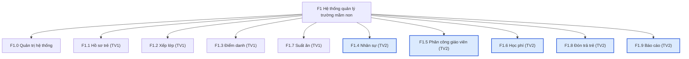
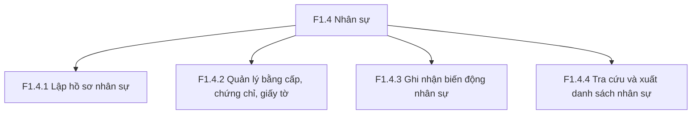
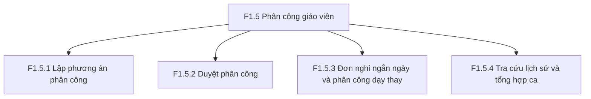
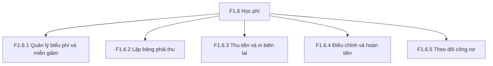
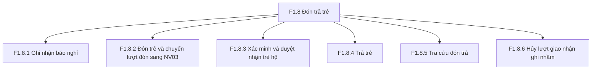
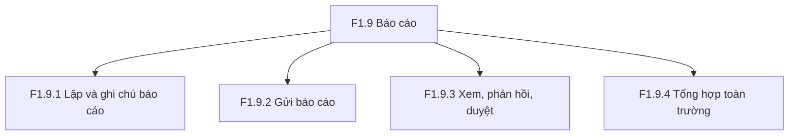

# Sơ đồ phân rã chức năng (BFD) phần TV2

Tài liệu này chi tiết hóa năm nhánh cấp 2 của TV2: `F1.4` Nhân sự, `F1.5` Phân công giáo viên, `F1.6` Học phí, `F1.8` Đón trả trẻ và `F1.9` Báo cáo. Căn cứ là các file khảo sát [NV04](../../survey/04-staff-management.md), [NV05](../../survey/05-teacher-assignment.md), [NV06](../../survey/06-tuition-management.md), [NV08](../../survey/08-child-drop-off-and-pick-up.md) và [NV09](../../survey/09-reporting.md).

Mã chức năng giữ nguyên theo [mục 8.1 của khảo sát](../../survey/README.md). Phần 1–3 của ma trận truy vết (phần TV1) đã dùng các mã này, nên không đánh số lại. Truy vết đầy đủ của từng chức năng lá TV2 ở phần 4 của [ma trận truy vết](../traceability.md). BFD có ba cấp: cấp 1 là hệ thống, cấp 2 là nhánh theo nghiệp vụ, cấp 3 là chức năng lá `F1.x.y`. Cột "Công việc chính" mô tả các bước bên trong một chức năng lá, không phải cấp phân rã thứ tư.

## 1. Vị trí trong BFD toàn hệ thống

| Nhánh cấp 2 | Thành viên | Số chức năng lá | Hệ thống con chính |
| --- | --- | --- | --- |
| F1.0 Quản trị hệ thống | Dùng chung, TV1 đặc tả | 3 | Ban giám hiệu |
| F1.1 Hồ sơ trẻ | TV1 | 5 | Văn phòng |
| F1.2 Xếp lớp | TV1 | 4 | Văn phòng |
| F1.3 Điểm danh | TV1 | 4 | Giáo viên |
| F1.7 Suất ăn | TV1 | 4 | Bếp, Giáo viên |
| F1.4 Nhân sự | TV2 | 4 | Văn phòng |
| F1.5 Phân công giáo viên | TV2 | 4 | Văn phòng, Giáo viên |
| F1.6 Học phí | TV2 | 5 | Kế toán |
| F1.8 Đón trả trẻ | TV2 | 6 | Giáo viên, Văn phòng |
| F1.9 Báo cáo | TV2 | 4 | Mọi hệ thống con, Ban giám hiệu |

TV2 có 5 nhánh cấp 2 và 23 chức năng lá. Hệ thống con ghi theo README §5 và ma trận T/D/X ở README §7.

## 2. F1.4 Nhân sự (NV04)

| Mã | Chức năng lá | Công việc chính | Thực hiện / duyệt | YC, QT | Biểu mẫu |
| --- | --- | --- | --- | --- | --- |
| F1.4.1 | Lập hồ sơ nhân sự | Tra trùng theo họ tên, ngày sinh, giấy tờ tùy thân và dùng lại hồ sơ cũ khi nhân sự quay lại. Ghi thông tin cá nhân, vị trí, loại nhân sự, có được giao đứng lớp hoặc dạy thay, ngày bắt đầu, loại hợp đồng. Trình Ban giám hiệu xác nhận để chuyển sang đang làm việc. | Văn phòng lập. Ban giám hiệu xác nhận. | YC-NS-01. QT-NS-01. | NS-01 (Mẫu 06), NS-03 |
| F1.4.2 | Quản lý bằng cấp, chứng chỉ, giấy tờ | Ghi bằng cấp, chuyên ngành, chứng chỉ, ngày cấp, ngày hết hạn. Đánh dấu giấy tờ còn thiếu. Đưa chứng chỉ vào danh sách cần xử lý từ 30 ngày trước ngày hết hạn. Chứng chỉ cấp lại ghi thành dòng mới, giữ dòng cũ. | Văn phòng. | YC-NS-02. QT-NS-02, QT-NS-05. | NS-02 (Mẫu 06) |
| F1.4.3 | Ghi nhận biến động nhân sự | Ghi tạm nghỉ (từ 6 ngày làm việc liên tục hoặc nghỉ chế độ), nghỉ việc, chuyển vị trí, hết tạm nghỉ và sửa thông tin quan trọng. Lưu ngày hiệu lực, giá trị trước và sau, người xác nhận. Cảnh báo lớp bị ảnh hưởng cho người phân công. Nhắc Ban giám hiệu khóa hoặc mở tài khoản tại F1.0.1. | Văn phòng ghi. Ban giám hiệu xác nhận. | YC-NS-03, YC-NS-05. QT-NS-03, QT-NS-04. | NS-04 (Mẫu 06), NS-03 |
| F1.4.4 | Tra cứu và xuất danh sách nhân sự | Tra theo mã, họ tên, vị trí, trạng thái. Lập danh sách đủ điều kiện đứng lớp tại một ngày. Xem lịch sử biến động. Lọc và xuất danh sách theo quyền, che thông tin nhạy cảm với người không có quyền. | Văn phòng. Ban giám hiệu xem. | YC-NS-03, YC-NS-04. QT-NS-02, QT-NS-04. | NS-02 (Mẫu 06) |

**Liên phân hệ**

- F1.4.4 → F1.5.1, F1.5.3: danh sách nhân sự đủ điều kiện đứng lớp tại ngày hiệu lực (QT-NS-02, QT-PC-01).
- F1.4.3 → F1.5.3: tạm nghỉ đã xác nhận để xếp dạy thay. NV05 chỉ đọc.
- F1.4.3 → F1.0.1: tạm nghỉ, nghỉ việc khóa tài khoản từ ngày hiệu lực. Hết tạm nghỉ mở lại từ ngày kết thúc (YC-NS-05).
- F1.4.4 → F1.9.1: số liệu báo cáo nhân sự của Văn phòng.

## 3. F1.5 Phân công giáo viên (NV05)

| Mã | Chức năng lá | Công việc chính | Thực hiện / duyệt | YC, QT | Biểu mẫu |
| --- | --- | --- | --- | --- | --- |
| F1.5.1 | Lập phương án phân công | Lấy lớp đang hoạt động và sĩ số tại ngày hiệu lực, nhân sự đủ điều kiện đứng lớp, định mức và ca. Ghi giáo viên chủ nhiệm, giáo viên phụ, ca, ngày bắt đầu và kết thúc. Kiểm tra trùng ca, tối đa một chủ nhiệm mỗi lớp, định mức tối thiểu. Khi thay đổi, kết thúc phân công cũ và mở phân công mới trong một lần cập nhật. | Người phân công (Văn phòng). | YC-PC-01, YC-PC-02. QT-PC-01, QT-PC-02, QT-PC-03, QT-PC-04. | PC-01 (Mẫu 07) |
| F1.5.2 | Duyệt phân công | Xem phương án và danh sách cảnh báo lớp thiếu giáo viên. Duyệt hoặc trả lại, chốt ngày hiệu lực. Người lập và người duyệt không là một người. Thông báo cho giáo viên và văn phòng. | Ban giám hiệu. | YC-PC-02. QT-PC-03, QT-PC-04. | PC-01 (Mẫu 07) |
| F1.5.3 | Đơn nghỉ ngắn ngày và phân công dạy thay | Giáo viên gửi đơn nghỉ tối đa 5 ngày làm việc, Ban giám hiệu duyệt. Đọc tạm nghỉ đã xác nhận từ F1.4.3. Gợi ý giáo viên còn trống ca. Giao dạy thay có thời hạn. Nếu không có người, trình hiệu trưởng chọn nhân sự đủ điều kiện khác hoặc ghi cảnh báo thiếu giáo viên kèm khoảng ngày. Lập danh sách giáo viên phụ trách lớp theo ngày. | Giáo viên gửi đơn. Người phân công xếp dạy thay. Ban giám hiệu duyệt. | YC-PC-03. QT-PC-02, QT-PC-05, QT-PC-06. | PC-03 (Mẫu 07) |
| F1.5.4 | Tra cứu lịch sử và tổng hợp ca | Tra lịch sử phân công theo lớp, giáo viên và ngày. Giáo viên xem lịch làm việc của mình. Tổng hợp và xuất số ca đứng lớp, dạy thay theo giáo viên và tháng. | Người phân công. Giáo viên xem lịch mình. Ban giám hiệu xem. | YC-PC-04. QT-PC-04. | PC-04 (Mẫu 07), PC-02 |

**Liên phân hệ**

- F1.2.4 → F1.5.1: lớp đang hoạt động và sĩ số theo ngày hiệu lực (QT-PC-01). Khi xếp lớp hoặc chuyển lớp, NV02 kiểm tra cảnh báo định mức của lớp đích (QT-PC-03).
- F1.0.2 → F1.5.1: ca làm việc, khung giờ và định mức giáo viên theo nhóm tuổi.
- F1.5.3 → F1.3.1, F1.7.3, F1.8.2, F1.8.4: danh sách giáo viên phụ trách lớp theo ngày, gồm dạy thay, không gồm người có đơn nghỉ đã duyệt hoặc đang tạm nghỉ (QT-PC-06, QT-DT-05).
- F1.5.4 → F1.9.1: số liệu báo cáo phân công và dạy thay của Văn phòng.

## 4. F1.6 Học phí (NV06)

| Mã | Chức năng lá | Công việc chính | Thực hiện / duyệt | YC, QT | Biểu mẫu |
| --- | --- | --- | --- | --- | --- |
| F1.6.1 | Quản lý biểu phí và miễn giảm | Ghi khoản thu, đơn giá, đơn vị tính, nhóm áp dụng, ngày hiệu lực. Biểu phí đã dùng để lập phải thu không được sửa, chỉ ban hành biểu phí mới. Ghi đơn và quyết định miễn giảm theo trẻ, loại, mức, kỳ áp dụng. Trình Ban giám hiệu duyệt. | Kế toán lập. Ban giám hiệu duyệt. | YC-HP-01. QT-HP-01, QT-HP-03. | HP-01, HP-05 |
| F1.6.2 | Lập bảng phải thu | Đọc lịch học, diện đi học, định danh trẻ và người giám hộ chính, số ngày có mặt đã khóa. Tính khoản tháng, theo tỷ lệ khi trẻ vào học, thôi học hoặc bảo lưu trong kỳ. Tạm thu tiền ăn theo ngày dự kiến. Đối soát tiền ăn kỳ trước và ghi bù trừ có tham chiếu kỳ phát sinh. Treo đối soát của trẻ còn ngày chưa khóa hoặc còn đề nghị chờ duyệt có thể đổi kết quả `Có mặt`. Chỉ gỡ treo khi mọi ngày liên quan đã khóa và hết đề nghị như vậy. Áp miễn giảm và trừ số dư có. Nợ cũ ở lại bảng của kỳ cũ và chỉ hiện trên thông báo. Trình duyệt rồi phát hành thông báo học phí. | Kế toán lập. Ban giám hiệu duyệt. | YC-HP-02, YC-HP-05, YC-HP-06. QT-HP-01, QT-HP-02, QT-HP-03, QT-HP-05, QT-HP-06. | HP-02, HP-03 (Mẫu 04) |
| F1.6.3 | Thu tiền và in biên lai | Ghi thu tiền mặt hoặc chuyển khoản, đối chiếu mã nội dung chuyển khoản theo trẻ và kỳ. Phân bổ vào bảng phải thu còn nợ của kỳ cũ nhất trước. Ghi phần thừa thành số dư có. Mỗi lần thu có một biên lai duy nhất, không xóa. | Kế toán. | YC-HP-03. QT-HP-04, QT-HP-07. | HP-04 (Mẫu 04) |
| F1.6.4 | Điều chỉnh và hoàn tiền | Lập phiếu điều chỉnh khi có sai sót. Hoàn số dư có khi phụ huynh đề nghị hoặc trẻ thôi học. Xử lý chênh lệch tiền ăn của trẻ đã thôi học và không còn kỳ thu tiếp theo. Lưu lịch sử kèm người duyệt. | Kế toán lập. Ban giám hiệu duyệt. | YC-HP-04. QT-HP-04, QT-HP-05, QT-HP-07. | HP-04 (Mẫu 04) |
| F1.6.5 | Theo dõi công nợ | Tính phải thu, đã thu, còn nợ, quá hạn theo trẻ, lớp và kỳ. Chuyển còn nợ sang kỳ sau. Xuất danh sách nhắc nợ. Cung cấp số liệu cho báo cáo thu. | Kế toán. Ban giám hiệu xem. | YC-HP-04. QT-HP-04. | HP-02, HP-04 (Mẫu 04) |

Theo phân tích của TV1, màn hình danh mục biểu phí và miễn giảm được đặc tả chung trong `UC-02` của F1.0.2. Dữ liệu vẫn do Kế toán tạo và sửa theo README §6, Ban giám hiệu duyệt.

**Liên phân hệ**

- F1.1.3 → F1.6.2, F1.6.3: định danh trẻ và người giám hộ chính, chỉ đọc. Kế toán không xem lưu ý chăm sóc và ủy quyền nhận trẻ.
- F1.2.1–F1.2.4 → F1.6.2: khoảng thời gian trẻ thuộc diện đi học. Nghỉ dài ngày thu đủ khoản tháng, bảo lưu và thôi học tính tỷ lệ (QT-HP-06). F1.2.3 thôi học → F1.6.4.
- F1.3.3, F1.3.4 → F1.6.2: số ngày `Có mặt` đã khóa, gồm điều chỉnh đã duyệt. `Chờ xác minh` tính 0 ngày. Treo và gỡ treo đối soát theo QT-DD-07, QT-HP-05.
- F1.6.5 → F1.9.1: số liệu báo cáo thu học phí và công nợ của Kế toán.

## 5. F1.8 Đón trả trẻ (NV08)

| Mã | Chức năng lá | Công việc chính | Thực hiện / duyệt | YC, QT | Biểu mẫu |
| --- | --- | --- | --- | --- | --- |
| F1.8.1 | Ghi nhận báo nghỉ | Ghi trẻ, ngày hoặc khoảng nghỉ, lý do, kênh báo, thời điểm nhận, người ghi nhận. Hiển thị nhãn báo nghỉ trên danh sách đón. Chuyển cho NV03 làm căn cứ xác minh vắng và cho NV07 lập danh sách ăn dự kiến. | Giáo viên (lớp mình) hoặc Văn phòng. | YC-DT-05. QT-DT-06. | DT-03 (Mẫu 08) |
| F1.8.2 | Đón trẻ và chuyển lượt đón sang NV03 | Mở danh sách trẻ chưa đón của lớp trong ngày. Chọn trẻ hoặc "Chọn tất cả", bấm "Đón n trẻ đã chọn" và xác nhận một lần. Ghi giờ đón thực tế, kể cả trẻ đã báo nghỉ. Gắn cờ đến muộn từ mốc bàn giao có hiệu lực (mặc định 08:30). Trước mốc khóa (mặc định 09:00), NV03 cập nhật `Có mặt`. Từ mốc khóa, tạo đề nghị điều chỉnh. | Giáo viên phụ trách lớp hoặc nhân sự trực được cấp quyền. | YC-DT-01, YC-DT-02, YC-DT-04. QT-DT-01, QT-DT-03, QT-DT-05, QT-DT-06. | DT-01 (Mẫu 08, Mẫu 02) |
| F1.8.3 | Xác minh và duyệt nhận trẻ hộ | Tiếp nhận xác nhận của người giám hộ qua kênh đã đăng ký, có lưu vết. Đối chiếu CCCD người đến nhận tại cổng hoặc lớp. Lập hồ sơ xác minh ở trạng thái `Chờ xác minh` hoặc `Chờ duyệt`. Chuyển người có quyền duyệt ngoại lệ. Duyệt chỉ có giá trị cho trẻ, người nhận và lượt trả đã xác minh. Từ chối thì trẻ vẫn ở danh sách chưa trả. | Giáo viên hoặc nhân sự trực xác minh. Ban giám hiệu hoặc người được giao quyền duyệt. | YC-DT-07. QT-DT-04, QT-DT-05. | DT-05 (Mẫu 08) |
| F1.8.4 | Trả trẻ | Mở danh sách trẻ đã đón và chưa trả. Chọn trẻ, bấm "Trả n trẻ đã chọn". Với từng trẻ, chọn người nhận thực tế trong danh sách đủ điều kiện và ghi giờ giao thực tế. Kiểm tra lại từng dòng khi lưu: dòng đủ điều kiện được ghi, dòng thiếu điều kiện báo lý do và ở lại danh sách chưa trả. Hết khung trả, cảnh báo trẻ còn ở trường và ghi người tiếp tục trông. | Giáo viên phụ trách lớp hoặc nhân sự trực được cấp quyền. | YC-DT-02, YC-DT-03, YC-DT-04, YC-DT-07. QT-DT-02, QT-DT-03, QT-DT-04, QT-DT-05. | DT-01, DT-04 (Mẫu 08) |
| F1.8.5 | Tra cứu đón trả | Tra lượt đón trả theo trẻ, lớp, ngày, người nhận thực tế. Lọc lượt trả theo ngoại lệ đã duyệt, ca đang chờ xử lý và trả muộn. Tổng hợp số lượt đến muộn, trả theo ngoại lệ, trả muộn trong kỳ. | Giáo viên (lớp mình). Văn phòng (toàn trường). Ban giám hiệu. | YC-DT-06. QT-DT-05. | DT-01, DT-04 (Mẫu 08) |
| F1.8.6 | Hủy lượt giao nhận ghi nhầm | Hủy, không xóa, kèm lý do, người hủy, thời điểm. Hủy lượt đón trước mốc khóa thì NV03 tính lại từ căn cứ còn lại. Từ mốc khóa thì tạo đề nghị điều chỉnh, `Có mặt` giữ nguyên tới khi duyệt. Không hủy lượt đón khi trẻ còn lượt trả chưa hủy. Hủy lượt trả chỉ khi trẻ thực tế còn ở trường và có duyệt, trẻ quay lại danh sách chưa trả. Thay đổi ảnh hưởng bữa ăn chuyển NV07. | Giáo viên phụ trách lớp hoặc người đã ghi. Ban giám hiệu hoặc người được giao duyệt hủy lượt trả. | YC-DT-08. QT-DT-07. | DT-01 (Mẫu 08) |

**Liên phân hệ**

- F1.2.4 → F1.8.2: danh sách trẻ thuộc lớp trong ngày, nhãn nghỉ dài ngày.
- F1.5.3 → F1.8.2, F1.8.4: giáo viên phụ trách lớp theo ngày. F1.0.1 → F1.8: quyền trực giao nhận và quyền duyệt ngoại lệ, cấp riêng (QT-DT-05).
- F1.0.3 → F1.8.2, F1.8.4: khung đón, mốc bàn giao, mốc khóa chuyên cần và khung trả có hiệu lực. F1.0.3 do TV1 đặc tả tại `UC-03`.
- F1.1.3, F1.1.4 → F1.8.3, F1.8.4: người giám hộ chính (F1.1.3) và ủy quyền cố định (F1.1.4) còn hiệu lực tại thời điểm trả (QT-HS-05, QT-DT-04).
- F1.8.1, F1.8.2, F1.8.6 → F1.3.2, F1.3.3: báo nghỉ là căn cứ xác minh. Lượt đón là nguồn duy nhất của `Có mặt` (QT-DT-01).
- F1.8.4 → F1.3.2: lượt trả và giờ về thực tế. Lượt trả không làm mất `Có mặt` và không hủy đề nghị đang chờ.
- F1.8.1, F1.8.4, F1.8.6 → F1.7.3, F1.7.4: báo nghỉ, giờ về thực tế và thay đổi ảnh hưởng bữa ăn. Trước mốc chốt bữa cập nhật danh sách dự kiến tại F1.7.3, sau mốc chốt thành đề nghị điều chỉnh tại F1.7.4 (QT-SA-04).
- F1.8.5 → F1.9.1: số lượt đến muộn, trả muộn cho báo cáo lớp của Giáo viên.

## 6. F1.9 Báo cáo (NV09)

| Mã | Chức năng lá | Công việc chính | Thực hiện / duyệt | YC, QT | Biểu mẫu |
| --- | --- | --- | --- | --- | --- |
| F1.9.1 | Lập và ghi chú báo cáo | Chọn loại báo cáo và kỳ của bộ phận mình. Lấy số liệu đã chốt trong phạm vi người lập. Hiển thị riêng lượt chờ xác minh, đánh dấu kỳ còn ngày chưa khóa hoặc điều chỉnh chờ duyệt. Thêm ghi chú chung, ghi chú theo dòng, tệp đính kèm. Lưu nháp, chỉ người lập thấy. | Người lập ở mọi hệ thống con: Giáo viên, Văn phòng, Kế toán, Bếp. | YC-BC-01. QT-BC-01, QT-BC-02, QT-BC-06. | BC-01 đến BC-04 |
| F1.9.2 | Gửi báo cáo | Bấm "Gửi Ban giám hiệu". Chụp số liệu tại lúc gửi, ghi người gửi, thời điểm và khóa nội dung. Đánh dấu trễ hạn khi gửi sau hạn. Sau yêu cầu bổ sung hoặc `Cần cập nhật`, gửi lại thành phiên bản mới. | Người lập. | YC-BC-01, YC-BC-03, YC-BC-04. QT-BC-03, QT-BC-04, QT-BC-06. | BC-01 đến BC-04 |
| F1.9.3 | Xem, phản hồi, duyệt | Mở hộp báo cáo nhận được, lọc theo bộ phận, loại, kỳ, trạng thái. Viết phản hồi gắn với phiên bản. Chọn "Yêu cầu bổ sung" hoặc "Duyệt". Khi số liệu nguồn thay đổi sau khi gửi, báo cáo không tự đổi và hệ thống cảnh báo người lập. Báo cáo `Đã gửi` được Ban giám hiệu xử lý bằng yêu cầu bổ sung nếu cần. Báo cáo `Đã duyệt` chuyển sang `Cần cập nhật`. | Ban giám hiệu. | YC-BC-02, YC-BC-03. QT-BC-01, QT-BC-03, QT-BC-04. | — |
| F1.9.4 | Tổng hợp toàn trường | Ghép chỉ tiêu từ phiên bản đã duyệt mới nhất của từng báo cáo. Đánh dấu kỳ chưa đầy đủ và kỳ có số liệu đang cập nhật. Theo dõi bộ phận chưa gửi, gửi trễ hạn. Xuất Excel hoặc PDF. | Ban giám hiệu. | YC-BC-04. QT-BC-05, QT-BC-06. | BC-05 (Mẫu 05) |

Danh mục loại báo cáo, kỳ và hạn gửi (YC-BC-05) do Ban giám hiệu quản lý tại F1.0.2, theo phân tích của TV1 (`UC-02`). F1.9 chỉ đọc danh mục này.

**Liên phân hệ**

- F1.0.2 → F1.9.1, F1.9.2: loại báo cáo, bộ phận lập, kỳ, hạn gửi, chỉ tiêu.
- F1.1.2, F1.2.4, F1.3.4, F1.7.4 → F1.9.1: số liệu đã chốt của TV1 về tuyển sinh, sĩ số, chuyên cần, suất ăn.
- F1.4.4, F1.5.4, F1.6.5, F1.8.5 → F1.9.1: số liệu đã chốt của TV2 về nhân sự, phân công, thu học phí, đón trả.
- F1.2.2, F1.2.4 (hồi tố), F1.3.3, F1.7.4 → F1.9.3: thay đổi nguồn sau khi gửi hoặc duyệt kích hoạt cảnh báo và trạng thái `Cần cập nhật` (QT-BC-04).

## 7. Đối chiếu checklist và use case

| Tiêu chí checklist | Yêu cầu | Kết quả |
| --- | --- | --- |
| Số nhánh cấp 2 của BFD | ≥6 cho cả nhóm, ≥3 mỗi thành viên | 9 nhánh nghiệp vụ và F1.0. TV1 có 4 nhánh, TV2 có 5 nhánh. |
| Chức năng lá của TV2 | Mỗi nhánh có chức năng lá | 23 chức năng lá, mỗi lá có YC, QT và biểu mẫu tham chiếu. |
| Luồng liên phân hệ TV1↔TV2 | ≥2 luồng (README §8.2, §8.3) | TV1 → TV2: F1.2 → F1.5, F1.6, F1.8. F1.3 → F1.6. F1.1 → F1.6, F1.8. TV2 → TV1: F1.8 → F1.3, F1.7. F1.5 → F1.3, F1.7. |

Bảng dưới đây nối chức năng lá với use case theo danh mục ở README §8.2 và phần bàn giao TV2 trong ma trận truy vết của TV1.

| Nhánh | Chức năng lá | Use case |
| --- | --- | --- |
| F1.4 | F1.4.1–F1.4.4 | [UC-04 · Lập và cập nhật hồ sơ nhân sự](../use-cases/uc-04-lap-va-cap-nhat-ho-so-nhan-su.md) |
| F1.5 | F1.5.1–F1.5.4 | [UC-05 · Lập phân công giáo viên](../use-cases/uc-05-lap-phan-cong-giao-vien.md) |
| F1.6 | F1.6.1 | `UC-02` · Quản lý danh mục dùng chung (TV1 đặc tả) |
| F1.6 | F1.6.2 | [UC-06 · Lập bảng phải thu theo kỳ](../use-cases/uc-06-lap-bang-phai-thu-theo-ky.md) |
| F1.6 | F1.6.3–F1.6.5 | [UC-07 · Ghi thu tiền và in biên lai](../use-cases/uc-07-ghi-thu-tien-va-in-bien-lai.md) |
| F1.8 | F1.8.1, F1.8.2, F1.8.5, F1.8.6 | [UC-08 · Đón trẻ theo nhóm](../use-cases/uc-08-don-tre-theo-nhom.md) |
| F1.8 | F1.8.3–F1.8.6 | [UC-09 · Trả trẻ theo nhóm](../use-cases/uc-09-tra-tre-theo-nhom.md) |
| F1.9 | F1.9.1–F1.9.4 | [UC-10 · Gửi, phản hồi và duyệt báo cáo](../use-cases/uc-10-gui-phan-hoi-va-duyet-bao-cao.md) |
