# Sơ đồ luồng dữ liệu hệ thống quản lý nhà trẻ

Hình chữ nhật biểu diễn tác nhân ngoài phần mềm, hình bo tròn biểu diễn tiến trình, hình trụ biểu diễn kho dữ liệu logic. Mũi tên chỉ chiều truyền của dữ liệu ghi trên cạnh. Cùng mã ở hai hình là cùng một đối tượng. Mã tiến trình DFD tăng từ 1.0 để dành số 0 cho toàn hệ thống.

[BFD và danh mục chức năng lá](bfd-toan-he-thong.md) · [Sơ đồ tác nhân và Use Case](use-case-toan-he-thong.md) · [Ma trận truy vết](../traceability.md) · [Danh mục khảo sát và biểu mẫu](../../survey/README.md)

## 1. Mức ngữ cảnh

Mỗi cạnh mang một mã gói. Bảng ngay dưới hình định nghĩa toàn bộ thành phần của gói theo đúng tên luồng mức 1. Phụ huynh cung cấp hoặc nhận dữ liệu qua nhân viên trường. Vai trò lập báo cáo là giáo viên, văn phòng, kế toán hoặc bếp trong phạm vi bộ phận. Hai quyền duyệt được giao có phạm vi độc lập.

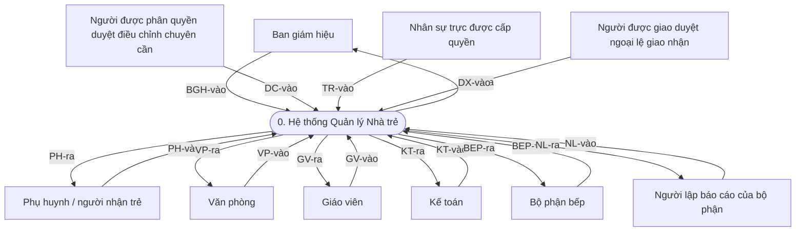

| Tác nhân ngoài | Gói theo chiều hệ thống | Thành phần dữ liệu |
| --- | --- | --- |
| Ban giám hiệu | BGH-vào | Quyền theo vai trò, lớp và thời hạn, Danh mục trường và quyết định duyệt, Khung giờ và mốc chốt theo bữa, Quyết định duyệt hồ sơ, Quyết định sửa ngày sinh hoặc giám hộ, Xác nhận lưu ý chăm sóc, Quyết định xếp lớp, Quyết định chuyển lớp, Quyết định biến động sĩ số, Quyết định điều chỉnh ngày khóa, Xác nhận tiếp nhận nhân sự, Xác nhận biến động nhân sự, Quyết định duyệt phân công, Quyết định nghỉ và dạy thay, Quyết định duyệt bảng phải thu, Quyết định điều chỉnh hoặc hoàn tiền, Quyết định duyệt thực đơn, Quyết định duyệt ngoại lệ nhận hộ, Quyết định hủy lượt trả, Phản hồi, yêu cầu bổ sung và quyết định duyệt |
| Văn phòng | VP-vào | Thông tin nhân sự cần cấp tài khoản, Danh mục lớp đề xuất, Phiếu tiếp nhận và kết quả đối chiếu, Phiếu cập nhật hồ sơ, Giấy ủy quyền và thời hạn, Nội dung lưu ý và căn cứ, Phương án xếp lớp, Phương án chuyển lớp và ngày hiệu lực, Hồ sơ biến động diện đi học, Hồ sơ tiếp nhận nhân sự, Văn bằng và chứng chỉ, Phiếu biến động nhân sự, Phương án bố trí giáo viên, Phương án dạy thay, Phiếu báo nghỉ do văn phòng tiếp nhận |
| Ban giám hiệu | BGH-ra | Danh sách tài khoản cần khóa hoặc mở, Tổng hợp nhân sự, Tổng hợp công nợ, Tổng hợp giao nhận, Báo cáo tổng hợp toàn trường |
| Phụ huynh / người nhận trẻ | PH-vào | Hồ sơ nhập học và giấy tờ bổ sung, Thông tin thay đổi nhân thân và giám hộ, Xác nhận lịch đón về trước bữa, Thông tin báo nghỉ, Thông tin người nhận hộ đột xuất |
| Phụ huynh / người nhận trẻ | PH-ra | Danh sách giấy tờ cần bổ sung, Thông báo học phí kèm nợ kỳ cũ, Biên lai thu tiền, Thực đơn tuần và thông tin món cần lưu ý |
| Giáo viên | GV-vào | Đề nghị lưu ý chăm sóc, Kết quả xác minh trẻ vắng, Đề nghị điều chỉnh và chứng cứ, Đơn nghỉ ngắn ngày, Lịch về sớm do lớp ghi nhận, Bảng chốt suất theo lớp và bữa, Đề nghị đổi suất và số thực nhận, Phiếu báo nghỉ của lớp, Danh sách trẻ đến lớp, Kết quả xác minh người nhận hộ, Thông tin bàn giao tại lớp, Lý do hủy lượt sai |
| Văn phòng | VP-ra | Bảng sĩ số đầu kỳ, tăng, giảm và cuối kỳ, Danh sách nhân sự, Tổng hợp ca theo lớp, Sổ đón trả toàn trường |
| Người được phân quyền duyệt điều chỉnh chuyên cần | DC-vào | Quyết định theo quyền duyệt điều chỉnh |
| Giáo viên | GV-ra | Bảng chuyên cần theo kỳ, Lịch cá nhân, Sổ đón trả của lớp |
| Kế toán | KT-vào | Biểu phí và diện miễn giảm đề xuất, Kỳ thu và danh sách khoản thu, Chứng từ thu và phân bổ, Phiếu đề nghị điều chỉnh hoặc hoàn tiền |
| Kế toán | KT-ra | Sổ công nợ chi tiết |
| Bộ phận bếp | BEP-vào | Thực đơn theo ngày và bữa, Xác nhận điều chỉnh và số thực giao |
| Bộ phận bếp | BEP-ra | Số suất chốt theo lớp và bữa |
| Nhân sự trực được cấp quyền | TR-vào | Danh sách trẻ đến trong ca trực, Chứng cứ xác minh trong ca trực, Thông tin bàn giao trong ca trực, Lý do hủy lượt do nhân sự trực ghi |
| Người được giao duyệt ngoại lệ giao nhận | DX-vào | Quyết định nhận hộ theo quyền được giao, Quyết định hủy lượt trả theo ủy quyền |
| Người lập báo cáo của bộ phận | NL-vào | Kỳ báo cáo và ghi chú bộ phận, Thông tin xác nhận gửi phiên bản |
| Người lập báo cáo của bộ phận | NL-ra | Cảnh báo nguồn đổi và yêu cầu bổ sung |

## 2. Mức đỉnh

| Tiến trình chính | Nhánh BFD | Nghiệp vụ |
| --- | --- | --- |
| 1.0 Quản trị hệ thống | F1.0 | Nền tảng dùng chung |
| 2.0 Quản lý hồ sơ trẻ | F1.1 | NV01 |
| 3.0 Xếp lớp và theo dõi sĩ số | F1.2 | NV02 |
| 4.0 Chốt và điều chỉnh chuyên cần | F1.3 | NV03 |
| 5.0 Quản lý hồ sơ nhân sự | F1.4 | NV04 |
| 6.0 Phân công giáo viên | F1.5 | NV05 |
| 7.0 Lập và thu học phí | F1.6 | NV06 |
| 8.0 Quản lý thực đơn và suất ăn | F1.7 | NV07 |
| 9.0 Ghi nhận đón trả và báo nghỉ | F1.8 | NV08 |
| 10.0 Lập và duyệt báo cáo | F1.9 | NV09 |

| Kho | Nội dung |
| --- | --- |
| D1 | Tài khoản, quyền, danh mục và cấu hình hiệu lực |
| D2 | Hồ sơ trẻ, giám hộ, ủy quyền và lưu ý |
| D3 | Lịch sử lớp, diện đi học và sĩ số |
| D4 | Chuyên cần, khóa ngày và điều chỉnh |
| D5 | Hồ sơ và biến động nhân sự |
| D6 | Phân công, nghỉ và dạy thay |
| D7 | Học phí, thanh toán và công nợ theo kỳ |
| D8 | Thực đơn, suất ăn và đối soát giao nhận |
| D9 | Báo nghỉ và sổ đón trả |
| D10 | Phiên bản, ảnh chụp và phản hồi báo cáo |

Các hình sau ghép thành một DFD mức 1. Cạnh giữa hai tiến trình xuất hiện ở cả hai hình để có thể đọc riêng từng nhánh.

### 1.0 Quản trị hệ thống

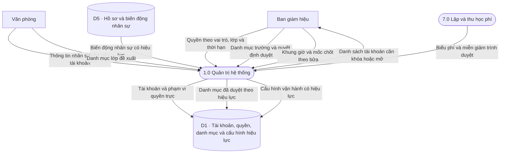

### 2.0 Quản lý hồ sơ trẻ

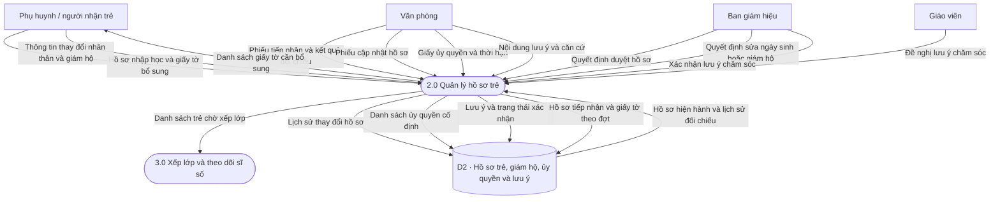

### 3.0 Xếp lớp và theo dõi sĩ số

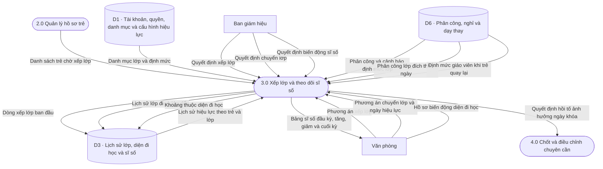

### 4.0 Chốt và điều chỉnh chuyên cần

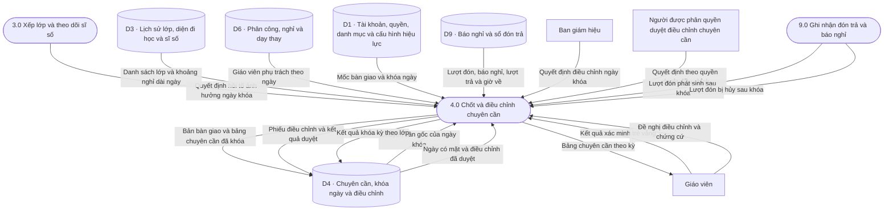

### 5.0 Quản lý hồ sơ nhân sự

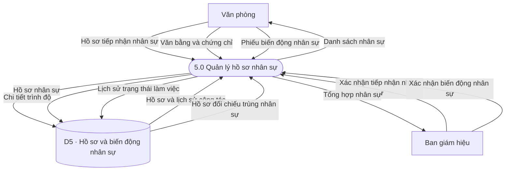

### 6.0 Phân công giáo viên

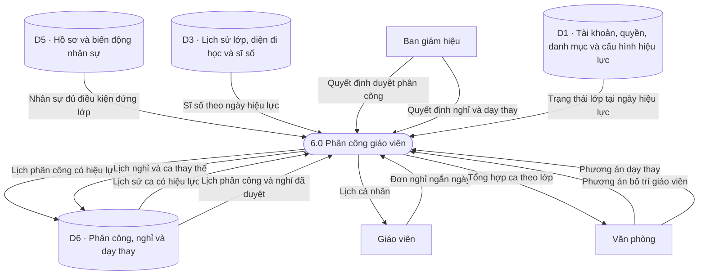

### 7.0 Lập và thu học phí

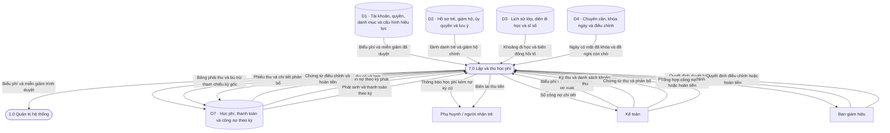

### 8.0 Quản lý thực đơn và suất ăn

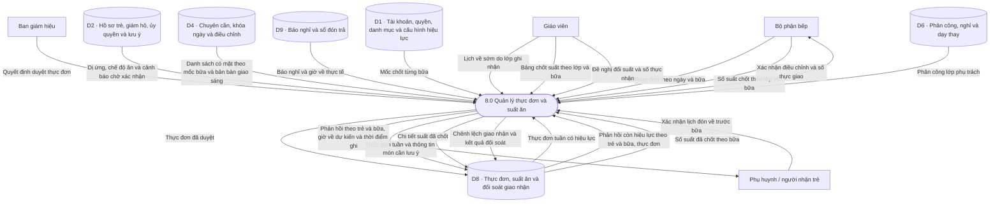

### 9.0 Ghi nhận đón trả và báo nghỉ

```mermaid
flowchart TD
    PH["Phụ huynh / người nhận trẻ"]
    P8(["9.0 Ghi nhận đón trả và báo nghỉ"])
    VP["Văn phòng"]
    GV["Giáo viên"]
    D9[("D9 · Báo nghỉ và sổ đón trả")]
    D3[("D3 · Lịch sử lớp, diện đi học và sĩ số")]
    D6[("D6 · Phân công, nghỉ và dạy thay")]
    D1[("D1 · Tài khoản, quyền, danh mục và cấu hình hiệu lực")]
    TR["Nhân sự trực được cấp quyền"]
    P3(["4.0 Chốt và điều chỉnh chuyên cần"])
    D2[("D2 · Hồ sơ trẻ, giám hộ, ủy quyền và lưu ý")]
    BGH["Ban giám hiệu"]
    DX["Người được giao duyệt ngoại lệ giao nhận"]
    PH -->|"Thông tin báo nghỉ"| P8
    VP -->|"Phiếu báo nghỉ do văn phòng tiếp nhận"| P8
    GV -->|"Phiếu báo nghỉ của lớp"| P8
    P8 -->|"Báo nghỉ theo trẻ, khoảng ngày và lý do"| D9
    D3 -->|"Danh sách trẻ thuộc lớp theo ngày"| P8
    D6 -->|"Ca phụ trách và dạy thay"| P8
    D1 -->|"Quyền trực theo lớp và thời gian"| P8
    GV -->|"Danh sách trẻ đến lớp"| P8
    TR -->|"Danh sách trẻ đến trong ca trực"| P8
    P8 -->|"Lượt đón có giờ và người ghi"| D9
    P8 -->|"Lượt đón phát sinh sau khóa"| P3
    PH -->|"Thông tin người nhận hộ đột xuất"| P8
    D2 -->|"Giám hộ và ủy quyền còn hiệu lực"| P8
    GV -->|"Kết quả xác minh người nhận hộ"| P8
    TR -->|"Chứng cứ xác minh trong ca trực"| P8
    BGH -->|"Quyết định duyệt ngoại lệ nhận hộ"| P8
    DX -->|"Quyết định nhận hộ theo quyền được giao"| P8
    D2 -->|"Giám hộ và ủy quyền cố định theo ngày"| P8
    D9 -->|"Lượt đón còn hiệu lực"| P8
    D6 -->|"Giáo viên phụ trách tại thời điểm trả"| P8
    D1 -->|"Phạm vi quyền trực giao trả"| P8
    GV -->|"Thông tin bàn giao tại lớp"| P8
    TR -->|"Thông tin bàn giao trong ca trực"| P8
    P8 -->|"Lượt trả và giờ về thực tế"| D9
    D9 -->|"Nhật ký giao nhận theo phạm vi"| P8
    P8 -->|"Sổ đón trả toàn trường"| VP
    P8 -->|"Sổ đón trả của lớp"| GV
    P8 -->|"Tổng hợp giao nhận"| BGH
    GV -->|"Lý do hủy lượt sai"| P8
    TR -->|"Lý do hủy lượt do nhân sự trực ghi"| P8
    BGH -->|"Quyết định hủy lượt trả"| P8
    DX -->|"Quyết định hủy lượt trả theo ủy quyền"| P8
    P8 -->|"Dấu hủy và lịch sử lượt gốc"| D9
    P8 -->|"Lượt đón bị hủy sau khóa"| P3
    D9 -->|"Trạng thái lượt gốc và lượt liên quan"| P8
    P8 -->|"Kết quả xác minh và quyết định ngoại lệ kể cả từ chối"| D9
```

### 10.0 Lập và duyệt báo cáo

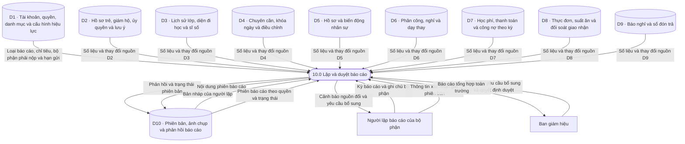

## 3. Mức dưới

Mỗi hình phân rã đúng một tiến trình cha. Bảng kèm theo ánh xạ từng xử lý sang chức năng lá và đặc tả.

### Phân rã 1.0 Quản trị hệ thống

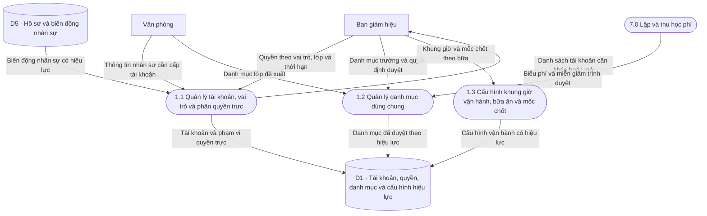

| Tiến trình con | Lá BFD | Use Case |
| --- | --- | --- |
| 1.1 | F1.0.1 | UC-01 |
| 1.2 | F1.0.2 | UC-02 |
| 1.3 | F1.0.3 | UC-03 |

### Phân rã 2.0 Quản lý hồ sơ trẻ

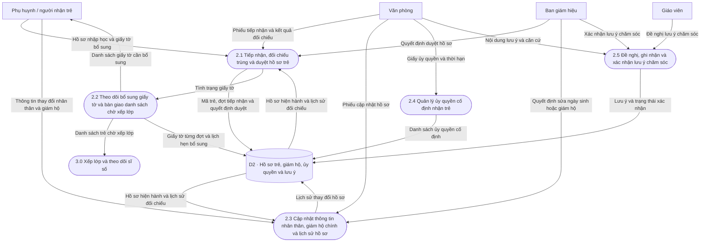

| Tiến trình con | Lá BFD | Use Case |
| --- | --- | --- |
| 2.1 | F1.1.1 | UC-11 |
| 2.2 | F1.1.2 | UC-11 |
| 2.3 | F1.1.3 | UC-16 |
| 2.4 | F1.1.4 | UC-16 |
| 2.5 | F1.1.5 | UC-16 |

### Phân rã 3.0 Xếp lớp và theo dõi sĩ số

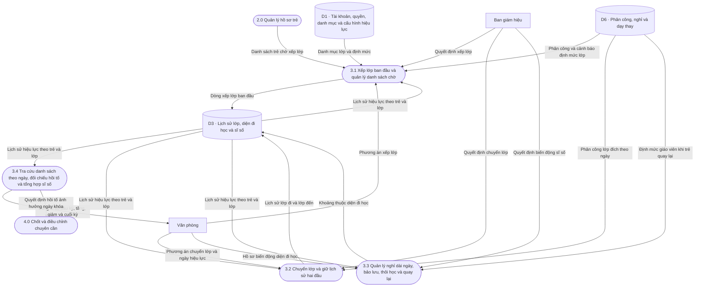

| Tiến trình con | Lá BFD | Use Case |
| --- | --- | --- |
| 3.1 | F1.2.1 | UC-17 |
| 3.2 | F1.2.2 | UC-12 |
| 3.3 | F1.2.3 | UC-17 |
| 3.4 | F1.2.4 | UC-12, UC-17 |

### Phân rã 4.0 Chốt và điều chỉnh chuyên cần

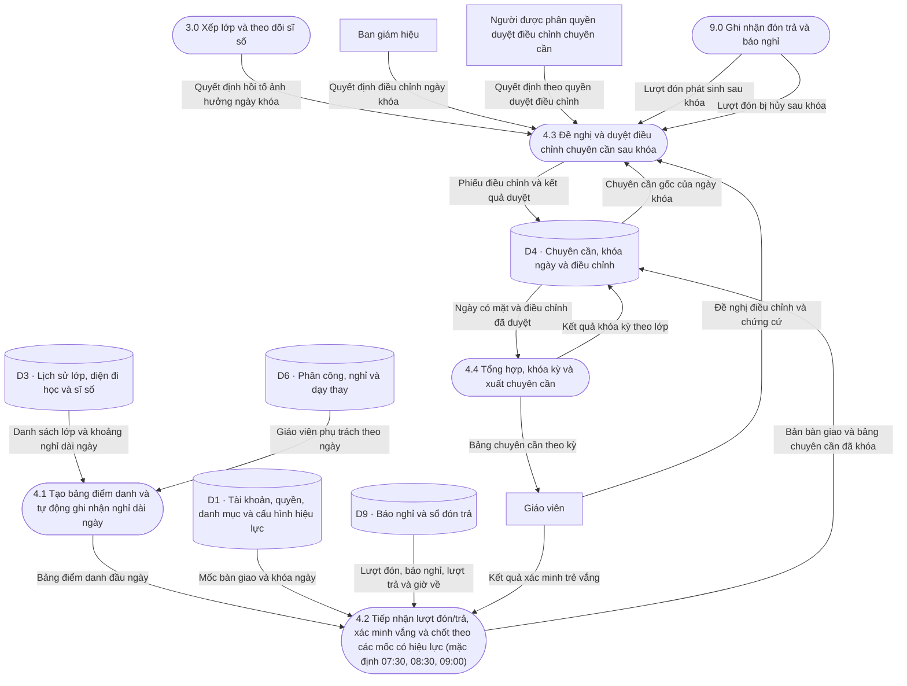

| Tiến trình con | Lá BFD | Use Case |
| --- | --- | --- |
| 4.1 | F1.3.1 | UC-13 |
| 4.2 | F1.3.2 | UC-13 |
| 4.3 | F1.3.3 | UC-14 |
| 4.4 | F1.3.4 | UC-13 |

### Phân rã 5.0 Quản lý hồ sơ nhân sự

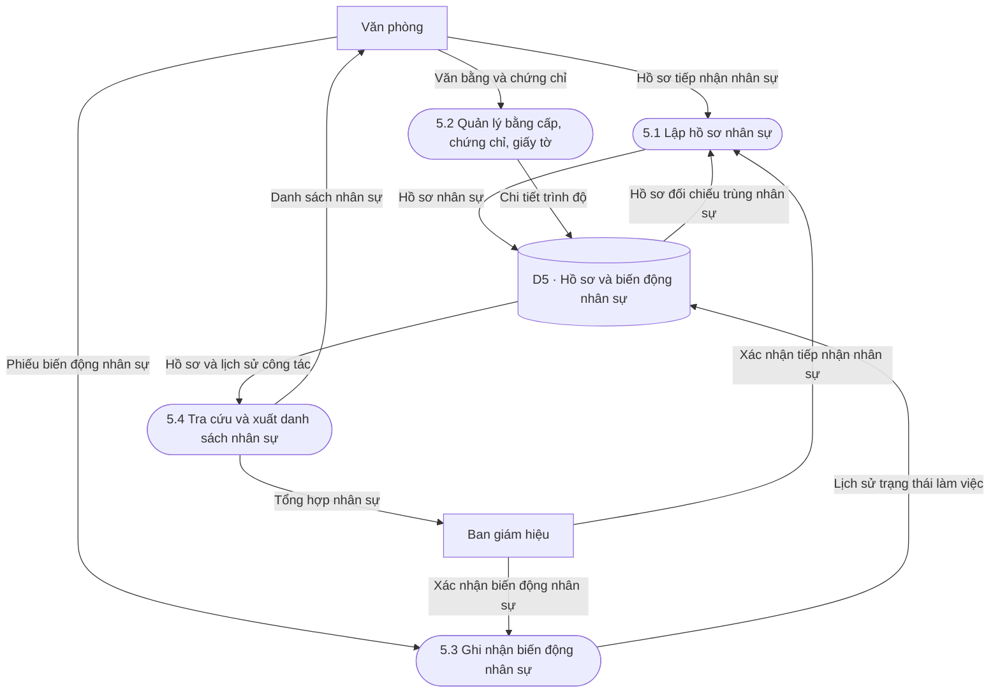

| Tiến trình con | Lá BFD | Use Case |
| --- | --- | --- |
| 5.1 | F1.4.1 | UC-04 |
| 5.2 | F1.4.2 | UC-04 |
| 5.3 | F1.4.3 | UC-04 |
| 5.4 | F1.4.4 | UC-04 |

### Phân rã 6.0 Phân công giáo viên

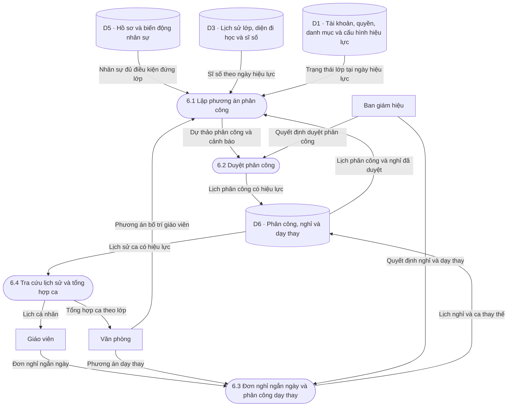

| Tiến trình con | Lá BFD | Use Case |
| --- | --- | --- |
| 6.1 | F1.5.1 | UC-05 |
| 6.2 | F1.5.2 | UC-05 |
| 6.3 | F1.5.3 | UC-05 |
| 6.4 | F1.5.4 | UC-05 |

### Phân rã 7.0 Lập và thu học phí

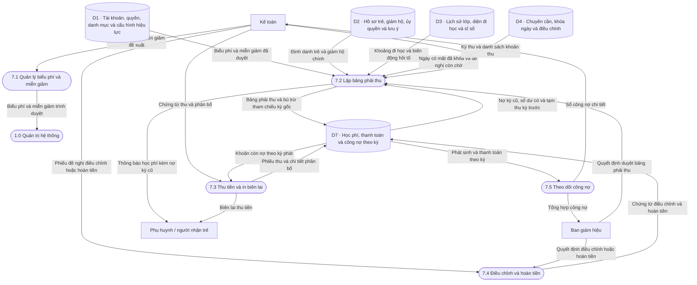

| Tiến trình con | Lá BFD | Use Case |
| --- | --- | --- |
| 7.1 | F1.6.1 | UC-02 |
| 7.2 | F1.6.2 | UC-06 |
| 7.3 | F1.6.3 | UC-07 |
| 7.4 | F1.6.4 | UC-07 |
| 7.5 | F1.6.5 | UC-07 |

### Phân rã 8.0 Quản lý thực đơn và suất ăn

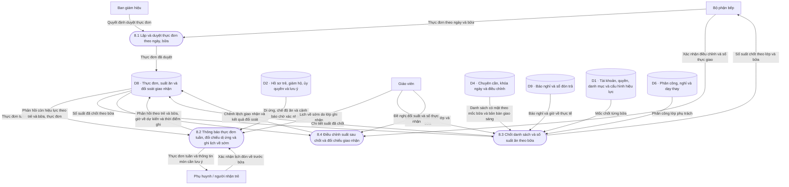

| Tiến trình con | Lá BFD | Use Case |
| --- | --- | --- |
| 8.1 | F1.7.1 | UC-18 |
| 8.2 | F1.7.2 | UC-18 |
| 8.3 | F1.7.3 | UC-15 |
| 8.4 | F1.7.4 | UC-15 |

### Phân rã 9.0 Ghi nhận đón trả và báo nghỉ

```mermaid
flowchart TD
    PH["Phụ huynh / người nhận trẻ"]
    L81(["9.1 Ghi nhận báo nghỉ"])
    VP["Văn phòng"]
    GV["Giáo viên"]
    D9[("D9 · Báo nghỉ và sổ đón trả")]
    D3[("D3 · Lịch sử lớp, diện đi học và sĩ số")]
    L82(["9.2 Đón trẻ và chuyển lượt đón sang NV03"])
    D6[("D6 · Phân công, nghỉ và dạy thay")]
    D1[("D1 · Tài khoản, quyền, danh mục và cấu hình hiệu lực")]
    TR["Nhân sự trực được cấp quyền"]
    P3(["4.0 Chốt và điều chỉnh chuyên cần"])
    L83(["9.3 Xác minh và duyệt nhận trẻ hộ"])
    D2[("D2 · Hồ sơ trẻ, giám hộ, ủy quyền và lưu ý")]
    BGH["Ban giám hiệu"]
    DX["Người được giao duyệt ngoại lệ giao nhận"]
    L84(["9.4 Trả trẻ"])
    L85(["9.5 Tra cứu đón trả"])
    L86(["9.6 Hủy lượt giao nhận ghi nhầm"])
    PH -->|"Thông tin báo nghỉ"| L81
    VP -->|"Phiếu báo nghỉ do văn phòng tiếp nhận"| L81
    GV -->|"Phiếu báo nghỉ của lớp"| L81
    L81 -->|"Báo nghỉ theo trẻ, khoảng ngày và lý do"| D9
    D3 -->|"Danh sách trẻ thuộc lớp theo ngày"| L82
    D6 -->|"Ca phụ trách và dạy thay"| L82
    D1 -->|"Quyền trực theo lớp và thời gian"| L82
    GV -->|"Danh sách trẻ đến lớp"| L82
    TR -->|"Danh sách trẻ đến trong ca trực"| L82
    L82 -->|"Lượt đón có giờ và người ghi"| D9
    L82 -->|"Lượt đón phát sinh sau khóa"| P3
    PH -->|"Thông tin người nhận hộ đột xuất"| L83
    D2 -->|"Giám hộ và ủy quyền còn hiệu lực"| L83
    GV -->|"Kết quả xác minh người nhận hộ"| L83
    TR -->|"Chứng cứ xác minh trong ca trực"| L83
    BGH -->|"Quyết định duyệt ngoại lệ nhận hộ"| L83
    DX -->|"Quyết định nhận hộ theo quyền được giao"| L83
    L83 -->|"Ngoại lệ đã duyệt cho lượt trả"| L84
    D2 -->|"Giám hộ và ủy quyền cố định theo ngày"| L84
    D9 -->|"Lượt đón còn hiệu lực"| L84
    D6 -->|"Giáo viên phụ trách tại thời điểm trả"| L84
    D1 -->|"Phạm vi quyền trực giao trả"| L84
    GV -->|"Thông tin bàn giao tại lớp"| L84
    TR -->|"Thông tin bàn giao trong ca trực"| L84
    L84 -->|"Lượt trả và giờ về thực tế"| D9
    D9 -->|"Nhật ký giao nhận theo phạm vi"| L85
    L85 -->|"Sổ đón trả toàn trường"| VP
    L85 -->|"Sổ đón trả của lớp"| GV
    L85 -->|"Tổng hợp giao nhận"| BGH
    GV -->|"Lý do hủy lượt sai"| L86
    TR -->|"Lý do hủy lượt do nhân sự trực ghi"| L86
    BGH -->|"Quyết định hủy lượt trả"| L86
    DX -->|"Quyết định hủy lượt trả theo ủy quyền"| L86
    L86 -->|"Dấu hủy và lịch sử lượt gốc"| D9
    L86 -->|"Lượt đón bị hủy sau khóa"| P3
    D9 -->|"Trạng thái lượt gốc và lượt liên quan"| L82
    D9 -->|"Trạng thái lượt gốc và lượt liên quan"| L86
    L83 -->|"Kết quả xác minh và quyết định ngoại lệ kể cả từ chối"| D9
```

| Tiến trình con | Lá BFD | Use Case |
| --- | --- | --- |
| 9.1 | F1.8.1 | UC-08 |
| 9.2 | F1.8.2 | UC-08 |
| 9.3 | F1.8.3 | UC-09 |
| 9.4 | F1.8.4 | UC-09 |
| 9.5 | F1.8.5 | UC-08, UC-09 |
| 9.6 | F1.8.6 | UC-08, UC-09 |

### Phân rã 10.0 Lập và duyệt báo cáo

```mermaid
flowchart TD
    D1[("D1 · Tài khoản, quyền, danh mục và cấu hình hiệu lực")]
    NL["Người lập báo cáo của bộ phận"]
    L91(["10.1 Lập và ghi chú báo cáo"])
    L92(["10.2 Gửi báo cáo"])
    D10[("D10 · Phiên bản, ảnh chụp và phản hồi báo cáo")]
    L93(["10.3 Xem, phản hồi, duyệt"])
    BGH["Ban giám hiệu"]
    L94(["10.4 Tổng hợp toàn trường"])
    D2[("D2 · Hồ sơ trẻ, giám hộ, ủy quyền và lưu ý")]
    D3[("D3 · Lịch sử lớp, diện đi học và sĩ số")]
    D4[("D4 · Chuyên cần, khóa ngày và điều chỉnh")]
    D5[("D5 · Hồ sơ và biến động nhân sự")]
    D6[("D6 · Phân công, nghỉ và dạy thay")]
    D7[("D7 · Học phí, thanh toán và công nợ theo kỳ")]
    D8[("D8 · Thực đơn, suất ăn và đối soát giao nhận")]
    D9[("D9 · Báo nghỉ và sổ đón trả")]
    NL -->|"Kỳ báo cáo và ghi chú bộ phận"| L91
    L91 -->|"Bản nháp và nguồn số liệu theo kỳ"| L92
    NL -->|"Thông tin xác nhận gửi phiên bản"| L92
    L92 -->|"Ảnh chụp số liệu tại lúc gửi"| D10
    D10 -->|"Phiên bản đã nộp và trạng thái"| L93
    BGH -->|"Phản hồi, yêu cầu bổ sung và quyết định duyệt"| L93
    L93 -->|"Phản hồi và trạng thái phiên bản"| D10
    L93 -->|"Cảnh báo nguồn đổi và yêu cầu bổ sung"| NL
    D10 -->|"Phiên bản đã duyệt mới nhất và cờ cập nhật"| L94
    L94 -->|"Báo cáo tổng hợp toàn trường"| BGH
    D2 -->|"Số liệu tuyển sinh đã chốt theo kỳ"| L91
    D2 -->|"Thay đổi nguồn tuyển sinh ảnh hưởng phiên bản"| L93
    D3 -->|"Số liệu sĩ số đã chốt theo kỳ"| L91
    D3 -->|"Thay đổi nguồn sĩ số ảnh hưởng phiên bản"| L93
    D4 -->|"Số liệu chuyên cần đã chốt theo kỳ"| L91
    D4 -->|"Thay đổi nguồn chuyên cần ảnh hưởng phiên bản"| L93
    D5 -->|"Số liệu nhân sự đã chốt theo kỳ"| L91
    D5 -->|"Thay đổi nguồn nhân sự ảnh hưởng phiên bản"| L93
    D6 -->|"Số liệu ca phân công đã chốt theo kỳ"| L91
    D6 -->|"Thay đổi nguồn ca phân công ảnh hưởng phiên bản"| L93
    D7 -->|"Số liệu thu phí và công nợ đã chốt theo kỳ"| L91
    D7 -->|"Thay đổi nguồn thu phí và công nợ ảnh hưởng phiên bản"| L93
    D8 -->|"Số liệu suất ăn đã chốt theo kỳ"| L91
    D8 -->|"Thay đổi nguồn suất ăn ảnh hưởng phiên bản"| L93
    D9 -->|"Số liệu giao nhận trẻ đã chốt theo kỳ"| L91
    D9 -->|"Thay đổi nguồn giao nhận trẻ ảnh hưởng phiên bản"| L93
    L91 -->|"Bản nháp và ghi chú theo dòng"| D10
    D10 -->|"Bản nháp của người lập"| L91
    D1 -->|"Loại báo cáo, chỉ tiêu, bộ phận phải nộp và hạn gửi"| L91
    D1 -->|"Loại báo cáo, chỉ tiêu, bộ phận phải nộp và hạn gửi"| L94
```

| Tiến trình con | Lá BFD | Use Case |
| --- | --- | --- |
| 10.1 | F1.9.1 | UC-10 |
| 10.2 | F1.9.2 | UC-10 |
| 10.3 | F1.9.3 | UC-10 |
| 10.4 | F1.9.4 | UC-10 |

## 4. Quy tắc tại năm điểm bàn giao

| Điểm bàn giao | Căn cứ và tác động khi dữ liệu đổi |
| --- | --- |
| Đón trả → chuyên cần | Lượt đón hợp lệ là nguồn duy nhất của Có mặt. Báo nghỉ hỗ trợ xác minh. Ghi hoặc hủy lượt đón sau khóa phát sinh đề nghị UC-14. Bản bàn giao 08:30 và khóa ngày 09:00 theo cấu hình hiệu lực (QT-DT-01, QT-DD-03). |
| Hồ sơ → trả trẻ | Kiểm tra giám hộ hoặc thời hạn ủy quyền tại ngày trả. Nhận hộ đột xuất cần xác minh và quyết định duyệt cho chính lượt đó (QT-HS-05, QT-DT-04). |
| Xếp lớp ↔ phân công | Đọc lớp hoạt động và sĩ số tại ngày hiệu lực. Lớp đóng hoặc đổi sĩ số làm phát sinh cảnh báo phân công. Chiều ngược lại cung cấp căn cứ kiểm tra định mức lớp đích (QT-PC-01, QT-PC-03). |
| Xếp lớp, chuyên cần, suất ăn và công nợ | NV07 dùng danh sách bàn giao, báo nghỉ và giờ về để vận hành bữa ăn. NV06 tạm thu theo ngày dự kiến thuộc diện đi học, quyết toán theo ngày Có mặt đã khóa của NV03. Số suất bếp giao chỉ dùng để đối soát vận hành. Treo khi còn ngày chưa khóa hoặc đề nghị có thể đổi Có mặt. Hồi tố dẫn đến bù trừ tham chiếu kỳ gốc, hoặc điều chỉnh/hoàn khi thôi học. Nợ cũ vẫn thuộc bảng cũ và chỉ hiển thị trên thông báo mới (QT-DD-07, QT-HP-02, QT-HP-05, QT-HP-06). |
| Nguồn → báo cáo | D1 xác định nghĩa vụ nộp và hạn gửi. Báo cáo đột xuất có mã và lịch sử phiên riêng theo sự việc. Khi nguồn đổi, dùng phiên nguồn và đối chiếu phạm vi cũ/mới với điều kiện lọc đã lưu, kể cả chỉ tiêu ban đầu bằng 0. Giữ ảnh chụp lúc gửi. Với Đã gửi, cảnh báo người lập và chuyển BGH xử lý yêu cầu bổ sung. Với Đã duyệt, chuyển Cần cập nhật. Tổng hợp dùng phiên bản đã duyệt mới nhất và đánh dấu đang cập nhật (QT-BC-02, QT-BC-04, QT-BC-05). |

## 5. Kiểm tra cân bằng và chuyển sang ERD

Ở mức đỉnh, các thành phần cùng nguồn, đích và chiều sau đây đi chung một gói. Khi đối chiếu mức dưới, thay nhãn gói bằng từng thành phần trong bảng.

| Gói mức đỉnh | Thành phần ở mức dưới |
| --- | --- |
| Số liệu và thay đổi nguồn D2 | Số liệu tuyển sinh đã chốt theo kỳ · Thay đổi nguồn tuyển sinh ảnh hưởng phiên bản |
| Số liệu và thay đổi nguồn D3 | Số liệu sĩ số đã chốt theo kỳ · Thay đổi nguồn sĩ số ảnh hưởng phiên bản |
| Số liệu và thay đổi nguồn D4 | Số liệu chuyên cần đã chốt theo kỳ · Thay đổi nguồn chuyên cần ảnh hưởng phiên bản |
| Số liệu và thay đổi nguồn D5 | Số liệu nhân sự đã chốt theo kỳ · Thay đổi nguồn nhân sự ảnh hưởng phiên bản |
| Số liệu và thay đổi nguồn D6 | Số liệu ca phân công đã chốt theo kỳ · Thay đổi nguồn ca phân công ảnh hưởng phiên bản |
| Số liệu và thay đổi nguồn D7 | Số liệu thu phí và công nợ đã chốt theo kỳ · Thay đổi nguồn thu phí và công nợ ảnh hưởng phiên bản |
| Số liệu và thay đổi nguồn D8 | Số liệu suất ăn đã chốt theo kỳ · Thay đổi nguồn suất ăn ảnh hưởng phiên bản |
| Số liệu và thay đổi nguồn D9 | Số liệu giao nhận trẻ đã chốt theo kỳ · Thay đổi nguồn giao nhận trẻ ảnh hưởng phiên bản |
| Hồ sơ tiếp nhận và giấy tờ theo đợt | Mã trẻ, đợt tiếp nhận và quyết định duyệt · Giấy tờ từng đợt và lịch hẹn bổ sung |
| Nội dung phiên báo cáo | Ảnh chụp số liệu tại lúc gửi · Bản nháp và ghi chú theo dòng |
| Phiên báo cáo theo quyền và trạng thái | Phiên bản đã nộp và trạng thái · Phiên bản đã duyệt mới nhất và cờ cập nhật |

Mức 0 có 17 gói theo tác nhân và chiều, tương ứng 86 luồng chi tiết với tác nhân ở mức 1. Khi thay mỗi tiến trình con bằng tiến trình cha, bỏ cạnh nội bộ và gộp thành phần theo bảng trên, mức 2 khôi phục đủ 179 cạnh phân biệt của mức 1. Cả 43 lá thuộc 10 tiến trình cha đều có đầu vào và đầu ra.

Các thực thể ứng viên gồm Trẻ, Người giám hộ, Giấy ủy quyền, Lưu ý chăm sóc, Lớp, Lịch sử xếp lớp, Nhân sự, Phân công, Ca dạy thay, Tài khoản, Quyền theo phạm vi, Báo nghỉ, Lượt giao nhận, Phiếu duyệt ngoại lệ, Chuyên cần ngày, Đề nghị điều chỉnh, Thực đơn, Bữa ăn, Chi tiết suất, Phiếu giao nhận suất, Kỳ thu, Khoản phải thu, Phiếu thu, Phân bổ thanh toán, Chứng từ điều chỉnh, Báo cáo và Phiên bản báo cáo. Khi dựng quan hệ cần giữ ngày hiệu lực của xếp lớp, kỳ gốc của khoản nợ và phiên bản nguồn tại lúc gửi.
