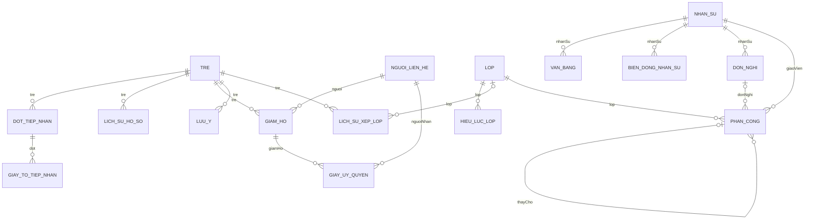
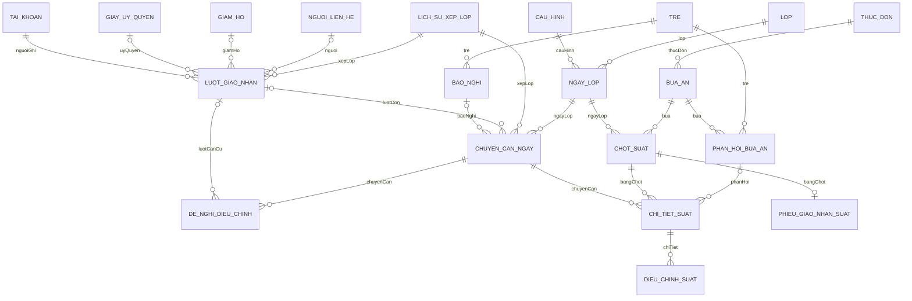
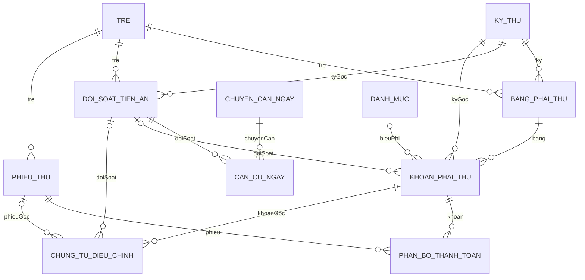
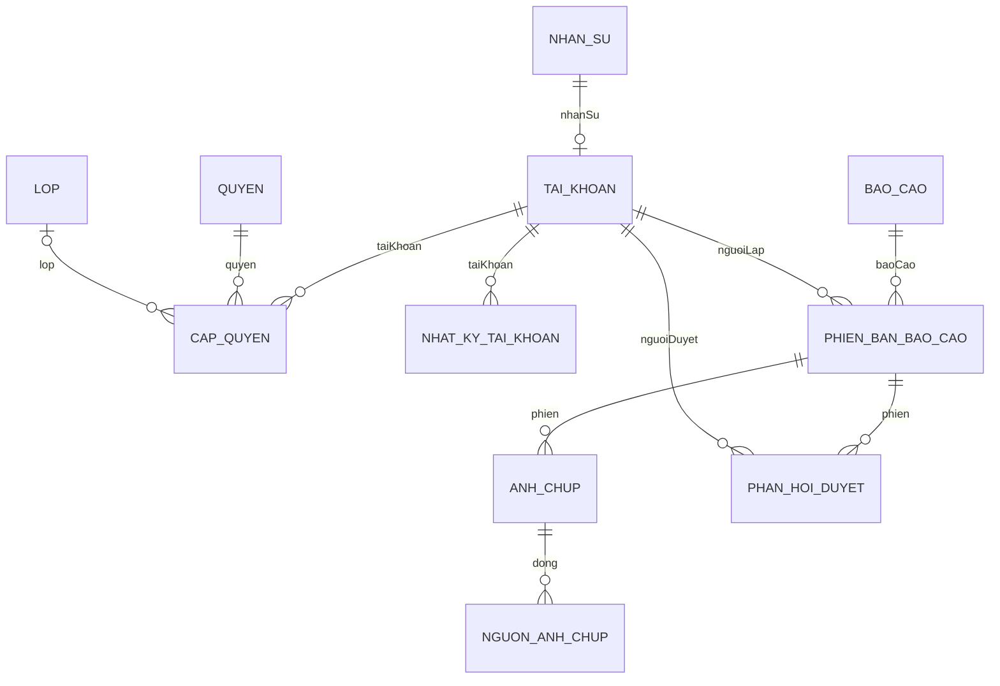

# Sơ đồ thực thể liên kết hệ thống quản lý nhà trẻ

Mô hình logic phân rã các kho của [DFD hệ thống](dfd-he-thong.md). Mỗi cụm có một hình; tên thực thể xuất hiện ở nhiều hình chỉ cùng một bảng. Đối chiếu chức năng qua [BFD 43 chức năng lá](bfd-toan-he-thong.md), [ma trận truy vết](../traceability.md) và [danh mục quy tắc khảo sát](../../survey/README.md).

| Kho | Tiến trình quản lý | Use Case | Dữ liệu chịu trách nhiệm |
| --- | --- | --- | --- |
| D1 | 1.0 | UC-01–03 | Tài khoản, quyền, lớp, danh mục và cấu hình có hiệu lực |
| D2 | 2.0 · NV01 | UC-11, UC-16 | Hồ sơ, giám hộ, ủy quyền và lưu ý |
| D3 | 3.0 · NV02 | UC-12, UC-17 | Khoảng xếp lớp và diện đi học |
| D4 | 4.0 · NV03 | UC-13–14 | Bàn giao, chuyên cần, khóa và điều chỉnh |
| D5 | 5.0 · NV04 | UC-04 | Hồ sơ, văn bằng và biến động nhân sự |
| D6 | 6.0 · NV05 | UC-05 | Phân công, nghỉ, dạy thay |
| D7 | 7.0 · NV06 | UC-02, UC-06–07 | Phải thu, quyết toán, thu và công nợ |
| D8 | 8.0 · NV07 | UC-15, UC-18 | Thực đơn, chốt suất và giao nhận |
| D9 | 9.0 · NV08 | UC-08–09 | Báo nghỉ, lượt đón/trả và căn cứ nhận trẻ |
| D10 | 10.0 · NV09 | UC-10 | Phiên bản, số liệu lúc gửi và quyết định duyệt |

Mô hình gồm **47 thực thể**. Số thực thể theo D1–D10 lần lượt là 8, 8, 1, 3, 3, 2, 8, 7, 2 và 5.

Mỗi thực thể dùng khóa chính `id`. Trong bảng, mỗi FK trỏ tới `id` của thực thể sau mũi tên. Dấu `?` cho phép để trống. Trong hình, `||` là đúng một, `o|` là không hoặc một, `o{` là không hoặc nhiều. Nhãn cạnh là tên FK ở bảng con.

## Hồ sơ và lớp

| Kho | Thực thể (PK: id) | Khóa ngoại | Thuộc tính chính |
| --- | --- | --- | --- |
| D2 | TRE | — | Mã trẻ duy nhất, họ tên, ngày sinh, số định danh nếu có |
| D2 | DOT_TIEP_NHAN | tre → TRE | Mã đợt, kênh và ngày đăng ký, kết quả đối chiếu trùng, ngày dự kiến học, trạng thái, lý do, người và thời điểm duyệt |
| D2 | GIAY_TO_TIEP_NHAN | dot → DOT_TIEP_NHAN | Loại giấy tờ, mốc phải nộp, tình trạng đối chiếu, lịch hẹn bổ sung, ngày nhận |
| D2 | LICH_SU_HO_SO | tre → TRE | Đối tượng và khóa bản ghi thay đổi, trường, giá trị trước và giá trị đề nghị, căn cứ, người đề nghị/thực hiện/duyệt, thời điểm từng bước, kết quả, lý do quyết định |
| D2 | NGUOI_LIEN_HE | — | Họ tên, quan hệ liên hệ, số điện thoại, định danh |
| D2 | GIAM_HO | tre → TRE nguoi → NGUOI_LIEN_HE | Quan hệ với trẻ, giám hộ chính, từ ngày, đến ngày |
| D2 | GIAY_UY_QUYEN | giamHo → GIAM_HO nguoiNhan → NGUOI_LIEN_HE | Số giấy, từ ngày, đến ngày, thời điểm thu hồi, căn cứ |
| D2 | LUU_Y | tre → TRE | Dị ứng hoặc chế độ chăm sóc, căn cứ, hiệu lực, trạng thái xác nhận |
| D1 | LOP | — | Mã lớp, năm học, nhóm tuổi |
| D1 | HIEU_LUC_LOP | lop → LOP | Chỉ tiêu, trạng thái hoạt động, từ ngày, đến ngày, quyết định duyệt |
| D3 | LICH_SU_XEP_LOP | tre → TRE lop → LOP? | Loại biến động, diện đi học, từ ngày, đến ngày, lúc ghi, lý do, quyết định duyệt |
| D5 | NHAN_SU | — | Mã nhân sự, họ tên, ngày sinh, loại và số giấy tờ tùy thân, chức danh, loại nhân sự, loại hợp đồng, ngày tiếp nhận |
| D5 | VAN_BANG | nhanSu → NHAN_SU | Loại giấy tờ, số hiệu, ngày cấp, hạn dùng, tình trạng đối chiếu |
| D5 | BIEN_DONG_NHAN_SU | nhanSu → NHAN_SU | Trạng thái làm việc, điều kiện được đứng lớp và được dạy thay, khoảng hiệu lực, căn cứ, người xác nhận |
| D6 | DON_NGHI | nhanSu → NHAN_SU | Khoảng nghỉ, lý do, quyết định duyệt |
| D6 | PHAN_CONG | lop → LOP giaoVien → NHAN_SU thayCho → PHAN_CONG? donNghi → DON_NGHI? | Vai trò, ca, giờ bắt đầu/kết thúc, khoảng ngày, người lập/duyệt, trạng thái |

## Vận hành trong ngày

| Kho | Thực thể (PK: id) | Khóa ngoại | Thuộc tính chính |
| --- | --- | --- | --- |
| D9 | BAO_NGHI | tre → TRE | tu_ngay, den_ngay (bao gồm hai đầu), lý do báo nghỉ, giờ tiếp nhận, kênh báo, người báo và người ghi |
| D9 | LUOT_GIAO_NHAN | xepLop → LICH_SU_XEP_LOP nguoi → NGUOI_LIEN_HE? giamHo → GIAM_HO? uyQuyen → GIAY_UY_QUYEN? nguoiGhi → TAI_KHOAN | Loại đón/trả, thời điểm thực tế và lúc ghi, trạng thái, căn cứ xác minh, người duyệt ngoại lệ, lúc duyệt, kết quả xác minh hoặc từ chối và lý do, người hủy, thời điểm hủy, lý do hủy |
| D4 | NGAY_LOP | lop → LOP cauHinh → CAU_HINH | Ngày học, lúc bàn giao, trạng thái khóa ngày/kỳ, thời điểm khóa ngày và thời điểm khóa kỳ |
| D4 | CHUYEN_CAN_NGAY | ngayLop → NGAY_LOP xepLop → LICH_SU_XEP_LOP luotDon → LUOT_GIAO_NHAN? baoNghi → BAO_NGHI? | Kết quả, cờ đến muộn, kết quả bàn giao sáng, phiên sửa |
| D4 | DE_NGHI_DIEU_CHINH | chuyenCan → CHUYEN_CAN_NGAY luotCanCu → LUOT_GIAO_NHAN? | Giá trị trước/sau, lý do, chứng cứ, người đề nghị/duyệt, thời điểm, trạng thái |
| D8 | THUC_DON | — | Tuần, phiên, trạng thái duyệt, lúc duyệt và thông báo |
| D8 | BUA_AN | thucDon → THUC_DON | Ngày, bữa sáng/trưa/xế, danh sách món |
| D8 | PHAN_HOI_BUA_AN | tre → TRE bua → BUA_AN | Nội dung phản hồi, giờ dự kiến về, người ghi, lúc ghi, thời điểm thay thế hoặc hủy |
| D8 | CHOT_SUAT | bua → BUA_AN ngayLop → NGAY_LOP | Mốc chốt, người chốt, số suất ban đầu, trạng thái |
| D8 | CHI_TIET_SUAT | bangChot → CHOT_SUAT chuyenCan → CHUYEN_CAN_NGAY phanHoi → PHAN_HOI_BUA_AN? | Có suất lúc chốt, lý do loại |
| D8 | DIEU_CHINH_SUAT | chiTiet → CHI_TIET_SUAT | Mức tăng/giảm, căn cứ, người đề nghị, xác nhận bếp, lúc xác nhận |
| D8 | PHIEU_GIAO_NHAN_SUAT | bangChot → CHOT_SUAT | Số cần giao lúc bàn giao, thực giao, thực nhận, nguyên nhân lệch, hai bên xác nhận, trạng thái đối chiếu |

## Học phí và công nợ

| Kho | Thực thể (PK: id) | Khóa ngoại | Thuộc tính chính |
| --- | --- | --- | --- |
| D7 | KY_THU | — | Mã kỳ, ngày đầu, ngày cuối, hạn nộp |
| D7 | BANG_PHAI_THU | ky → KY_THU tre → TRE | Trạng thái nháp/chờ duyệt/đã duyệt, thời điểm phát hành |
| D7 | DOI_SOAT_TIEN_AN | tre → TRE kyGoc → KY_THU | Ngày dự kiến, tiền tạm thu, số ngày có mặt đã khóa, tiền quyết toán, trạng thái treo/đã đối soát, lý do, lần tính |
| D7 | CAN_CU_NGAY | doiSoat → DOI_SOAT_TIEN_AN chuyenCan → CHUYEN_CAN_NGAY | Phiên sửa nguồn, giá trị lúc tính, đơn giá áp dụng |
| D7 | KHOAN_PHAI_THU | bang → BANG_PHAI_THU kyGoc → KY_THU bieuPhi → DANH_MUC? doiSoat → DOI_SOAT_TIEN_AN? | Loại khoản, số lượng, đơn giá, miễn giảm, số tiền có dấu |
| D7 | PHIEU_THU | tre → TRE | Số biên lai, ngày thu, số tiền, phương thức, người thu, trạng thái |
| D7 | PHAN_BO_THANH_TOAN | phieu → PHIEU_THU khoan → KHOAN_PHAI_THU | Số tiền phân bổ, thời điểm ghi |
| D7 | CHUNG_TU_DIEU_CHINH | khoanGoc → KHOAN_PHAI_THU phieuGoc → PHIEU_THU? doiSoat → DOI_SOAT_TIEN_AN? | Loại điều chỉnh/hoàn, số tiền, lý do, người lập/duyệt, ngày hạch toán, trạng thái |

## Báo cáo và quản trị

| Kho | Thực thể (PK: id) | Khóa ngoại | Thuộc tính chính |
| --- | --- | --- | --- |
| D1 | TAI_KHOAN | nhanSu → NHAN_SU | Tên đăng nhập duy nhất, trạng thái hoạt động/khóa |
| D1 | QUYEN | — | Mã quyền, hệ thống con, thao tác |
| D1 | CAP_QUYEN | taiKhoan → TAI_KHOAN quyen → QUYEN lop → LOP? | Vai trò, phạm vi, từ/đến thời điểm, người cấp, lúc thu hồi |
| D1 | NHAT_KY_TAI_KHOAN | taiKhoan → TAI_KHOAN | Thao tác khóa/mở, thời điểm, người thực hiện, lý do |
| D1 | DANH_MUC | — | Loại, mã nghiệp vụ, phiên, giá trị, khoảng hiệu lực, trạng thái duyệt. Với loại báo cáo: chỉ tiêu, bộ phận và phạm vi phải nộp, kỳ và hạn gửi |
| D1 | CAU_HINH | — | Phiên cấu hình, giờ đón/trả, bàn giao, khóa ngày, chốt từng bữa, khoảng hiệu lực, người duyệt |
| D10 | BAO_CAO | — | Mã báo cáo duy nhất, định kỳ hoặc đột xuất, loại, kỳ, bộ phận, phạm vi |
| D10 | PHIEN_BAN_BAO_CAO | baoCao → BAO_CAO nguoiLap → TAI_KHOAN | Số phiên, trạng thái, lúc gửi/duyệt, cờ trễ, ghi chú chung, ghi chú nháp theo mã chỉ tiêu và chiều tổng hợp, tệp đính kèm |
| D10 | ANH_CHUP | phien → PHIEN_BAN_BAO_CAO | Mã chỉ tiêu, chiều tổng hợp, giá trị tại lúc gửi, ghi chú dòng |
| D10 | NGUON_ANH_CHUP | dong → ANH_CHUP | Kho và loại nguồn, kỳ, phạm vi và điều kiện lọc độc lập với bản ghi, khóa nguồn và phiên nguồn tùy chọn |
| D10 | PHAN_HOI_DUYET | phien → PHIEN_BAN_BAO_CAO nguoiDuyet → TAI_KHOAN | Quyết định, nội dung, thời điểm |

## Ràng buộc toàn vẹn và lịch sử tại năm điểm bàn giao

1. **Đón trẻ → chuyên cần** (QT-DT-01, QT-DD-03). Duy nhất một dòng chuyên cần cho mỗi trẻ/ngày và một NGAY_LOP cho mỗi lớp/ngày. Khoảng xếp lớp phải khớp lớp và ngày của dòng. Kết quả Có mặt phải dẫn về lượt loại đón của cùng trẻ/ngày; báo nghỉ và lượt trả không tạo Có mặt. Giữ bản bàn giao 08:30 và kết quả khóa 09:00 theo phiên cấu hình ngày đó. Từ đúng mốc khóa, ghi hoặc hủy lượt làm thay đổi kết quả phải tạo đề nghị, giữ kết quả khóa đến khi duyệt. Kiểm tra lại lượt còn hợp lệ khi duyệt Có mặt. Lưu cả lượt hủy và các quyết định từ chối để giải thích chênh lệch giữa kết quả khóa và nguồn hiện hành.
2. **Hồ sơ → trả trẻ** (QT-HS-05, QT-DT-04). GIAM_HO nối trẻ với người liên hệ theo thời hạn, cho phép cùng một người là giám hộ của nhiều trẻ. Giấy ủy quyền phải do giám hộ của chính trẻ cấp, có đủ hai đầu thời hạn. Lượt trả thành công cần lượt đón hợp lệ trước đó và đúng một căn cứ: giám hộ còn hiệu lực, giấy ủy quyền còn hiệu lực đúng người nhận, hoặc bằng chứng xác minh và quyết định duyệt đột xuất cho chính lượt đó. Kiểm tra quyền ghi/duyệt theo lớp và ca tại thời điểm giao dịch. Giữ yêu cầu bị chặn, người thực hiện và quyết định hủy cùng lượt gốc.
3. **Xếp lớp ↔ phân công** (QT-PC-01, QT-PC-03). Dùng khoảng hiệu lực đầu đóng, cuối mở cho lịch sử lớp và phân công; ngày cuối ghi trên giấy ủy quyền vẫn có giá trị hết ngày. Mỗi trẻ chỉ thuộc một lớp đang học tại một thời điểm. Khi chuyển, kết thúc khoảng cũ và mở khoảng mới trong cùng giao dịch. Sĩ số lấy từ các khoảng đã duyệt thuộc diện đi học. Kiểm tra lớp hoạt động, chỉ tiêu và định mức giáo viên tại ngày hiệu lực. PHAN_CONG nối nhân sự với lớp qua ca và vai trò; dòng dạy thay dẫn về dòng gốc và đơn nghỉ. Tra giáo viên thực tế theo ca, loại thời gian nghỉ và kiểm tra xung đột giờ. Giữ thời điểm ghi bên cạnh ngày hiệu lực để nhận diện hồi tố.
4. **Diện đi học, chuyên cần, suất ăn và công nợ** (QT-DD-07, QT-SA-05, QT-HP-02, QT-HP-05, QT-HP-06).
   - UC-18 ghi phản hồi ngay khi đã có trẻ và bữa trên thực đơn. UC-15 chọn phản hồi cùng trẻ/bữa còn hiệu lực tại mốc chốt và lưu tham chiếu trên chi tiết suất. Bữa sáng xét giờ đến tại mốc chốt; trưa/xế dùng bàn giao sáng, đối chiếu lưu ý và giờ về trước bữa. Mỗi lớp/bữa có một bảng chốt, mỗi trẻ có tối đa một chi tiết trên bảng. Giữ số chốt ban đầu. Số cần giao bằng số chốt cộng các thay đổi đã được bếp xác nhận và luôn không âm. Theo giả định khảo sát NV07 và Mẫu 03, mỗi bảng chốt có tối đa một phiếu bàn giao cuối cùng; đối chiếu riêng số cần giao, thực giao và thực nhận.
   - Tiền ăn tạm tính theo ngày dự kiến thuộc diện đi học. Cuối kỳ, CAN_CU_NGAY ghi từng ngày Có mặt đã khóa của cùng trẻ, cùng kỳ gốc, duy nhất theo lần đối soát và ngày chuyên cần. Treo đối soát riêng trẻ còn ngày chưa khóa hoặc đề nghị chờ duyệt có thể đổi Có mặt. Hồi tố tạo lần tính mới, chỉ ghi phần chênh sau các bù trừ đã phát hành; khi thôi học xử lý điều chỉnh/hoàn theo quyết định.
   - Mỗi trẻ/kỳ có một bảng phải thu. Khoản bù trừ ghi trên bảng kỳ xử lý nhưng giữ FK kỳ gốc. Nợ cũ hiển thị từ khoản gốc. PHAN_BO_THANH_TOAN nối M–N giữa phiếu và khoản, cho phép thu nhiều lần hoặc thu nhiều kỳ trên một phiếu. Chỉ phân bổ trong cùng trẻ, tổng phân bổ không vượt tiền thu hoặc dư nợ tương ứng. Theo dõi phần thu thừa bằng số dư có. Chứng từ điều chỉnh giữ khoản gốc, kỳ gốc tra qua khoản đó; giữ nguyên biên lai đã phát hành.
5. **Nguồn → phiên báo cáo** (QT-BC-02, QT-BC-04, QT-BC-05). Theo QT-BC-06, chỉ báo cáo định kỳ duy nhất theo loại/kỳ/bộ phận/phạm vi. Mỗi sự việc đột xuất có mã báo cáo riêng. Số phiên duy nhất trong từng báo cáo. Người lập lưu và mở lại phiên Nháp cùng ghi chú dòng và tệp. D1 xác định bộ phận phải nộp và hạn gửi theo loại/kỳ. Khi gửi, lưu phiên, các dòng ảnh chụp và nguồn trong cùng giao dịch. NGUON_ANH_CHUP là bảng nối dòng chỉ tiêu với nhiều bản ghi nguồn; kiểm tra khóa và phiên theo loại nguồn. Mỗi dòng chỉ tiêu luôn có dòng nguồn mô tả kho, loại, kỳ, phạm vi và điều kiện lọc, kể cả khi không có bản ghi khớp. Các dòng tham chiếu bản ghi cụ thể có thêm khóa và phiên nguồn. Mỗi lần ghi nghiệp vụ tại D2–D9 tạo số phiên tăng theo khóa nguồn, lưu thời điểm ghi và phạm vi trước/sau (trẻ, lớp, bộ phận, ngày hiệu lực theo loại nguồn). Khi thêm hoặc hủy, một phía của thay đổi có thể rỗng. Lưu cả phạm vi truy vấn để phát hiện bản ghi mới hoặc hồi tố chuyển lớp, kể cả khi số liệu ban đầu bằng 0. Khi nguồn đổi, tìm phiên bị ảnh hưởng theo cả phạm vi cũ và mới. Với Đã gửi, cảnh báo người lập và chuyển BGH xem xét Yêu cầu bổ sung. Với Đã duyệt, chuyển Cần cập nhật và giữ quyết định duyệt cũ. Lần gửi lại có số phiên mới. Tổng hợp lấy ảnh của phiên gần nhất từng được duyệt, đánh dấu đang cập nhật hoặc chưa đầy đủ theo tình trạng bộ phận.

**Tiếp nhận và cập nhật.** Khi trẻ quay lại, mở đợt mới trên cùng mã trẻ và giữ giấy tờ, lịch hẹn, quyết định của từng đợt. Mỗi đề nghị sửa tạo lịch sử riêng. Nếu bị từ chối, giữ giá trị hiện hành và lưu giá trị đề nghị cùng quyết định từ chối.

**Đối chiếu theo ngày.** Một báo nghỉ bao phủ mọi ngày từ tu_ngay đến den_ngay, kể cả trường hợp hai ngày trùng nhau. Lượt ngoại lệ giữ kết quả xác minh và quyết định từ chối dù không phát sinh bàn giao thành công. Khi tiếp nhận nhân sự, ghi điều kiện đứng lớp và dạy thay ban đầu trong lịch sử hiệu lực.

**Quản trị hiệu lực.** Mỗi nhân sự có tối đa một tài khoản. CAP_QUYEN lưu từng lần cấp và thu hồi. Duyệt ngoại lệ, điều chỉnh sau khóa và thao tác ở lớp phải đối chiếu quyền tại thời điểm thực hiện. Danh mục, chỉ tiêu lớp, biểu phí và cấu hình đã sử dụng được giữ theo phiên; các khoảng đã duyệt của cùng mã và phạm vi không chồng lấn. Các trường người lập, ghi, xác nhận và duyệt trong bảng thuộc tính tham chiếu tài khoản thực hiện. Giữ chứng từ và phiên đã được viện dẫn khi kết thúc hiệu lực.
