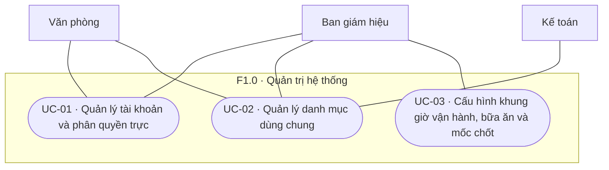
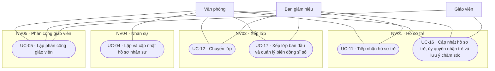
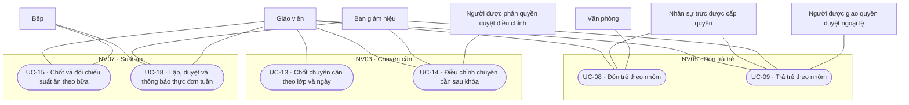
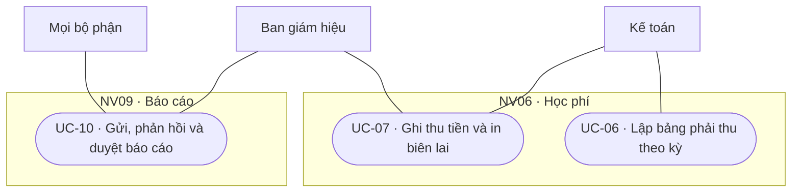

# Sơ đồ Use Case toàn hệ thống

Bốn hình dưới đây biểu diễn toàn bộ **18 use case** của hệ thống (`UC-01` đến `UC-03` cho nền tảng `F1.0`; `UC-04` đến `UC-10` của TV2; `UC-11` đến `UC-18` của TV1). Mỗi khung là một nghiệp vụ hoặc phân hệ. Đường liền nối tác nhân với giao dịch. Việc đọc dữ liệu và luồng liên phân hệ được đặc tả chi tiết trong [ma trận truy vết](../traceability.md). BFD và danh mục chức năng lá `F1.x.y` đầy đủ nằm tại [mục 8.1 của khảo sát](../../survey/README.md).

## Quản trị hệ thống (F1.0)

Trong `UC-01`, hệ thống tự động nhắc Ban giám hiệu khóa hoặc mở tài khoản theo ngày hiệu lực của biến động nhân sự tại `NV04`.

## Hồ sơ, lớp và nhân sự

Trong `UC-05`, `Giáo viên` là tác nhân phụ: gửi đơn nghỉ ngắn ngày của bản thân và xem lịch phân công của mình (`QT-PC-06`).

## Giao nhận, chuyên cần và suất ăn

- `UC-08` đồng bộ đầy đủ ba vai trò theo `QT-DT-05` và `YC-DT-05`: `Giáo viên` hoặc `Nhân sự trực được cấp quyền` ghi lượt đón; `Giáo viên` hoặc `Văn phòng` tiếp nhận báo nghỉ.
- `UC-14` là luồng độc lập thực hiện trên **ngày đã khóa** từ `UC-13` (được kích hoạt bất đồng bộ khi phát sinh/hủy lượt đón từ mốc khóa tại `UC-08`, có chứng cứ xác minh mới hoặc có quyết định hồi tố từ `UC-12`/`UC-17`). Liên hệ dữ liệu giữa `UC-13` và `UC-14` thể hiện qua tiền điều kiện `Đã khóa` và bảng truy vết, thay cho mũi tên `«extend»`.
- `Ban giám hiệu` (`A4`) là một tác nhân thống nhất; `A5` và `A6` là các tác nhân phân quyền tách riêng theo `QT-DT-05` và `QT-DD-03`. Trong `UC-13`, hệ thống tự động chụp danh sách bàn giao và khóa chuyên cần theo các mốc có hiệu lực từ `UC-03`.

## Học phí và báo cáo

Trong `UC-07`, `Ban giám hiệu` là tác nhân phụ: duyệt phiếu điều chỉnh và hoàn tiền (`QT-HP-04`).

`UC-10` nhận bảng tổng hợp sĩ số đầu kỳ/tăng/giảm/cuối kỳ từ `UC-17` (`YC-XL-04`), số liệu tuyển sinh từ `UC-11`, chuyên cần từ `UC-13` và suất ăn từ `UC-15`. Khi **bất kỳ thay đổi dữ liệu nguồn nào** ảnh hưởng đến báo cáo đã nộp (gồm xếp/chuyển lớp hồi tố ở `UC-12`/`UC-17`, duyệt điều chỉnh chuyên cần ở `UC-14`, hoặc điều chỉnh/đối chiếu suất ăn ở `UC-15`), `UC-10` giữ nguyên ảnh chụp số liệu và cảnh báo người lập theo `QT-BC-04`: nếu báo cáo đang ở `Đã gửi`, Ban giám hiệu xử lý yêu cầu bổ sung; nếu báo cáo ở `Đã duyệt`, chuyển sang trạng thái `Cần cập nhật`.
