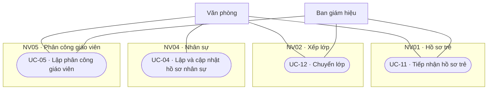
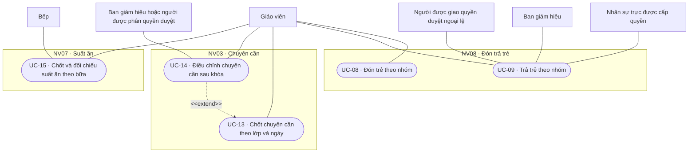
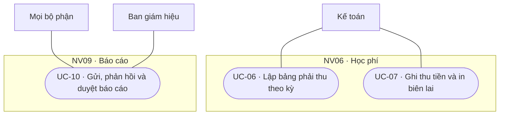

# Sơ đồ Use Case toàn hệ thống

Ba hình dưới đây biểu diễn cùng một hệ thống. Mỗi khung là một nghiệp vụ. Đường liền nối tác nhân với giao dịch. Việc đọc dữ liệu do nghiệp vụ khác cung cấp được ghi trong bảng truy vết. BFD và danh mục chức năng hiện có tại [mục 8.1 của khảo sát](../../survey/README.md).

## Hồ sơ, lớp và nhân sự

## Giao nhận, chuyên cần và suất ăn

UC-14 mở rộng UC-13 khi có căn cứ thay đổi kết quả đã khóa. Quyền duyệt điều chỉnh chuyên cần và quyền duyệt ngoại lệ trả trẻ được xét riêng.

## Học phí và báo cáo

