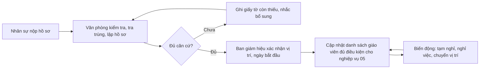

# 04. Quản lý hồ sơ giáo viên và nhân viên

> Hiện trạng mô phỏng tại Trường Mầm non Hoa Hướng Dương (tên giả định) theo kịch bản ở README §1. Nhóm chưa khảo sát trực tiếp tại trường. Mục 1–8 mô tả cách trường đang làm trong kịch bản, mục 9 là đề xuất cho hệ thống mới. Điểm cần xác nhận khi có cơ sở thực tế được ghi ở phần câu hỏi xác minh. Căn cứ trình bày gồm *HuongdanXDHTTTQLv1_1 (1).pdf*, trang 5–7, và *Checklist_BTL_HTTTQL_v2026 (1).xlsx*, trang tính **Nhóm 02 người**, mục 3.1 và 3.3.

## 1. Mục đích nghiệp vụ

Lập và duy trì hồ sơ của giáo viên và nhân viên trong suốt thời gian làm việc tại trường: thông tin cá nhân, vị trí công việc, trình độ chuyên môn, chứng chỉ và trạng thái làm việc. Danh sách nhân sự đang làm việc và đủ điều kiện đứng lớp là đầu vào để nghiệp vụ 05 phân công giáo viên. Khi nhân sự nghỉ việc, tạm nghỉ hoặc thay đổi vị trí, người có trách nhiệm cần tra được thông tin đang có hiệu lực và lịch sử trước đó.

## 2. Đối tượng tham gia

| Đối tượng | Công việc |
| --- | --- |
| Giáo viên hoặc nhân viên | Cung cấp thông tin, giấy tờ khi vào làm, thông báo thay đổi thông tin cá nhân và bổ sung chứng chỉ mới. |
| Nhân viên văn phòng hoặc người phụ trách nhân sự | Tiếp nhận, kiểm tra và lưu hồ sơ. Theo dõi giấy tờ còn thiếu, chứng chỉ sắp hết hạn và cập nhật trạng thái làm việc. |
| Ban giám hiệu hoặc người được phân quyền | Xác nhận tiếp nhận nhân sự, vị trí công việc, các thay đổi về trạng thái làm việc và xử lý trường hợp cần quyết định. |
| Người phân công giáo viên | Sử dụng danh sách giáo viên đang làm việc và đủ điều kiện đứng lớp cho nghiệp vụ 05. |

## 3. Quy trình nghiệp vụ hiện tại

| Bước | Ai, ở đâu và khi nào | Công việc và cách thực hiện | Kết quả |
| --- | --- | --- | --- |
| 1. Tiếp nhận hồ sơ | Nhân sự mới nộp tại văn phòng, sau khi được trường đồng ý tiếp nhận vào làm | Nộp sơ yếu lý lịch, bằng cấp, chứng chỉ và các giấy tờ theo danh mục trường yêu cầu. | Bộ hồ sơ nhân sự và thông tin liên hệ. |
| 2. Kiểm tra và lập hồ sơ | Người phụ trách nhân sự tại văn phòng, khi nhận hồ sơ hoặc giấy tờ bổ sung | Đối chiếu giấy tờ với thông tin khai báo. Tra sổ hoặc bảng tính theo họ tên, ngày sinh và giấy tờ tùy thân để tránh lập trùng khi nhân sự quay lại làm. Ghi vị trí, ngày bắt đầu làm việc, trình độ và chứng chỉ kèm ngày hết hạn nếu có. Đánh dấu giấy tờ còn thiếu. | Hồ sơ nhân sự có mã, trạng thái giấy tờ và danh sách cần bổ sung. |
| 3. Xác nhận | Ban giám hiệu tại trường, sau khi hồ sơ đủ căn cứ | Xem hồ sơ, xác nhận vị trí công việc và ngày bắt đầu. Văn phòng chuyển trạng thái sang đang làm việc. | Hồ sơ đã xác nhận, có người và ngày xác nhận. |
| 4. Bàn giao | Văn phòng, sau khi xác nhận hoặc khi có thay đổi | Cập nhật danh sách giáo viên đang làm việc và đủ điều kiện đứng lớp. Gửi cho người phân công giáo viên. | Danh sách giáo viên dùng cho nghiệp vụ 05. |
| 5. Cập nhật và biến động | Nhân sự, văn phòng và ban giám hiệu, khi phát sinh thay đổi | Nhận đề nghị thay đổi thông tin hoặc bổ sung chứng chỉ, kiểm tra căn cứ rồi cập nhật. Với tạm nghỉ, nghỉ việc hoặc chuyển vị trí, ghi ngày hiệu lực và người xác nhận. Báo người phân công nếu thay đổi ảnh hưởng tới lớp đang phụ trách. Với tạm nghỉ hoặc nghỉ việc, báo ban giám hiệu khóa tài khoản từ ngày hiệu lực. | Hồ sơ cập nhật, lịch sử thay đổi, thông báo cho nghiệp vụ 05 và yêu cầu khóa tài khoản. |

**Câu hỏi xác minh khi phỏng vấn văn phòng và ban giám hiệu**

- Hồ sơ nhân sự hiện lưu ở đâu: giấy, Excel hay phần mềm? Ai được xem và sửa thông tin cá nhân, lương hoặc giấy tờ tùy thân?
- Giáo viên cần bằng cấp hoặc chứng chỉ nào để được đứng lớp chính, lớp phụ? Chứng chỉ nào có thời hạn và ai theo dõi?
- Trường phân biệt các trạng thái nào: thử việc, chính thức, tạm nghỉ, nghỉ việc? Nhân viên không đứng lớp (bảo mẫu, cấp dưỡng, kế toán, bảo vệ) có cần quản lý chung một danh sách không?

## 4. Dữ liệu đầu vào

| Nhóm dữ liệu | Trường cần khảo sát | Nguồn |
| --- | --- | --- |
| Thông tin cá nhân | Họ tên, ngày sinh, giới tính, giấy tờ tùy thân, địa chỉ, số điện thoại, email | Sơ yếu lý lịch và giấy tờ tùy thân |
| Thông tin công việc | Vị trí, loại nhân sự (giáo viên, bảo mẫu, nhân viên), ngày bắt đầu, loại hợp đồng, trạng thái làm việc | Quyết định tiếp nhận hoặc hợp đồng |
| Trình độ và chứng chỉ | Bằng cấp, chuyên ngành, chứng chỉ, ngày cấp, ngày hết hạn nếu có | Bản sao bằng cấp, chứng chỉ |
| Giấy tờ hồ sơ | Loại giấy tờ, tình trạng đã nhận hoặc còn thiếu, ngày nhận | Bộ hồ sơ nhân sự nộp |
| Đề nghị thay đổi | Nhân sự, nội dung thay đổi, ngày hiệu lực, lý do và người xác nhận | Đơn hoặc thông báo của nhân sự, quyết định của ban giám hiệu |

## 5. Dữ liệu đầu ra

| Đầu ra | Nội dung chính | Nơi sử dụng |
| --- | --- | --- |
| Hồ sơ nhân sự | Mã nhân sự, thông tin cá nhân, vị trí, trình độ, chứng chỉ, trạng thái, người và ngày xác nhận | Văn phòng và ban giám hiệu tra cứu theo quyền |
| Danh sách giáo viên đủ điều kiện đứng lớp | Mã, họ tên, vị trí, trình độ, trạng thái làm việc tại ngày tra cứu | Nghiệp vụ 05 dùng để phân công |
| Danh sách cần xử lý | Hồ sơ thiếu giấy tờ, chứng chỉ sắp hoặc đã hết hạn | Văn phòng theo dõi và nhắc nhân sự |
| Lịch sử biến động nhân sự | Loại biến động, giá trị trước và sau, ngày hiệu lực, người xác nhận | Ban giám hiệu đối chiếu |
| Báo cáo nhân sự | Nhân sự vào làm, nghỉ việc, chứng chỉ sắp hết hạn trong kỳ, kèm ghi chú của văn phòng | Văn phòng lập và gửi Ban giám hiệu theo nghiệp vụ 09 |

## 6. Biểu mẫu và hồ sơ sử dụng

Phụ lục mô phỏng: [Mẫu 06 · Phiếu hồ sơ nhân sự và biến động](forms/mau-06-ho-so-nhan-su.md), minh họa NS-01, NS-02 và NS-04.

| Mã tham chiếu | Biểu mẫu hoặc hồ sơ cần xin | Nội dung cần đối chiếu |
| --- | --- | --- |
| NS-01 | Sơ yếu lý lịch hoặc phiếu thông tin nhân sự | Các trường thông tin cá nhân và công việc, chữ ký xác nhận. |
| NS-02 | Sổ hoặc bảng theo dõi hồ sơ nhân sự | Cột mã, vị trí, trình độ, chứng chỉ, ngày hết hạn, trạng thái và người cập nhật. |
| NS-03 | Quyết định tiếp nhận, hợp đồng hoặc quyết định thay đổi vị trí | Ngày hiệu lực, vị trí, người ký. |
| NS-04 | Đơn xin nghỉ việc, tạm nghỉ hoặc phiếu cập nhật thông tin | Nội dung thay đổi, ngày hiệu lực và người xác nhận. |

Khi phỏng vấn, xin mẫu trắng hoặc bản đã che thông tin cá nhân. Không sao chép giấy tờ tùy thân hoặc thông tin lương thật của nhân sự.

## 7. Quy tắc nghiệp vụ

| Mã | Quy tắc cần xác nhận | Trường hợp cần thử |
| --- | --- | --- |
| QT-NS-01 | Mỗi nhân sự có một mã duy nhất. Khi họ tên, ngày sinh hoặc giấy tờ tùy thân trùng hồ sơ cũ, văn phòng đối chiếu và dùng lại hồ sơ cũ thay vì lập mới. | Nhân sự nghỉ việc rồi quay lại làm sau một năm. |
| QT-NS-02 | Chỉ giáo viên có trạng thái đang làm việc và có trình độ, chứng chỉ còn hiệu lực theo quy định của trường mới xuất hiện trong danh sách đủ điều kiện đứng lớp. | Giáo viên có chứng chỉ hết hạn giữa năm học. |
| QT-NS-03 | Tạm nghỉ, nghỉ việc và chuyển vị trí được ghi theo ngày hiệu lực, có người xác nhận. Không xóa hồ sơ của nhân sự đã nghỉ để giữ lịch sử phân công. | Giáo viên nghỉ việc từ ngày 15 trong khi đang phụ trách một lớp. |
| QT-NS-04 | Khi sửa thông tin quan trọng, lưu nội dung thay đổi, thời điểm và người cập nhật. Thông tin cá nhân nhạy cảm chỉ người được phân quyền mới xem. | Đổi số điện thoại hoặc bổ sung chứng chỉ mới. |

## 8. Hạn chế của quy trình hiện tại

- Hồ sơ giấy và bảng tính có thể lệch nhau, khiến văn phòng không biết chứng chỉ nào còn hiệu lực hoặc giấy tờ nào còn thiếu.
- Nếu không theo dõi ngày hết hạn chứng chỉ, trường có thể phân công giáo viên chưa đủ điều kiện mà không biết.
- Khi nhân sự nghỉ việc, người phân công có thể vẫn dùng danh sách cũ, gây trống giáo viên ở lớp đang phụ trách.

## 9. Yêu cầu đối với hệ thống mới

| Mã | Yêu cầu đề xuất |
| --- | --- |
| YC-NS-01 | Lập và tra cứu hồ sơ nhân sự theo mã, họ tên, vị trí hoặc trạng thái. Cảnh báo hồ sơ có dấu hiệu trùng để người lập đối chiếu. |
| YC-NS-02 | Quản lý danh sách bằng cấp, chứng chỉ và giấy tờ trong một màn hình hồ sơ. Cảnh báo chứng chỉ sắp hết hạn và giấy tờ còn thiếu. |
| YC-NS-03 | Ghi nhận tạm nghỉ, nghỉ việc và chuyển vị trí theo ngày hiệu lực. Cung cấp trực tiếp danh sách giáo viên đủ điều kiện tại một ngày cho nghiệp vụ 05 và cảnh báo lớp bị ảnh hưởng. |
| YC-NS-04 | Phân quyền xem và sửa thông tin nhân sự. Lưu lịch sử thay đổi, cho phép lọc và xuất danh sách nhân sự theo vị trí, trạng thái cho người có quyền. |
| YC-NS-05 | Mỗi tài khoản người dùng gắn với một hồ sơ nhân sự. Khi tạm nghỉ hoặc nghỉ việc có hiệu lực, nhắc ban giám hiệu khóa tài khoản và không cho tài khoản đó đăng nhập từ ngày hiệu lực. |
