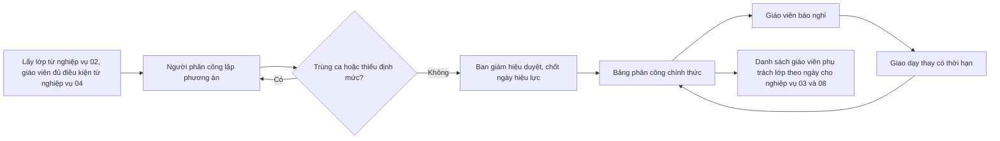

# 05. Phân công giáo viên theo lớp và thời gian

> Hiện trạng mô phỏng tại Trường Mầm non Hoa Hướng Dương (tên giả định) theo kịch bản ở README §1. Nhóm chưa khảo sát trực tiếp tại trường. Mục 1–8 mô tả cách trường đang làm trong kịch bản, mục 9 là đề xuất cho hệ thống mới. Điểm cần xác nhận khi có cơ sở thực tế được ghi ở phần câu hỏi xác minh. Căn cứ trình bày gồm *HuongdanXDHTTTQLv1_1 (1).pdf*, trang 5–7, và *Checklist_BTL_HTTTQL_v2026 (1).xlsx*, trang tính **Nhóm 02 người**, mục 3.1 và 3.3.

## 1. Mục đích nghiệp vụ

Phân công giáo viên phụ trách từng lớp theo năm học và khoảng thời gian hiệu lực, gồm giáo viên chủ nhiệm, giáo viên phụ và giáo viên dạy thay khi có người vắng. Bảo đảm mỗi lớp luôn có đủ giáo viên theo định mức và mỗi giáo viên không bị phân công chồng chéo. Kết quả phân công xác định giáo viên nào có quyền đón trả trẻ (nghiệp vụ 08) và điểm danh (nghiệp vụ 03) lớp nào trong ngày.

## 2. Đối tượng tham gia

| Đối tượng | Công việc |
| --- | --- |
| Người phân công (văn phòng, phương án đề xuất) | Lập phương án phân công đầu năm, xử lý thay đổi, sắp xếp giáo viên dạy thay và lập báo cáo phân công. Nếu trường giao việc này cho phó hiệu trưởng chuyên môn, người đó được cấp thêm hệ thống con Văn phòng. |
| Phó hiệu trưởng chuyên môn | Góp ý chuyên môn khi ghép giáo viên chủ nhiệm và giáo viên phụ. |
| Hiệu trưởng hoặc ban giám hiệu | Duyệt phương án phân công, ngày hiệu lực và các trường hợp ngoại lệ. Người lập và người duyệt không là một người. |
| Giáo viên | Nhận lịch phân công, gửi báo nghỉ của bản thân hoặc đề nghị thay đổi, nhận lớp dạy thay khi được giao. |
| Văn phòng | Cập nhật danh sách nhân sự cho người phân công (nghiệp vụ 04), thông báo phân công cho phụ huynh khi cần. |

## 3. Quy trình nghiệp vụ hiện tại

| Bước | Ai, ở đâu và khi nào | Công việc và cách thực hiện | Kết quả |
| --- | --- | --- | --- |
| 1. Chuẩn bị | Người phân công tại văn phòng, trước năm học hoặc khi mở lớp mới | Lấy danh sách lớp đang hoạt động và sĩ số từ nghiệp vụ 02, danh sách giáo viên đủ điều kiện từ nghiệp vụ 04. Đối chiếu định mức giáo viên theo lớp và nhóm tuổi. | Danh sách lớp cần phân công và giáo viên có thể phân công. |
| 2. Lập phương án | Người phân công tại bảng tính phân công, trước ngày bắt đầu | Ghi giáo viên chủ nhiệm, giáo viên phụ, ca làm việc và ngày hiệu lực cho từng lớp. Kiểm tra một giáo viên không phụ trách hai lớp trong cùng ca. Ghi lớp còn thiếu giáo viên để trình xử lý. | Phương án phân công và danh sách lớp thiếu giáo viên. |
| 3. Xác nhận và thông báo | Ban giám hiệu, sau khi nhận phương án | Duyệt phương án, chốt ngày hiệu lực. Thông báo cho giáo viên và văn phòng. | Bảng phân công chính thức. |
| 4. Xử lý vắng và dạy thay | Giáo viên báo nghỉ, người phân công sắp xếp, trước hoặc trong ngày nghỉ | Nhận báo nghỉ, tìm giáo viên rảnh trong ca đó, giao dạy thay có thời hạn. Thông báo giáo viên dạy thay và lớp liên quan. | Phân công dạy thay theo ngày hoặc ca. |
| 5. Điều chỉnh và tổng hợp | Người phân công và ban giám hiệu, khi giáo viên nghỉ việc, chuyển lớp hoặc lớp thay đổi | Kết thúc phân công cũ và ghi phân công mới theo cùng ngày hiệu lực. Cuối tháng tổng hợp số ngày hoặc ca đứng lớp và dạy thay của từng giáo viên. | Lịch sử phân công và bảng tổng hợp khối lượng công việc. |

**Câu hỏi xác minh khi phỏng vấn ban giám hiệu và giáo viên**

- Mỗi lớp theo nhóm tuổi cần bao nhiêu giáo viên và bảo mẫu? Trường chia ca như thế nào: theo buổi, ca sáng, ca chiều hay cả ngày?
- Ai sắp xếp dạy thay và theo tiêu chí nào? Dạy thay có được tính công hoặc phụ cấp riêng không?
- Khi phân công thay đổi giữa tháng, giáo viên cũ và mới được điểm danh lớp từ ngày nào? Phụ huynh có được thông báo không?

## 4. Dữ liệu đầu vào

| Nhóm dữ liệu | Trường cần khảo sát | Nguồn |
| --- | --- | --- |
| Danh sách lớp | Mã lớp, tên lớp, năm học, nhóm tuổi, sĩ số hiện hành, trạng thái hoạt động | Nghiệp vụ 02 |
| Danh sách giáo viên | Mã, họ tên, vị trí, trình độ, trạng thái làm việc tại ngày phân công | Nghiệp vụ 04 |
| Định mức và ca làm việc | Số giáo viên tối thiểu theo lớp hoặc nhóm tuổi, danh mục ca và khung giờ | Quy định của trường |
| Báo nghỉ của giáo viên | Giáo viên, ngày hoặc ca nghỉ, lý do, người duyệt | Đơn nghỉ hoặc thông báo của giáo viên |
| Đề nghị thay đổi phân công | Lớp, giáo viên cũ và mới, vai trò, ngày hiệu lực, lý do, người xác nhận | Người phân công hoặc ban giám hiệu |

## 5. Dữ liệu đầu ra

| Đầu ra | Nội dung chính | Nơi sử dụng |
| --- | --- | --- |
| Bảng phân công theo lớp | Lớp, giáo viên, vai trò (chủ nhiệm, phụ, dạy thay), ca, ngày bắt đầu và kết thúc | Giáo viên, văn phòng và ban giám hiệu |
| Lịch làm việc của giáo viên | Giáo viên, lớp, ca theo ngày hoặc tuần | Giáo viên tra cứu lịch của mình |
| Danh sách giáo viên phụ trách lớp theo ngày | Lớp, ngày, giáo viên phụ trách làm căn cứ kiểm tra quyền đón trả trẻ và điểm danh | NV08 và NV03 kiểm tra quyền của giáo viên. Quyền trực giao nhận bổ sung thuộc NV08 theo QT-DT-05. |
| Cảnh báo | Lớp thiếu giáo viên, giáo viên bị trùng ca | Người phân công xử lý trước khi trình duyệt |
| Báo cáo phân công | Tổng số ca đứng lớp và dạy thay theo giáo viên và tháng, kèm ghi chú | Người phân công lập và gửi Ban giám hiệu theo nghiệp vụ 09 |

## 6. Biểu mẫu và hồ sơ sử dụng

Phụ lục mô phỏng: [Mẫu 07 · Bảng phân công giáo viên và phiếu dạy thay](forms/mau-07-phan-cong-va-day-thay.md), minh họa PC-01, PC-03 và PC-04.

| Mã tham chiếu | Biểu mẫu hoặc hồ sơ cần xin | Nội dung cần đối chiếu |
| --- | --- | --- |
| PC-01 | Bảng phân công giáo viên đầu năm học | Lớp, giáo viên, vai trò, ca, ngày hiệu lực, người lập và người duyệt. |
| PC-02 | Lịch làm việc tuần hoặc tháng | Cách chia ca, ký hiệu và cách ghi dạy thay. |
| PC-03 | Đơn xin nghỉ và phiếu phân công dạy thay | Ngày nghỉ, giáo viên thay, lớp và người duyệt. |
| PC-04 | Bảng tổng hợp ngày công hoặc ca đứng lớp | Kỳ tổng hợp, cách tính ca dạy thay và người xác nhận. |

Khi phỏng vấn, xin mẫu trắng hoặc bản đã che thông tin cá nhân. Xin thêm một ví dụ giáo viên nghỉ đột xuất trong ngày để đối chiếu cách ghi dạy thay.

## 7. Quy tắc nghiệp vụ

| Mã | Quy tắc cần xác nhận | Trường hợp cần thử |
| --- | --- | --- |
| QT-PC-01 | Chỉ phân công giáo viên đang làm việc và đủ điều kiện tại ngày hiệu lực theo nghiệp vụ 04, vào lớp đang hoạt động theo nghiệp vụ 02. | Phân công giáo viên đã nghỉ việc hoặc vào lớp đã đóng. |
| QT-PC-02 | Một giáo viên không được phân công vào hai lớp trong cùng ca và cùng ngày, kể cả khi dạy thay. Mỗi lớp có tối đa một giáo viên chủ nhiệm có hiệu lực trong cùng ngày. | Giao dạy thay cho giáo viên đang đứng lớp khác cùng ca. |
| QT-PC-03 | Mỗi lớp phải đạt số giáo viên tối thiểu theo định mức. Lớp chưa đủ được đưa vào danh sách cảnh báo cho ban giám hiệu. | Giáo viên phụ nghỉ việc, lớp chỉ còn một giáo viên. |
| QT-PC-04 | Khi thay đổi phân công, kết thúc phân công cũ và bắt đầu phân công mới trong cùng một lần cập nhật theo quy ước ngày hiệu lực của nghiệp vụ 02. Giữ lịch sử để đối chiếu điểm danh và ngày công. | Đổi giáo viên chủ nhiệm có hiệu lực ngày 15. Ngày 14 giáo viên cũ điểm danh, ngày 15 giáo viên mới. |
| QT-PC-05 | Khi không có giáo viên trống ca để dạy thay, người phân công trình hiệu trưởng chọn một nhân sự khác có trong danh sách đủ điều kiện đứng lớp của NV04. Nếu vẫn không có người, lớp được ghi vào danh sách cảnh báo thiếu giáo viên kèm khoảng ngày bị ảnh hưởng. | Giáo viên phụ Mầm 2 tạm nghỉ 10 ngày, cả 10 giáo viên đều đứng lớp cả ngày. Phó hiệu trưởng chuyên môn dạy thay (Mẫu 07). |

## 8. Hạn chế của quy trình hiện tại

- Bảng phân công lập bằng bảng tính khó phát hiện giáo viên bị trùng ca hoặc lớp thiếu giáo viên.
- Dạy thay thường được sắp xếp qua tin nhắn nên khó tổng hợp lại khi tính công hoặc đối chiếu ai đã điểm danh lớp.
- Nếu bảng tính ghi đè phân công hiện tại, trường khó tra lại ai phụ trách lớp vào một ngày trước đó.

## 9. Yêu cầu đối với hệ thống mới

| Mã | Yêu cầu đề xuất |
| --- | --- |
| YC-PC-01 | Lập phương án phân công theo năm học, lớp, vai trò và ca từ danh sách lớp của nghiệp vụ 02 và giáo viên đủ điều kiện của nghiệp vụ 04. |
| YC-PC-02 | Kiểm tra trùng ca, định mức giáo viên và điều kiện của giáo viên trước khi lưu. Cảnh báo lớp thiếu giáo viên. |
| YC-PC-03 | Ghi nhận báo nghỉ và phân công dạy thay có thời hạn. Gợi ý giáo viên còn trống trong ca. Cung cấp danh sách giáo viên phụ trách lớp theo ngày cho nghiệp vụ 03 và 08. |
| YC-PC-04 | Tra cứu lịch sử phân công theo lớp, giáo viên và ngày. Tổng hợp và xuất số ca đứng lớp, dạy thay theo giáo viên và tháng. |
