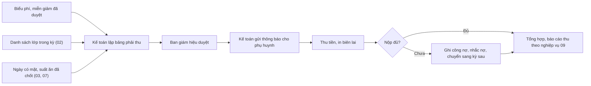

# 06. Lập khoản phải thu và thu học phí

> Bản khảo sát sơ bộ để phỏng vấn. Quy trình dùng sổ giấy và bảng tính, tên các vai trò, biểu mẫu và quy tắc dưới đây là giả định làm việc, chờ cơ sở khảo sát xác nhận. Căn cứ lập hồ sơ khảo sát gồm *HuongdanXDHTTTQLv1_1 (1).pdf*, trang 5–7, và *Checklist_BTL_HTTTQL_v2026 (1).xlsx*, trang tính **Nhóm 02 người**, mục 3.1 và 3.3.

## 1. Mục đích nghiệp vụ

Lập các khoản phải thu của từng trẻ theo kỳ thu (thường là tháng), gồm học phí, tiền ăn và các khoản khác theo biểu phí của trường. Ghi nhận các lần thu, theo dõi công nợ và xuất biên lai cho phụ huynh. Số tiền phải thu căn cứ vào lớp trẻ đang học ở nghiệp vụ 02 và, với khoản tính theo ngày như tiền ăn, căn cứ vào số ngày có mặt đã chốt ở nghiệp vụ 03.

## 2. Đối tượng tham gia

| Đối tượng | Công việc |
| --- | --- |
| Kế toán hoặc nhân viên thu phí | Lập bảng phải thu theo kỳ, gửi thông báo, ghi nhận thu tiền, xuất biên lai và theo dõi công nợ. |
| Ban giám hiệu hoặc người được phân quyền | Ban hành biểu phí, duyệt miễn giảm, duyệt điều chỉnh hoặc hoàn tiền và xem báo cáo thu. |
| Phụ huynh hoặc người giám hộ | Nhận thông báo, nộp tiền bằng tiền mặt hoặc chuyển khoản, đề nghị miễn giảm và nhận biên lai. Không trực tiếp dùng hệ thống. |
| Giáo viên, văn phòng và bếp | Không tham gia thu phí. Chỉ là nguồn số liệu đã chốt: giáo viên chốt điểm danh (nghiệp vụ 03), văn phòng chốt biến động lớp (nghiệp vụ 02), bếp chốt suất ăn (nghiệp vụ 07). |

## 3. Quy trình nghiệp vụ hiện tại

| Bước | Ai, ở đâu và khi nào | Công việc và cách thực hiện | Kết quả |
| --- | --- | --- | --- |
| 1. Chuẩn bị căn cứ | Kế toán tại văn phòng, cuối kỳ hoặc đầu kỳ thu | Lấy biểu phí đang áp dụng, danh sách trẻ theo lớp trong kỳ từ nghiệp vụ 02, số ngày có mặt đã chốt của kỳ trước từ nghiệp vụ 03, số suất ăn đã chốt từ nghiệp vụ 07 nếu trường tính tiền ăn theo suất, và danh sách miễn giảm đã duyệt. | Bộ căn cứ để tính phí. |
| 2. Lập bảng phải thu | Kế toán tại bảng tính thu phí | Tính từng khoản cho mỗi trẻ: học phí theo nhóm tuổi hoặc lớp, tiền ăn theo ngày, khoản khác. Trừ miễn giảm, cộng nợ cũ, trừ tiền hoàn hoặc dư kỳ trước nếu có. Kiểm tra trẻ vào học hoặc thôi học giữa kỳ. | Bảng phải thu theo trẻ và lớp. |
| 3. Duyệt và thông báo | Ban giám hiệu duyệt, kế toán gửi thông báo, đầu kỳ thu | Xem tổng phải thu và các trường hợp đặc biệt. Kế toán gửi thông báo học phí kèm hạn nộp trực tiếp cho phụ huynh (in giấy, tin nhắn hoặc email). Nếu trường nhờ giáo viên phát phiếu, giáo viên chỉ chuyển phiếu đã in sẵn, không xem dữ liệu học phí. | Thông báo học phí đã gửi. |
| 4. Thu tiền | Kế toán tại văn phòng hoặc qua chuyển khoản, trong thời hạn thu | Nhận tiền mặt hoặc đối chiếu sao kê chuyển khoản với nội dung chuyển. Ghi số tiền, ngày, hình thức thu vào sổ và xuất biên lai. Nếu nộp thiếu, ghi số còn nợ. | Phiếu thu hoặc biên lai và công nợ cập nhật. |
| 5. Theo dõi và tổng hợp | Kế toán, sau hạn nộp và cuối kỳ | Lập danh sách trẻ chưa nộp đủ để nhắc. Xử lý hoàn tiền hoặc điều chỉnh khi có sai sót đã được duyệt. Tổng hợp số phải thu, đã thu, còn nợ theo lớp và toàn trường. | Danh sách công nợ và báo cáo thu theo kỳ. |

**Câu hỏi xác minh khi phỏng vấn kế toán và ban giám hiệu**

- Biểu phí gồm những khoản nào, tính theo tháng, theo ngày hay theo học kỳ? Học phí khác nhau theo nhóm tuổi hay theo lớp?
- Tiền ăn tính theo số ngày có mặt thực tế, theo số suất ăn đã chốt ở nghiệp vụ 07, hay thu trước rồi hoàn theo ngày vắng? Vắng có phép và không phép có khác nhau không?
- Ai gửi thông báo học phí cho phụ huynh: kế toán trực tiếp hay nhờ giáo viên phát phiếu?
- Có các chính sách miễn giảm nào (con thứ hai, hộ nghèo, con nhân viên)? Ai duyệt và áp dụng từ kỳ nào?
- Trường thu tiền mặt, chuyển khoản hay cả hai? Đối chiếu chuyển khoản bằng cách nào? Biên lai có cần mẫu theo quy định thuế không?

## 4. Dữ liệu đầu vào

| Nhóm dữ liệu | Trường cần khảo sát | Nguồn |
| --- | --- | --- |
| Biểu phí | Khoản thu, đơn giá, đơn vị tính (tháng, ngày, lần), nhóm tuổi hoặc lớp áp dụng, ngày hiệu lực | Quyết định của ban giám hiệu |
| Danh sách trẻ theo kỳ | Định danh trẻ, lớp, ngày bắt đầu và kết thúc thuộc lớp trong kỳ | Nghiệp vụ 02 |
| Chuyên cần đã chốt | Trẻ, kỳ, số ngày có mặt, số ngày vắng theo loại. Chỉ nhận con số đã chốt, kế toán không có màn hình điểm danh | Nghiệp vụ 03, có mặt được ghi tự động từ đón trẻ ở nghiệp vụ 08 |
| Suất ăn đã chốt | Trẻ hoặc lớp, kỳ, số suất đã giao. Kế toán không có màn hình thực đơn | Nghiệp vụ 07, nếu trường tính tiền ăn theo suất |
| Miễn giảm | Trẻ, loại miễn giảm, mức giảm theo số tiền hoặc tỷ lệ, kỳ áp dụng, người duyệt | Đơn đề nghị và quyết định duyệt |
| Thông tin thu tiền | Trẻ, kỳ, số tiền, ngày thu, hình thức, mã giao dịch nếu chuyển khoản, người thu | Phụ huynh nộp, sao kê ngân hàng |

## 5. Dữ liệu đầu ra

| Đầu ra | Nội dung chính | Nơi sử dụng |
| --- | --- | --- |
| Bảng phải thu theo kỳ | Trẻ, lớp, từng khoản, miễn giảm, nợ kỳ trước, tổng phải thu | Kế toán và ban giám hiệu |
| Thông báo học phí | Trẻ, kỳ, chi tiết khoản thu, tổng tiền, hạn nộp, cách nộp | Phụ huynh |
| Biên lai hoặc phiếu thu | Số biên lai, trẻ, kỳ, số tiền, ngày thu, hình thức, người thu | Phụ huynh và kế toán lưu |
| Danh sách công nợ | Theo trẻ, lớp và kỳ: phải thu, đã thu, còn nợ, quá hạn | Kế toán nhắc nợ |
| Báo cáo thu học phí | Phải thu, đã thu, còn nợ, miễn giảm và hoàn tiền trong kỳ, kèm ghi chú của kế toán | Kế toán lập và gửi Ban giám hiệu theo nghiệp vụ 09 |

## 6. Biểu mẫu và hồ sơ sử dụng

| Mã tham chiếu | Biểu mẫu hoặc hồ sơ cần xin | Nội dung cần đối chiếu |
| --- | --- | --- |
| HP-01 | Biểu phí hoặc quyết định thu | Danh mục khoản thu, đơn giá, đơn vị tính, nhóm áp dụng và ngày hiệu lực. |
| HP-02 | Bảng tính phải thu theo tháng | Cột khoản thu, cách tính tiền ăn theo ngày, cột miễn giảm và nợ cũ. |
| HP-03 | Thông báo học phí gửi phụ huynh | Nội dung, hạn nộp, thông tin chuyển khoản. |
| HP-04 | Biên lai hoặc phiếu thu, sổ thu tiền | Số biên lai, số tiền, người thu, cách ghi nộp thiếu hoặc nộp nhiều kỳ. |
| HP-05 | Đơn đề nghị và quyết định miễn giảm | Loại miễn giảm, mức giảm, kỳ áp dụng và người duyệt. |

Khi phỏng vấn, xin mẫu trắng hoặc bản đã che thông tin cá nhân. Xin một ví dụ trẻ vào học giữa tháng và một ví dụ trẻ có miễn giảm để đối chiếu cách tính.

## 7. Quy tắc nghiệp vụ

| Mã | Quy tắc cần xác nhận | Trường hợp cần thử |
| --- | --- | --- |
| QT-HP-01 | Mỗi trẻ có tối đa một bảng phải thu cho mỗi kỳ. Dùng biểu phí có hiệu lực tại kỳ thu. Biểu phí đã dùng để lập phải thu không được sửa, chỉ ban hành biểu phí mới. | Trường tăng tiền ăn từ giữa năm học. |
| QT-HP-02 | Khoản tính theo ngày chỉ dùng số ngày có mặt đã chốt ở nghiệp vụ 03. Trẻ vào học hoặc thôi học giữa kỳ được tính theo khoảng thời gian thuộc lớp ở nghiệp vụ 02, theo quy tắc làm tròn trường xác nhận. | Trẻ vào học ngày 15, trong kỳ có ngày điểm danh chưa chốt. |
| QT-HP-03 | Miễn giảm chỉ áp dụng khi đã được duyệt và trong kỳ còn hiệu lực. Số tiền phải thu sau miễn giảm không âm. | Trẻ có hai loại miễn giảm cùng lúc. |
| QT-HP-04 | Mỗi lần thu có một biên lai duy nhất và không được xóa. Sai sót được xử lý bằng phiếu điều chỉnh hoặc hoàn tiền có người duyệt. Còn nợ bằng tổng phải thu trừ tổng đã thu, được chuyển sang kỳ sau. | Phụ huynh nộp thiếu, nộp thừa hoặc nộp gộp hai tháng. |

## 8. Hạn chế của quy trình hiện tại

- Tính tiền ăn bằng tay từ sổ điểm danh dễ sai khi có ngày nghỉ, trẻ chuyển lớp hoặc ngày chưa chốt.
- Đối chiếu chuyển khoản với từng trẻ mất nhiều thời gian khi nội dung chuyển khoản ghi không đúng mẫu.
- Công nợ nằm rải rác ở sổ thu và bảng tính nên khó biết trẻ nào còn nợ bao nhiêu và từ kỳ nào.

## 9. Yêu cầu đối với hệ thống mới

| Mã | Yêu cầu đề xuất |
| --- | --- |
| YC-HP-01 | Quản lý biểu phí theo khoản thu, đơn giá, nhóm áp dụng và ngày hiệu lực. Quản lý danh mục và quyết định miễn giảm. |
| YC-HP-02 | Tự lập bảng phải thu theo kỳ từ danh sách lớp của nghiệp vụ 02, chuyên cần đã chốt của nghiệp vụ 03, biểu phí và miễn giảm. Cảnh báo trẻ có ngày chưa chốt trước khi lập. |
| YC-HP-03 | Ghi nhận thu tiền theo nhiều hình thức, cho phép nộp thiếu hoặc nộp gộp, in biên lai. Hỗ trợ mã nội dung chuyển khoản theo trẻ và kỳ để đối chiếu. |
| YC-HP-04 | Theo dõi công nợ theo trẻ, lớp và kỳ. Xuất danh sách nhắc nợ. Lập báo cáo phải thu, đã thu, còn nợ, thêm ghi chú và gửi Ban giám hiệu theo nghiệp vụ 09. Lưu lịch sử điều chỉnh và hoàn tiền kèm người duyệt. |
| YC-HP-05 | Hệ thống con Kế toán chỉ gồm chức năng thu phí và công nợ. Không có thực đơn, suất ăn, điểm danh hay hồ sơ trẻ. Dữ liệu từ các nghiệp vụ đó chỉ được nhận ở dạng số liệu đã chốt. |
