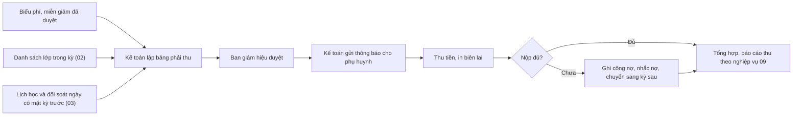

# 06. Lập khoản phải thu và thu học phí

> Quy trình dùng sổ giấy và bảng tính là hiện trạng mô phỏng. Quy tắc tạm thu và đối soát tiền ăn ở mục 7 là phương án của đồ án. Căn cứ trình bày gồm *HuongdanXDHTTTQLv1_1 (1).pdf*, trang 5–7, và *Checklist_BTL_HTTTQL_v2026 (1).xlsx*, trang tính **Nhóm 02 người**, mục 3.1 và 3.3.

## 1. Mục đích nghiệp vụ

Lập các khoản phải thu của từng trẻ theo kỳ thu (thường là tháng), gồm học phí, tiền ăn và các khoản khác theo biểu phí của trường. Ghi nhận các lần thu, theo dõi công nợ và xuất biên lai cho phụ huynh. Tiền ăn tạm thu theo số ngày trẻ dự kiến đi học. Cuối kỳ, kế toán đối soát theo số ngày có mặt đã xác nhận của NV03 và chuyển chênh lệch sang kỳ sau.

## 2. Đối tượng tham gia

| Đối tượng | Công việc |
| --- | --- |
| Kế toán hoặc nhân viên thu phí | Lập bảng phải thu theo kỳ, gửi thông báo, ghi nhận thu tiền, xuất biên lai và theo dõi công nợ. |
| Ban giám hiệu hoặc người được phân quyền | Ban hành biểu phí, duyệt miễn giảm, duyệt điều chỉnh hoặc hoàn tiền và xem báo cáo thu. |
| Phụ huynh hoặc người giám hộ | Nhận thông báo, nộp tiền bằng tiền mặt hoặc chuyển khoản, đề nghị miễn giảm và nhận biên lai. Không trực tiếp dùng hệ thống. |
| Giáo viên và văn phòng | Cung cấp căn cứ tính tiền ăn: NV02 cung cấp lịch sử thuộc lớp, NV03 cung cấp chuyên cần đã khóa và các điều chỉnh đã duyệt. |

## 3. Quy trình nghiệp vụ hiện tại

| Bước | Ai, ở đâu và khi nào | Công việc và cách thực hiện | Kết quả |
| --- | --- | --- | --- |
| 1. Chuẩn bị căn cứ | Kế toán tại văn phòng, cuối kỳ hoặc đầu kỳ thu | Lấy biểu phí, lịch học, danh sách trẻ theo lớp, sổ chuyên cần kỳ trước và danh sách miễn giảm đã duyệt. | Bộ căn cứ để tính phí. |
| 2. Lập bảng phải thu | Kế toán tại bảng tính thu phí | Tạm tính tiền ăn theo số ngày học dự kiến trong thời gian trẻ thuộc diện đi học. Đối chiếu sổ chuyên cần kỳ trước để nhập khoản bù trừ. Tính các khoản khác, miễn giảm và nợ cũ theo biểu phí. | Bảng phải thu theo trẻ và lớp. |
| 3. Duyệt và thông báo | Ban giám hiệu duyệt, kế toán gửi thông báo, đầu kỳ thu | Xem tổng phải thu và các trường hợp đặc biệt. Kế toán gửi thông báo học phí kèm hạn nộp trực tiếp cho phụ huynh (in giấy, tin nhắn hoặc email). Nếu trường nhờ giáo viên phát phiếu, giáo viên chỉ chuyển phiếu đã in sẵn, không xem dữ liệu học phí. | Thông báo học phí đã gửi. |
| 4. Thu tiền | Kế toán tại văn phòng hoặc qua chuyển khoản, trong thời hạn thu | Nhận tiền mặt hoặc đối chiếu sao kê chuyển khoản với nội dung chuyển. Ghi số tiền, ngày, hình thức thu vào sổ và xuất biên lai. Nếu nộp thiếu, ghi số còn nợ. | Phiếu thu hoặc biên lai và công nợ cập nhật. |
| 5. Theo dõi và tổng hợp | Kế toán, sau hạn nộp và cuối kỳ | Lập danh sách trẻ chưa nộp đủ để nhắc. Xử lý hoàn tiền hoặc điều chỉnh khi có sai sót đã được duyệt. Tổng hợp số phải thu, đã thu, còn nợ theo lớp và toàn trường. | Danh sách công nợ và báo cáo thu theo kỳ. |

**Câu hỏi xác minh khi phỏng vấn kế toán và ban giám hiệu**

- Biểu phí gồm những khoản nào, tính theo tháng, theo ngày hay theo học kỳ? Học phí khác nhau theo nhóm tuổi hay theo lớp?
- Khi đối chiếu với một cơ sở thực tế, cần xác nhận cách thu tiền ăn, lịch học và cách xử lý chênh lệch cuối kỳ. Kịch bản đồ án dùng phương án ở QT-HP-02.
- Khi trẻ vào học, thôi học hoặc bảo lưu giữa tháng, học phí cơ bản thu theo tháng hay theo ngày? Phụ huynh nộp thừa thì trường trừ vào kỳ sau hay hoàn lại? Kịch bản đồ án dùng QT-HP-06 và QT-HP-07.
- Ai gửi thông báo học phí cho phụ huynh: kế toán trực tiếp hay nhờ giáo viên phát phiếu?
- Có các chính sách miễn giảm nào (con thứ hai, hộ nghèo, con nhân viên)? Ai duyệt và áp dụng từ kỳ nào?
- Trường thu tiền mặt, chuyển khoản hay cả hai? Đối chiếu chuyển khoản bằng cách nào? Biên lai có cần mẫu theo quy định thuế không?

## 4. Dữ liệu đầu vào

| Nhóm dữ liệu | Trường cần khảo sát | Nguồn |
| --- | --- | --- |
| Biểu phí | Khoản thu, đơn giá, đơn vị tính (tháng, ngày, lần), nhóm tuổi hoặc lớp áp dụng, ngày hiệu lực | Quyết định của ban giám hiệu |
| Danh sách trẻ theo kỳ | Định danh trẻ, lớp, ngày bắt đầu và kết thúc thuộc lớp trong kỳ | Nghiệp vụ 02 |
| Lịch học dự kiến | Các ngày có lịch học trong kỳ và ngày nghỉ theo lịch trường. Kết hợp với diện đi học và khoảng hiệu lực của NV02 để đếm ngày dự kiến của từng trẻ. | Danh mục lịch trường và NV02 |
| Chuyên cần theo kỳ | Trẻ, kỳ, số ngày có mặt, số ngày vắng theo loại và cảnh báo theo trẻ về ngày chưa khóa hoặc đề nghị điều chỉnh chờ duyệt có thể làm thay đổi kết quả có mặt (QT-DD-07). Kế toán nhận kết quả tổng hợp. | NV03 tổng hợp kết quả chuyên cần đã khóa, có tính các điều chỉnh đã duyệt. Lượt đón của NV08 là nguồn tạo có mặt. |
| Tiền ăn đã tạm tính và đã bù trừ | Số ngày dự kiến, đơn giá áp dụng, tiền ăn đã tạm tính và các khoản bù trừ đã phát hành cho kỳ phát sinh | Bảng phải thu và lịch sử điều chỉnh của NV06 |
| Miễn giảm | Trẻ, loại miễn giảm, mức giảm theo số tiền hoặc tỷ lệ, kỳ áp dụng, người duyệt | Đơn đề nghị và quyết định duyệt |
| Thông tin thu tiền | Trẻ, kỳ, số tiền, ngày thu, hình thức, mã giao dịch nếu chuyển khoản, người thu | Phụ huynh nộp, sao kê ngân hàng |

## 5. Dữ liệu đầu ra

| Đầu ra | Nội dung chính | Nơi sử dụng |
| --- | --- | --- |
| Bảng phải thu theo kỳ | Trẻ, lớp, từng khoản, miễn giảm, nợ kỳ trước, tổng phải thu | Kế toán và ban giám hiệu |
| Kết quả đối soát tiền ăn | Trẻ, kỳ phát sinh, số ngày dự kiến, số ngày có mặt, đơn giá kỳ phát sinh, tiền đã tạm tính và chênh lệch. Bản ghi đã bù trừ tham chiếu kỳ thu và bảng phải thu áp dụng. | Kế toán và ban giám hiệu |
| Thông báo học phí | Trẻ, kỳ, chi tiết khoản thu, tổng tiền, hạn nộp, cách nộp | Phụ huynh |
| Biên lai hoặc phiếu thu | Số biên lai, trẻ, kỳ, số tiền, ngày thu, hình thức, người thu | Phụ huynh và kế toán lưu |
| Danh sách công nợ | Theo trẻ, lớp và kỳ: phải thu, đã thu, còn nợ, quá hạn | Kế toán nhắc nợ |
| Báo cáo thu học phí | Phải thu, đã thu, còn nợ, miễn giảm và hoàn tiền trong kỳ, kèm ghi chú của kế toán | Kế toán lập và gửi Ban giám hiệu theo nghiệp vụ 09 |

## 6. Biểu mẫu và hồ sơ sử dụng

Phụ lục mô phỏng: [Mẫu 04 · Thông báo phải thu và biên lai](forms/mau-04-hoc-phi-va-bien-lai.md), minh họa HP-02 đến HP-04 theo phương án tạm thu và đối soát tiền ăn của đồ án.

| Mã tham chiếu | Biểu mẫu hoặc hồ sơ cần xin | Nội dung cần đối chiếu |
| --- | --- | --- |
| HP-01 | Biểu phí hoặc quyết định thu | Danh mục khoản thu, đơn giá, đơn vị tính, nhóm áp dụng và ngày hiệu lực. |
| HP-02 | Bảng tính phải thu theo tháng | Cột khoản thu, cách tính tiền ăn theo ngày, cột miễn giảm và nợ cũ. |
| HP-03 | Thông báo học phí gửi phụ huynh | Nội dung, hạn nộp, thông tin chuyển khoản. |
| HP-04 | Biên lai hoặc phiếu thu, sổ thu tiền | Số biên lai, số tiền, người thu, cách ghi nộp thiếu hoặc nộp nhiều kỳ. |
| HP-05 | Đơn đề nghị và quyết định miễn giảm | Loại miễn giảm, mức giảm, kỳ áp dụng và người duyệt. |

Khi phỏng vấn, xin mẫu trắng hoặc bản đã che thông tin cá nhân. Xin một ví dụ trẻ vào học giữa tháng và một ví dụ trẻ có miễn giảm để đối chiếu cách tính.

## 7. Quy tắc nghiệp vụ

| Mã | Quy tắc cần xác nhận | Trường hợp cần thử |
| --- | --- | --- |
| QT-HP-01 | Mỗi trẻ có tối đa một bảng phải thu cho mỗi kỳ. Dùng biểu phí có hiệu lực tại kỳ thu. Biểu phí đã dùng để lập phải thu không được sửa, chỉ ban hành biểu phí mới. | Trường tăng tiền ăn từ giữa năm học. |
| QT-HP-02 | Tạm thu tiền ăn theo số ngày có lịch học mà trẻ thuộc diện đi học theo NV02. Cuối kỳ, dùng số ngày `Có mặt` đã khóa của NV03, gồm điều chỉnh đã duyệt. Mỗi ngày có mặt tính một lần, kể cả đến muộn hoặc về sớm. Vắng có phép và vắng không phép đều tính 0 ngày. Số suất của NV07 dùng cho vận hành theo từng bữa. | Trẻ vào giữa tháng, đi muộn một ngày, về sớm một ngày và nghỉ trọn ngày không phép một ngày. |
| QT-HP-03 | Miễn giảm chỉ áp dụng khi đã được duyệt và trong kỳ còn hiệu lực. Số tiền phải thu sau miễn giảm không âm. | Trẻ có hai loại miễn giảm cùng lúc. |
| QT-HP-04 | Mỗi lần thu có một biên lai duy nhất và không được xóa. Sai sót được xử lý bằng phiếu điều chỉnh hoặc hoàn tiền có người duyệt. Còn nợ bằng tổng phải thu trừ tổng đã thu, được chuyển sang kỳ sau. Cách phân bổ một lần thu theo QT-HP-07. | Phụ huynh nộp thiếu, nộp thừa hoặc nộp gộp hai tháng. |
| QT-HP-05 | Chênh lệch tiền ăn bằng tiền tính theo ngày có mặt trừ tiền đã tạm tính, dùng đơn giá của kỳ phát sinh. Số âm giảm trừ, số dương thu bổ sung. Bù trừ ở kỳ thu kế tiếp có tham chiếu kỳ phát sinh. Nếu trẻ còn ngày chưa khóa hoặc đề nghị điều chỉnh chờ duyệt có thể làm thay đổi kết quả `Có mặt` (QT-DD-07), để khoản đối soát của trẻ đó ở trạng thái chờ xử lý. Lượt `Chờ xác minh` không có lượt đón không làm treo đối soát vì luôn tính 0 ngày có mặt. Khi đối soát lại, chỉ áp dụng phần chênh lệch còn lại sau các khoản bù trừ đã phát hành. Nếu trẻ đã thôi học và không còn kỳ thu tiếp theo, chuyển chênh lệch sang luồng điều chỉnh hoặc hoàn tiền. | Tạm tính 18 ngày, xác nhận 16 ngày có mặt, đơn giá 35.000 đồng. Giảm 70.000 đồng ở kỳ tiếp theo và không ghi thêm khoản giảm khi chạy đối soát lại cùng dữ liệu. |
| QT-HP-06 | Phương án của đồ án. Khoản tính theo tháng (học phí cơ bản, phụ phí bán trú và chăm sóc) thu đủ khi trẻ thuộc diện đi học cả kỳ. Trong kỳ trẻ vào học, thôi học, bắt đầu hoặc kết thúc bảo lưu, khoản tháng tính theo tỷ lệ: đơn giá tháng × số ngày có lịch học mà trẻ thuộc diện đi học ÷ số ngày có lịch học của kỳ, làm tròn đến nghìn đồng. Nghỉ dài ngày vẫn thuộc lớp nên thu đủ khoản tháng. Tiền ăn áp dụng QT-HP-02. | Trẻ vào học 07/09, kỳ tháng 09 có 20 ngày học, trẻ thuộc diện 18 ngày. Học phí cơ bản 2.500.000 × 18 ÷ 20 = 2.250.000 đồng. Phụ phí 300.000 × 18 ÷ 20 = 270.000 đồng. |
| QT-HP-07 | Một lần thu được phân bổ vào bảng phải thu còn nợ của kỳ cũ nhất trước, rồi đến kỳ kế tiếp. Biên lai ghi rõ số tiền phân bổ cho từng bảng phải thu. Phần còn thừa sau khi trả hết các bảng còn nợ được ghi thành số dư có của trẻ và tự trừ vào bảng phải thu kỳ kế tiếp. Số dư có chỉ được hoàn tiền khi phụ huynh đề nghị hoặc trẻ thôi học, có người duyệt theo QT-HP-04. | Còn nợ tháng 09 là 200.000 đồng. Phụ huynh chuyển 4.000.000 đồng khi thông báo tháng 10 là 3.500.000 đồng. Phân bổ 200.000 cho tháng 09, 3.500.000 cho tháng 10 và ghi số dư có 300.000 đồng cho kỳ sau. |

## 8. Hạn chế của quy trình hiện tại

- Tính tiền ăn bằng tay từ sổ điểm danh dễ sai khi có ngày nghỉ, trẻ chuyển lớp hoặc ngày chưa chốt.
- Đối chiếu chuyển khoản với từng trẻ mất nhiều thời gian khi nội dung chuyển khoản ghi không đúng mẫu.
- Công nợ nằm rải rác ở sổ thu và bảng tính nên khó biết trẻ nào còn nợ bao nhiêu và từ kỳ nào.

## 9. Yêu cầu đối với hệ thống mới

| Mã | Yêu cầu đề xuất |
| --- | --- |
| YC-HP-01 | Quản lý biểu phí theo khoản thu, đơn giá, nhóm áp dụng và ngày hiệu lực. Quản lý danh mục và quyết định miễn giảm. |
| YC-HP-02 | Lập khoản tạm thu tiền ăn từ lịch học, danh sách lớp có hiệu lực của NV02 và biểu phí. Cuối kỳ, đối soát theo chuyên cần NV03 và chuyển chênh lệch theo QT-HP-05. Hiển thị các trường hợp đang chờ xử lý và lưu căn cứ tính trên dòng bù trừ. |
| YC-HP-03 | Ghi nhận thu tiền theo nhiều hình thức, cho phép nộp thiếu hoặc nộp gộp, in biên lai. Tự phân bổ số tiền vào các bảng phải thu và ghi số dư có theo QT-HP-07. Hỗ trợ mã nội dung chuyển khoản theo trẻ và kỳ để đối chiếu. |
| YC-HP-06 | Khi lập bảng phải thu, tự tính khoản tháng theo tỷ lệ cho trẻ vào học, thôi học hoặc bảo lưu trong kỳ theo QT-HP-06 và lưu số ngày dùng để tính trên từng dòng. |
| YC-HP-04 | Theo dõi công nợ theo trẻ, lớp và kỳ. Xuất danh sách nhắc nợ. Lập báo cáo phải thu, đã thu, còn nợ, thêm ghi chú và gửi Ban giám hiệu theo nghiệp vụ 09. Lưu lịch sử điều chỉnh và hoàn tiền kèm người duyệt. |
| YC-HP-05 | Hệ thống con Kế toán gồm chức năng thu phí, đối soát tiền ăn và công nợ. Kế toán nhận ở chế độ chỉ đọc lịch học, khoảng thời gian trẻ thuộc diện đi học và số liệu chuyên cần theo kỳ. |
