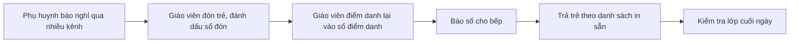
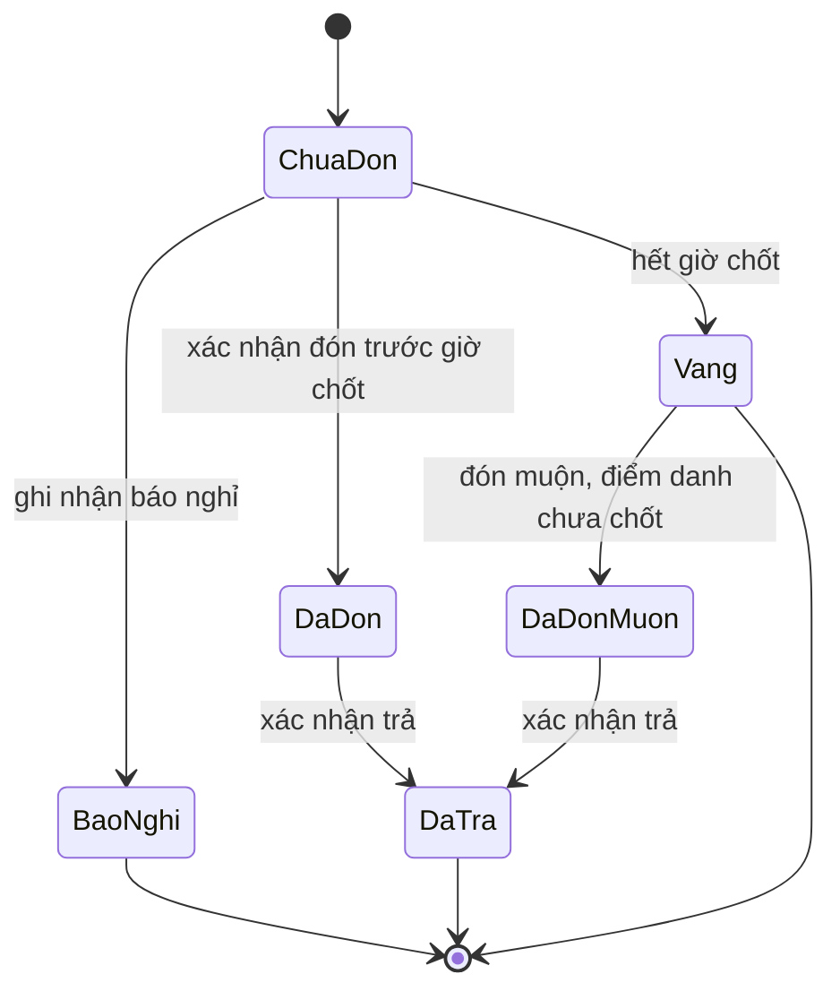

# 08. Đón trẻ, trả trẻ và tự động ghi nhận có mặt

> Bản khảo sát sơ bộ để phỏng vấn. Quy trình dùng sổ giấy, giờ chốt, trạng thái và cách chọn trẻ để đón trả dưới đây là giả định làm việc và phương án đề xuất, chờ cơ sở khảo sát xác nhận. Căn cứ lập hồ sơ khảo sát gồm *HuongdanXDHTTTQLv1_1 (1).pdf*, trang 5–7, và *Checklist_BTL_HTTTQL_v2026 (1).xlsx*, trang tính **Nhóm 02 người**, mục 3.1 và 3.3.

## 1. Mục đích nghiệp vụ

Ghi nhận lúc giáo viên nhận trẻ từ phụ huynh buổi sáng (đón trẻ) và giao trẻ cho người đón (trả trẻ), để nhà trường biết tại mỗi thời điểm trẻ nào đang ở trường và ai đã đón trẻ về. Trong hệ thống mới, **đón trẻ và điểm danh là một luồng dữ liệu**, không phải hai việc ghi riêng:

- Trẻ đã được đón vào lớp thì **có mặt**. Hệ thống tự ghi có mặt cho nghiệp vụ 03, giáo viên không phải điểm danh lại.
- Trẻ chưa được đón thì **chưa có mặt**. Hết giờ chốt mà vẫn chưa đón thì trẻ được ghi **vắng**.
- Trẻ vắng không ở trong lớp nên **không có trong danh sách trả trẻ**.

## 2. Đối tượng tham gia

| Đối tượng | Công việc |
| --- | --- |
| Giáo viên được phân công lớp trong ngày (nghiệp vụ 05) | Ghi nhận báo nghỉ của phụ huynh lớp mình, đón trẻ, trả trẻ, xác minh trẻ vắng và chốt điểm danh. |
| Phụ huynh hoặc người được ủy quyền đón | Đưa trẻ đến, báo nghỉ, đón trẻ về. Không trực tiếp dùng hệ thống. |
| Văn phòng | Cập nhật danh sách người đưa đón (nghiệp vụ 01). Ghi nhận báo nghỉ khi phụ huynh báo qua văn phòng. Xem tình hình đón trả toàn trường. |
| Ban giám hiệu hoặc người trực | Xác nhận trường hợp người đón không có trong danh sách. Xử lý trẻ chưa có người đón sau giờ trả. |

## 3. Quy trình nghiệp vụ hiện tại

| Bước | Ai, ở đâu và khi nào | Công việc và cách thực hiện | Kết quả |
| --- | --- | --- | --- |
| 1. Nhận báo nghỉ | Giáo viên qua Zalo, điện thoại hoặc sổ liên lạc; văn phòng qua điện thoại, trước hoặc đầu ngày | Ghi tên trẻ, ngày nghỉ và lý do vào sổ hoặc ghi nhớ. Văn phòng nhận báo nghỉ thì nhắn lại giáo viên lớp. | Danh sách trẻ báo nghỉ trong ngày, nằm rải rác ở nhiều kênh. |
| 2. Đón trẻ | Giáo viên tại cửa lớp hoặc cổng trường, khoảng 6h45–8h00 | Nhận trẻ từ phụ huynh, hỏi nhanh tình trạng sức khỏe. Đánh dấu vào sổ đón trẻ hoặc nhớ để điểm danh sau. | Trẻ vào lớp, sổ đón trẻ được đánh dấu. |
| 3. Điểm danh và báo số | Giáo viên tại lớp, khoảng 8h00–8h30 | Đếm trẻ trong lớp, ghi sổ điểm danh theo nghiệp vụ 03. Gọi phụ huynh của trẻ chưa đến mà chưa báo nghỉ. Báo số có mặt cho bếp. | Sổ điểm danh và số báo bếp. |
| 4. Trả trẻ | Giáo viên tại lớp, khoảng 16h30–17h30, hoặc khi phụ huynh đón sớm | Đối chiếu người đón với người giáo viên biết mặt hoặc danh sách người đưa đón. Người lạ đến đón thì gọi phụ huynh xác nhận. Một số trường cho người đón ký sổ. | Trẻ được giao cho người đón. |
| 5. Cuối ngày | Giáo viên và bảo vệ, sau giờ trả | Kiểm tra lớp không còn trẻ. Trẻ chưa có người đón thì gọi phụ huynh và báo ban giám hiệu, giáo viên ở lại trông. | Lớp trống hoặc trẻ được trông muộn. |

**Câu hỏi xác minh khi phỏng vấn giáo viên và văn phòng**

- Giờ đón trẻ, giờ chốt và giờ trả trẻ của trường là mấy giờ? Giờ chốt đón có trùng với giờ báo bếp ở nghiệp vụ 03 và 07 không?
- Đón trẻ và điểm danh hiện ghi ở một sổ hay hai sổ? Có lúc nào hai sổ lệch nhau không?
- Phụ huynh báo nghỉ qua những kênh nào? Ai ghi lại và ghi ở đâu?
- Khi trả trẻ, giáo viên đối chiếu người đón bằng cách nào? Có danh sách người được ủy quyền hay chỉ nhận mặt? Người đón có phải ký sổ không?
- Trẻ chưa có người đón sau giờ trả thì xử lý thế nào? Có thu phí trông muộn không?

## 4. Dữ liệu đầu vào

| Nhóm dữ liệu | Trường cần khảo sát | Nguồn |
| --- | --- | --- |
| Danh sách trẻ thuộc lớp trong ngày | Mã lớp, ngày, mã và họ tên trẻ, trạng thái thuộc lớp tại ngày đó | Nghiệp vụ 02 |
| Giáo viên phụ trách lớp trong ngày | Lớp, ngày, ca, giáo viên, vai trò (chủ nhiệm, phụ, dạy thay) | Nghiệp vụ 05 |
| Báo nghỉ của phụ huynh | Trẻ, ngày hoặc khoảng nghỉ, lý do, kênh báo, thời điểm nhận, người ghi nhận | Phụ huynh báo, giáo viên hoặc văn phòng ghi |
| Danh sách người đưa đón | Trẻ, họ tên người đón, quan hệ, số điện thoại, người giám hộ chính | Nghiệp vụ 01 |
| Giờ chốt và giờ trả | Giờ chốt đón, giờ bắt đầu trả trẻ, giờ kết thúc trả trẻ | Danh mục dùng chung do Ban giám hiệu quy định |

## 5. Dữ liệu đầu ra

| Đầu ra | Nội dung chính | Nơi sử dụng |
| --- | --- | --- |
| Lượt đón | Trẻ, lớp, ngày, giờ đón, giáo viên nhận trẻ, đến muộn hay không | Nghiệp vụ 03 tự tạo kết quả có mặt |
| Lượt trả | Trẻ, lớp, ngày, giờ trả, người đón, giáo viên trả, ghi chú nếu người đón ngoài danh sách | Văn phòng tra cứu, đối chiếu an toàn |
| Kết quả điểm danh theo ngày | Trẻ, ngày, có mặt hoặc vắng (có phép, không phép, chờ xác minh) | Nghiệp vụ 03 chốt, sau đó nghiệp vụ 06 và 07 dùng số đã chốt |
| Danh sách cảnh báo | Trẻ đã đón mà chưa trả khi kết thúc ngày, trẻ do người ngoài danh sách đón | Giáo viên, văn phòng và ban giám hiệu |
| Báo cáo đón trả | Số lượt đến muộn, số lượt đón bởi người ngoài danh sách, số trẻ trả muộn trong kỳ | Giáo viên đưa vào báo cáo lớp theo nghiệp vụ 09 |

## 6. Biểu mẫu và hồ sơ sử dụng

| Mã tham chiếu | Biểu mẫu hoặc hồ sơ cần xin | Nội dung cần đối chiếu |
| --- | --- | --- |
| DT-01 | Sổ đón trẻ hoặc sổ giao nhận trẻ hằng ngày | Cột trẻ, giờ đến, giờ về, người đón, chữ ký nếu có. |
| DT-02 | Danh sách hoặc giấy ủy quyền người đưa đón | Người được đón, quan hệ, ảnh hoặc giấy tờ đối chiếu, thời hạn ủy quyền. |
| DT-03 | Sổ hoặc tin nhắn ghi nhận báo nghỉ | Kênh báo, thời điểm báo, người ghi nhận. |
| DT-04 | Sổ theo dõi trẻ về muộn hoặc biên bản bàn giao trẻ ngoài giờ | Giờ bàn giao, người trông, người đón, phí trông muộn nếu có. |

Khi phỏng vấn, xin mẫu trắng hoặc bản đã che thông tin cá nhân. Xin quan sát một buổi đón trẻ để đo thời gian giờ cao điểm.

## 7. Quy tắc nghiệp vụ

| Mã | Quy tắc cần xác nhận | Trường hợp cần thử |
| --- | --- | --- |
| QT-DT-01 | Đón trẻ là nguồn duy nhất tạo kết quả có mặt. Không có màn hình điểm danh có mặt riêng song song với đón trẻ. | Giáo viên đón trẻ xong, mở điểm danh thấy trẻ đã có mặt. |
| QT-DT-02 | Chỉ trẻ ở trạng thái đã đón mới được trả. Trẻ vắng hoặc báo nghỉ không có trong danh sách trả và không thể ghi trả. | Thử trả một trẻ vắng: trẻ không có trong danh sách trả nên không chọn được. |
| QT-DT-03 | Đón và trả trẻ chỉ thực hiện qua thao tác chọn trẻ rồi xác nhận, không có nút riêng trên từng dòng. Các trẻ đã chọn được ghi trong một lần xác nhận. Trẻ không hợp lệ được bỏ qua và liệt kê lại cho giáo viên. | Chọn 5 trẻ, trong đó 1 trẻ đã đón trước đó. Kết quả: đón 4 trẻ, báo 1 trẻ bị bỏ qua. |
| QT-DT-04 | Người đón phải thuộc danh sách người đưa đón của trẻ. Trường hợp khác, giáo viên gọi người giám hộ chính xác nhận, ghi tên người đón và người xác nhận. Nếu không liên lạc được người giám hộ, ban giám hiệu hoặc người trực quyết định. | Ông bà chưa đăng ký đến đón trẻ. |
| QT-DT-05 | Chỉ giáo viên được phân công lớp trong ngày mới đón trả trẻ của lớp đó. | Giáo viên dạy thay đón trẻ lớp được giao dạy thay. |
| QT-DT-06 | Trẻ đến sau giờ chốt: nếu điểm danh chưa chốt thì đón bình thường và đánh dấu đến muộn; nếu đã chốt thì ghi đề nghị điều chỉnh theo QT-DD-03 của nghiệp vụ 03. | Trẻ đến lúc 9h00 khi điểm danh lớp đã chốt lúc 8h30. |

## 8. Hạn chế của quy trình hiện tại

- Đón trẻ ghi một nơi, điểm danh ghi một nơi khác, nên trẻ đã đón vẫn có thể bị ghi vắng hoặc ngược lại.
- Báo nghỉ nằm ở nhiều kênh, giáo viên dễ bỏ sót và gọi nhầm phụ huynh đã báo.
- Danh sách trả trẻ in sẵn gồm cả trẻ vắng, dễ ghi nhầm là đã trả.
- Đối chiếu người đón dựa vào trí nhớ của giáo viên, khó kiểm soát khi giáo viên dạy thay không biết mặt phụ huynh.
- Đón từng trẻ một rất chậm vào giờ cao điểm buổi sáng.

## 9. Yêu cầu đối với hệ thống mới

### 9.1. Trạng thái của trẻ trong ngày

| Trạng thái | Khi nào | Kết quả điểm danh (nghiệp vụ 03) | Có trong danh sách trả trẻ |
| --- | --- | --- | --- |
| Chưa đón | Mặc định đầu ngày, trước giờ chốt | Tạm tính vắng, chờ xác minh | Không |
| Báo nghỉ | Giáo viên hoặc văn phòng ghi nhận báo nghỉ của phụ huynh | Vắng có phép | Không |
| Đã đón | Giáo viên xác nhận đón trước giờ chốt | **Có mặt (tự động)**, ghi giờ đến | **Có** |
| Đã đón (đến muộn) | Giáo viên xác nhận đón sau giờ chốt, khi điểm danh chưa chốt | **Có mặt**, đánh dấu đến muộn | **Có** |
| Vắng | Hết giờ chốt mà chưa đón | Vắng (có phép hoặc không phép theo xác minh) | Không, hiển thị nhóm "Vắng hôm nay", không có nút trả |
| Đã trả | Giáo viên xác nhận trả | Vẫn có mặt, ghi giờ về và người đón | Đã xong, không trả lại lần nữa |

### 9.2. Quy trình đề xuất

| Bước | Ai, khi nào | Công việc | Kết quả |
| --- | --- | --- | --- |
| 1. Mở danh sách đón | Giáo viên tại lớp, đầu giờ đón | Hệ thống lấy danh sách trẻ thuộc lớp trong ngày (nghiệp vụ 02). Trẻ đã báo nghỉ được tách sẵn sang trạng thái báo nghỉ. | Danh sách trẻ chưa đón. |
| 2. Đón trẻ | Giáo viên, khi phụ huynh đưa trẻ đến | Chọn các trẻ vừa được đưa đến rồi bấm "Đón các trẻ đã chọn" (mục 9.3). Hệ thống ghi giờ đón và tự chuyển điểm danh của trẻ sang có mặt. | Trẻ ở trạng thái đã đón, có mặt. |
| 3. Chốt đón | Hệ thống và giáo viên, đến giờ chốt | Trẻ còn chưa đón chuyển sang vắng. Giáo viên xác minh lý do theo nghiệp vụ 03 rồi chốt điểm danh. | Điểm danh đã chốt, lấy từ kết quả đón. |
| 4. Đón muộn | Giáo viên, khi trẻ đến sau giờ chốt | Áp dụng QT-DT-06. | Trẻ có mặt (đến muộn) hoặc đề nghị điều chỉnh. |
| 5. Trả trẻ | Giáo viên, giờ trả trẻ hoặc khi phụ huynh đón sớm | Danh sách trả **chỉ gồm trẻ đã đón và chưa trả**. Chọn các trẻ được đón về rồi bấm "Trả các trẻ đã chọn". Ghi giờ trả và người đón, đối chiếu với danh sách người đưa đón. | Trẻ ở trạng thái đã trả. |
| 6. Kết thúc ngày | Giáo viên, sau giờ trả | Hệ thống cảnh báo nếu còn trẻ đã đón mà chưa trả. Giáo viên liên hệ phụ huynh, báo ban giám hiệu hoặc người trực và ghi người trông muộn. | Không còn trẻ ở lớp mà chưa được ghi trả. |

### 9.3. Chọn trẻ để đón hoặc trả

Đây là **cách duy nhất** để đón và trả trẻ. Không có nút đón hoặc trả riêng trên từng dòng. Muốn đón một trẻ thì chỉ chọn một trẻ, muốn đón cả nhóm thì chọn cả nhóm, nên giáo viên chỉ cần học một thao tác.

1. Mỗi dòng trẻ có **ô chọn**. Đầu danh sách có ô **"Chọn tất cả"**, chọn tất cả các trẻ **đang hiển thị** theo bộ lọc (ví dụ lọc "Chưa đón").
2. Khi đã chọn, thanh thao tác hiện **"Đã chọn n trẻ"** và nút **"Đón n trẻ đã chọn"** (hoặc **"Trả n trẻ đã chọn"** ở màn hình trả).
3. Bấm nút, hộp xác nhận liệt kê tên các trẻ. Xác nhận một lần thì hệ thống ghi đón (hoặc trả) cho tất cả trẻ đã chọn, cùng giờ và cùng người thực hiện.
4. Trẻ không hợp lệ được **bỏ qua và báo lại**, không làm hỏng cả nhóm. Ví dụ: trẻ đã đón rồi, trẻ đã báo nghỉ khi đón; trẻ vắng hoặc đã trả khi trả.
5. Khi trả trẻ, hộp xác nhận hiện người đón của từng trẻ, mặc định là người giám hộ chính đã đăng ký. Nếu trẻ do người khác đón, giáo viên đổi người đón ngay trong hộp xác nhận rồi mới xác nhận. Người ngoài danh sách được xử lý theo QT-DT-04.

### 9.4. Yêu cầu

| Mã | Yêu cầu đề xuất |
| --- | --- |
| YC-DT-01 | Màn hình đón trẻ theo lớp và ngày, có bộ lọc theo trạng thái. Đón trẻ tự động tạo kết quả có mặt ở nghiệp vụ 03. |
| YC-DT-02 | Đón và trả trẻ bằng một thao tác duy nhất: chọn trẻ bằng ô chọn hoặc "Chọn tất cả", rồi bấm "Đón/Trả các trẻ đã chọn" và xác nhận một lần. Không có nút đón trả riêng trên từng dòng. Báo lại các trẻ bị bỏ qua. |
| YC-DT-03 | Danh sách trả trẻ chỉ gồm trẻ đã đón và chưa trả. Trẻ vắng hiển thị trong nhóm riêng, không thao tác được. |
| YC-DT-04 | Tự chuyển trẻ chưa đón sang vắng khi đến giờ chốt. Cảnh báo trẻ đã đón mà chưa trả khi kết thúc ngày. |
| YC-DT-05 | Ghi nhận báo nghỉ của phụ huynh tại hệ thống con Giáo viên (lớp mình) và Văn phòng, lưu kênh báo, thời điểm và người ghi nhận. |
| YC-DT-06 | Tra cứu lượt đón trả theo trẻ, lớp, ngày và người đón. Lọc lượt đón bởi người ngoài danh sách và lượt trả muộn. |
