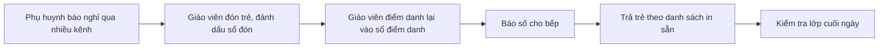
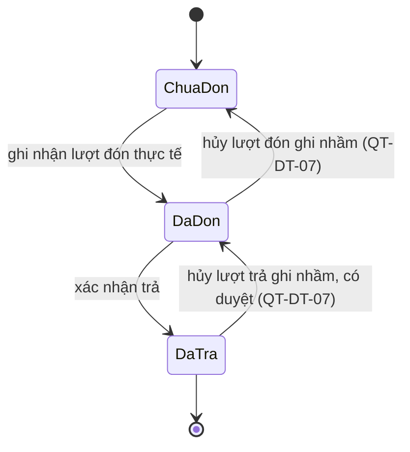

# 08. Đón trẻ, trả trẻ và tự động ghi nhận có mặt

> Hiện trạng mô phỏng tại Trường Mầm non Hoa Hướng Dương (tên giả định) theo kịch bản ở README §1. Nhóm chưa khảo sát trực tiếp tại trường. Mục 1–8 mô tả cách trường đang làm trong kịch bản, trừ nội dung có nhãn *(đề xuất)* hoặc được ghi rõ là phương án đề xuất. Cột **Loại** ở mục 7 ghi `Hiện trạng` khi trường đang làm như vậy trong kịch bản, `Hiện trạng có bổ sung` khi trường đang làm và hệ thống mới thêm kiểm tra, lưu vết hoặc tự động hóa, `Đề xuất` khi quy tắc chỉ có ở hệ thống mới. Mục 9 là đề xuất cho hệ thống mới. Điểm cần xác nhận khi có cơ sở thực tế được ghi ở phần câu hỏi xác minh. Mục 9.3 ghi cách thao tác nhóm đã thống nhất, sẽ chuyển sang tài liệu thiết kế khi bắt đầu giai đoạn thiết kế. Căn cứ trình bày gồm *HuongdanXDHTTTQLv1_1 (1).pdf*, trang 5–7, và *Checklist_BTL_HTTTQL_v2026 (1).xlsx*, trang tính **Nhóm 02 người**, mục 3.1 và 3.3.

## 1. Mục đích nghiệp vụ

Ghi nhận lúc giáo viên nhận trẻ từ phụ huynh buổi sáng (đón trẻ) và giao trẻ cho người nhận trẻ (trả trẻ), để nhà trường biết tại mỗi thời điểm trẻ nào đang ở trường và ai đã nhận trẻ về. Việc giao trẻ phải đúng người được phụ huynh cho phép.

## 2. Đối tượng tham gia

| Đối tượng | Công việc |
| --- | --- |
| Giáo viên phụ trách lớp trong ngày | Nhận báo nghỉ, đón và trả trẻ của lớp. Đối chiếu người đến nhận trẻ, gọi phụ huynh khi người nhận lạ. |
| Bảo vệ | Hỗ trợ tại cổng giờ cao điểm. Cùng giáo viên trông trẻ chưa có người nhận sau giờ trả. |
| Người giám hộ hoặc người được ủy quyền | Người giám hộ báo nghỉ hoặc báo trước khi nhờ người khác nhận trẻ. Người được ủy quyền đến nhận trẻ theo danh sách đã đăng ký. |
| Văn phòng | Cập nhật danh sách người đưa đón (nghiệp vụ 01). Nhận báo nghỉ khi phụ huynh gọi văn phòng rồi nhắn lại giáo viên lớp. |
| Ban giám hiệu | Quyết định khi người lạ đến nhận trẻ mà chưa liên hệ được phụ huynh. Bố trí người trông trẻ sau giờ trả. |

## 3. Quy trình nghiệp vụ hiện tại

| Bước | Ai, ở đâu và khi nào | Công việc và cách thực hiện | Kết quả |
| --- | --- | --- | --- |
| 1. Nhận báo nghỉ | Giáo viên qua Zalo, điện thoại hoặc sổ liên lạc; văn phòng qua điện thoại, trước hoặc đầu ngày | Ghi tên trẻ, ngày nghỉ và lý do vào sổ hoặc ghi nhớ. Văn phòng nhận báo nghỉ thì nhắn lại giáo viên lớp. | Danh sách trẻ báo nghỉ trong ngày, nằm rải rác ở nhiều kênh. |
| 2. Đón trẻ | Giáo viên tại cửa lớp hoặc cổng trường, khoảng 6h45–8h00 | Nhận trẻ từ phụ huynh, hỏi nhanh tình trạng sức khỏe. Đánh dấu vào sổ đón trẻ hoặc nhớ để điểm danh sau. | Trẻ vào lớp, sổ đón trẻ được đánh dấu. |
| 3. Điểm danh và báo số | Giáo viên tại lớp, khoảng 8h00–8h30 | Đếm trẻ trong lớp, ghi sổ điểm danh theo nghiệp vụ 03. Gọi phụ huynh của trẻ chưa đến mà chưa báo nghỉ. Báo số có mặt cho bếp. | Sổ điểm danh và số báo bếp. |
| 4. Trả trẻ | Giáo viên tại lớp, khoảng 16h30–17h30, hoặc khi phụ huynh nhận trẻ sớm | Đối chiếu người nhận trẻ với người giáo viên biết mặt hoặc danh sách người đưa đón. Người lạ đến nhận trẻ thì gọi phụ huynh xác nhận. Người nhận trẻ và giáo viên ký vào sổ giao nhận (Mẫu 08). | Trẻ được giao cho người nhận trẻ. |
| 5. Cuối ngày | Giáo viên và bảo vệ, sau giờ trả | Kiểm tra lớp không còn trẻ. Trẻ chưa có người nhận thì gọi phụ huynh và báo ban giám hiệu, giáo viên ở lại trông. | Lớp trống hoặc trẻ được trông muộn. |

**Câu hỏi xác minh khi phỏng vấn giáo viên và văn phòng**

- Giờ đón trẻ, giờ chốt và giờ trả trẻ của trường là mấy giờ? Giờ chốt đón có trùng với giờ báo bếp ở nghiệp vụ 03 và 07 không?
- Đón trẻ và điểm danh hiện ghi ở một sổ hay hai sổ? Có lúc nào hai sổ lệch nhau không?
- Phụ huynh báo nghỉ qua những kênh nào? Ai ghi lại và ghi ở đâu?
- Khi trả trẻ, giáo viên đối chiếu người nhận trẻ bằng cách nào? Có danh sách người được ủy quyền hay chỉ nhận mặt? Người nhận trẻ có phải ký sổ không?
- Trẻ chưa có người nhận sau giờ trả thì xử lý thế nào? Có thu phí trông muộn không?
- Khi giáo viên đánh dấu nhầm trẻ đã đón hoặc đã trả, ai được sửa và sửa đến lúc nào? Kịch bản dùng QT-DT-07.
- Có trường hợp trẻ đã được nhận về rồi quay lại trường trong cùng ngày không, ví dụ đi khám rồi quay lại? Kịch bản giả định không có.

## 4. Dữ liệu đầu vào

| Nhóm dữ liệu | Trường cần khảo sát | Nguồn |
| --- | --- | --- |
| Danh sách trẻ thuộc lớp trong ngày | Mã lớp, ngày, mã và họ tên trẻ, trạng thái thuộc lớp tại ngày đó | Nghiệp vụ 02 |
| Giáo viên phụ trách lớp trong ngày | Lớp, ngày, ca, giáo viên, vai trò (chủ nhiệm, phụ, dạy thay) | Nghiệp vụ 05 |
| Báo nghỉ của phụ huynh | Trẻ, ngày hoặc khoảng nghỉ, lý do, kênh báo, thời điểm nhận, người ghi nhận | Phụ huynh báo, giáo viên hoặc văn phòng ghi |
| Danh sách người có quyền nhận trẻ | Người giám hộ chính đã xác nhận, người được ủy quyền cố định, thông tin đối chiếu và thời hạn hiệu lực | NV01, tra cứu theo từng trẻ và thời điểm trả |
| Yêu cầu nhận trẻ hộ đột xuất | Trẻ, người đến nhận, người giám hộ xác nhận, kênh và thời điểm báo, thông tin đối chiếu CCCD tại cổng hoặc lớp, người xác minh | Người giám hộ báo trước khi giao trẻ qua điện thoại hoặc tin nhắn có lưu vết. Giáo viên hoặc nhân sự trực được giao quyền tiếp nhận. |
| Mốc vận hành *(đề xuất)* | Khung đón chính, mốc bàn giao buổi sáng, giờ khóa chuyên cần, khung trả trẻ thông thường | Danh mục dùng chung do Ban giám hiệu quy định, xem NV03 §9 |

## 5. Dữ liệu đầu ra

| Đầu ra | Nội dung chính | Nơi sử dụng |
| --- | --- | --- |
| Lượt đón | Trẻ, lớp, ngày, giờ đón, người đưa trẻ đến nếu có ghi, ghi chú khi nhận trẻ, người ghi nhận, đến muộn hay không. Nếu bị hủy do ghi nhầm: lý do, người hủy và thời điểm hủy | Hiện trạng: giáo viên đánh dấu sổ đón rồi điểm danh lại. *(Đề xuất)* NV03 cập nhật có mặt hoặc nhận đề nghị điều chỉnh theo mốc khóa |
| Lượt trả | Trẻ, lớp, giờ giao thực tế của trẻ, người thực tế nhận, người giao và mã căn cứ ủy quyền hoặc mã duyệt ngoại lệ nếu có. Nếu bị hủy do ghi nhầm: lý do, người hủy và người duyệt | Văn phòng tra cứu theo quyền |
| Hồ sơ xác minh người nhận *(đề xuất)* | Trẻ, danh tính người được đề nghị nhận, căn cứ người giám hộ xác nhận, kết quả đối chiếu CCCD, trạng thái, lý do, người và thời điểm xác minh, người và thời điểm duyệt hoặc từ chối | Giáo viên, nhân sự trực và người có quyền duyệt |
| Căn cứ chuyên cần *(đề xuất)* | Mã lượt đón hoặc trả, giờ thực tế, báo nghỉ và thời điểm ghi nhận | NV03 sở hữu kết quả chuyên cần, lưu bản bàn giao cho NV07 và tổng hợp kết quả chuyên cần theo kỳ |
| Danh sách cảnh báo *(đề xuất)* | Yêu cầu nhận trẻ còn chờ xác minh hoặc duyệt và trẻ chưa trả khi kết thúc khung trả | Giáo viên, người trực, văn phòng và Ban giám hiệu theo quyền |
| Báo cáo đón trả *(đề xuất)* | Số lượt đến muộn, số lượt trả theo ngoại lệ đã duyệt, số lượt trả muộn trong kỳ | Giáo viên đưa vào báo cáo lớp theo NV09 |

## 6. Biểu mẫu và hồ sơ sử dụng

Phụ lục mô phỏng: [Mẫu 08 · Sổ giao nhận trẻ hằng ngày](forms/mau-08-so-giao-nhan-tre.md) là mẫu trắng của sổ hiện trạng, minh họa DT-01, DT-03, DT-04 và DT-05, kèm bảng đối chiếu từng cột với dữ liệu ở mục 4 và 5. [Mẫu 02 · Sổ điểm danh và giao nhận trẻ](forms/mau-02-diem-danh-giao-nhan.md) minh họa cách ghi trong một ngày cụ thể, kèm [thông tin người được ủy quyền ở Mẫu 01](forms/mau-01-ho-so-tre.md).

| Mã tham chiếu | Biểu mẫu hoặc hồ sơ cần xin | Nội dung cần đối chiếu |
| --- | --- | --- |
| DT-01 | Sổ đón trẻ hoặc sổ giao nhận trẻ hằng ngày | Cột trẻ, giờ đến, giờ về, người nhận trẻ, chữ ký nếu có. |
| DT-02 | Danh sách hoặc giấy ủy quyền người đưa đón | Người được ủy quyền nhận trẻ, quan hệ, ảnh hoặc giấy tờ đối chiếu, thời hạn ủy quyền. |
| DT-03 | Sổ hoặc tin nhắn ghi nhận báo nghỉ | Kênh báo, thời điểm báo, người ghi nhận. |
| DT-04 | Sổ theo dõi trẻ về muộn hoặc biên bản bàn giao trẻ ngoài giờ | Giờ bàn giao, người trông, người nhận trẻ, phí trông muộn nếu có. |
| DT-05 | Phiếu xác minh người nhận trẻ đột xuất | Căn cứ người giám hộ xác nhận, đối chiếu danh tính tại chỗ, kết quả duyệt ngoại lệ hoặc lý do chưa thể giao trẻ. |

Khi phỏng vấn, xin mẫu trắng hoặc bản đã che thông tin cá nhân. Xin quan sát một buổi đón trẻ để đo thời gian giờ cao điểm.

## 7. Quy tắc nghiệp vụ

| Mã | Loại | Quy tắc cần xác nhận | Trường hợp cần thử |
| --- | --- | --- | --- |
| QT-DT-01 | Đề xuất | Lượt đón hợp lệ là nguồn duy nhất tạo kết quả có mặt ở NV03. Áp dụng QT-DD-05 để cập nhật trực tiếp hoặc đề nghị điều chỉnh theo mốc khóa. | Đón trước giờ khóa tạo kết quả có mặt. Đón từ giờ khóa tạo đề nghị điều chỉnh. |
| QT-DT-02 | Đề xuất | Danh sách trả gồm trẻ đã có lượt đón và chưa được trả. Trạng thái chuyên cần không quyết định trẻ có trong danh sách trả hay không. Nếu trẻ thực tế có mặt nhưng bị sót lượt đón, giáo viên xác minh và bổ sung lượt đón trước khi ghi trả theo quy trình thông thường. | Trẻ đến sau 09:00 hiện trong danh sách trả dù đề nghị điều chỉnh chuyên cần còn chờ duyệt. |
| QT-DT-03 | Đề xuất | Có thể xác nhận nhiều trẻ trong một lần. Khi trả, từng trẻ phải có người nhận thực tế được chọn và đối chiếu, căn cứ nhận còn hiệu lực và giờ giao thực tế. Hệ thống kiểm tra lại từng dòng khi lưu. Dòng đủ điều kiện được ghi trả, dòng còn thiếu điều kiện được báo rõ lý do và tiếp tục ở danh sách chưa trả. | Chọn 3 trẻ, 2 trẻ đã xác minh người nhận, 1 trẻ còn chờ. Chỉ ghi trả 2 trẻ. |
| QT-DT-04 | Hiện trạng có bổ sung | Người giám hộ chính đã xác nhận hoặc người có ủy quyền cố định còn hiệu lực theo QT-HS-05 được nhận trẻ sau khi danh tính thực tế đã được đối chiếu. Người ngoài danh sách, có ủy quyền hết hạn hoặc bị thu hồi phải có xác nhận trước khi giao từ người giám hộ qua kênh đã đăng ký và có lưu vết, được đối chiếu CCCD tại cổng hoặc lớp, rồi được Ban giám hiệu hoặc người được giao quyền duyệt ngoại lệ. Duyệt chỉ có giá trị cho trẻ, người nhận và lượt trả đã xác minh. Thiếu bất kỳ điều kiện nào thì chặn hoàn tất lượt trả. | Cậu đến nhận sau khi hết hạn ủy quyền, chưa liên hệ được người giám hộ. Trẻ tiếp tục được trông tại trường, yêu cầu ở trạng thái chờ xác minh. |
| QT-DT-05 | Đề xuất | Giáo viên được phân công lớp hoặc nhân sự trực được cấp quyền NV08 thực hiện giao nhận trong phạm vi lớp và thời gian được giao. Quyền ghi giao nhận và quyền duyệt ngoại lệ được cấp riêng. | Nhân sự trực có quyền ghi trả và xác minh CCCD, còn ngoại lệ được chuyển đến người có quyền duyệt. |
| QT-DT-06 | Đề xuất | Ghi lượt đón khi trẻ thực tế vào trường, kể cả trẻ đã báo nghỉ hoặc đã xác nhận vắng. Giờ đến thực tế từ mốc bàn giao 08:30 được đánh dấu đến muộn. Ghi nhận từ mốc khóa 09:00 tạo đề nghị điều chỉnh theo QT-DD-03. Giữ báo nghỉ và căn cứ xác minh đã ghi. | Trẻ báo nghỉ rồi đến 08:50 vẫn được đón. Trẻ đến đúng 09:00 vẫn được đón và NV03 nhận đề nghị điều chỉnh. |
| QT-DT-07 | Đề xuất | Lượt đón hoặc lượt trả ghi nhầm không bị xóa mà được hủy, kèm lý do, người hủy và thời điểm hủy. Trước mốc khóa 09:00, giáo viên phụ trách lớp hoặc người đã ghi được hủy lượt đón. NV03 tính lại kết quả trong ngày từ các căn cứ còn lại như báo nghỉ và kết quả xác minh. Từ mốc khóa, hủy lượt đón tạo đề nghị điều chỉnh theo QT-DD-03, kết quả `Có mặt` giữ nguyên cho tới khi được duyệt. Không hủy lượt đón khi trẻ còn lượt trả chưa hủy. Lượt trả chỉ được hủy khi trẻ thực tế còn ở trường và phải được Ban giám hiệu hoặc người được giao quyền duyệt. Khi đó trẻ quay lại danh sách chưa trả. Bản bàn giao 08:30 không đổi. Thay đổi ảnh hưởng bữa ăn được chuyển NV07 theo QT-SA-04. | Lúc 07:40 giáo viên chọn nhầm một trẻ đã báo nghỉ khi đón theo nhóm, phát hiện lúc 08:05 và hủy lượt đón. NV03 đưa trẻ về kết quả theo báo nghỉ. Nếu phát hiện lúc 09:20, NV03 nhận đề nghị điều chỉnh. |

## 8. Hạn chế của quy trình hiện tại

- Đón trẻ ghi một nơi, điểm danh ghi một nơi khác, nên trẻ đã đón vẫn có thể bị ghi vắng hoặc ngược lại.
- Báo nghỉ nằm ở nhiều kênh, giáo viên dễ bỏ sót và gọi nhầm phụ huynh đã báo.
- Danh sách trả trẻ in sẵn gồm cả trẻ vắng, dễ ghi nhầm là đã trả.
- Đối chiếu người nhận trẻ dựa vào trí nhớ của giáo viên, khó kiểm soát khi giáo viên dạy thay không biết mặt phụ huynh.
- Đón từng trẻ một rất chậm vào giờ cao điểm buổi sáng.

## 9. Yêu cầu đối với hệ thống mới

Trong hệ thống mới, **đón trẻ và điểm danh là một luồng dữ liệu**, không phải hai việc ghi riêng:

- Lượt đón là căn cứ duy nhất tạo kết quả **có mặt** ở NV03. Trước giờ khóa, kết quả cập nhật tự động. Từ giờ khóa, lượt đón tạo đề nghị điều chỉnh chuyên cần.
- Trẻ chưa được đón có kết quả chuyên cần theo xác minh của NV03. Ghi báo nghỉ chỉ cung cấp căn cứ xác minh.
- Danh sách trả gồm trẻ **đã đón và chưa trả**, kể cả khi điều chỉnh chuyên cần đang chờ duyệt.

**Vai trò trong hệ thống mới**

| Vai trò | Công việc |
| --- | --- |
| Giáo viên được phân công lớp trong ngày (NV05) | Ghi báo nghỉ, đón và trả trẻ trong phạm vi lớp. Tiếp nhận báo nhận trẻ hộ, đối chiếu người nhận thực tế và trình duyệt ngoại lệ. Xác minh vắng và đề nghị điều chỉnh chuyên cần tại NV03. |
| Nhân sự trực được giao quyền tại NV08 | Tiếp nhận báo nhận trẻ hộ, đối chiếu CCCD và ghi nhận giao nhận trong phạm vi lớp và thời gian được giao. Dùng hệ thống con Giáo viên với quyền được Ban giám hiệu cấp theo lớp và thời gian. |
| Văn phòng | Ghi nhận báo nghỉ khi phụ huynh báo qua văn phòng. Xem tình hình đón trả toàn trường. |
| Ban giám hiệu hoặc người được giao quyền duyệt ngoại lệ | Kiểm tra căn cứ và duyệt hoặc từ chối yêu cầu nhận trẻ ngoài danh sách đang có hiệu lực. Phối hợp bố trí người trông trẻ trong thời gian chờ hoặc sau giờ trả. |

### 9.1. Trạng thái của trẻ trong ngày

| Trạng thái giao nhận | Khi nào | Dữ liệu chuyển cho chuyên cần (NV03) | Có trong danh sách trả trẻ |
| --- | --- | --- | --- |
| Chưa đón | Chưa có lượt đón thực tế | Nếu có báo nghỉ, chuyển thông tin làm căn cứ xác minh. NV03 quản lý kết quả vắng hoặc chờ xác minh. Ngày thuộc nghỉ dài ngày đã xác nhận ở NV02 hiển thị nhãn nghỉ dài ngày, NV03 tự ghi vắng có phép theo QT-DD-06. | Không |
| Đã đón | Người có quyền NV08 ghi nhận lượt đón, kể cả khi trước đó có báo nghỉ | Mã lượt đón và giờ thực tế. NV03 cập nhật có mặt hoặc tiếp nhận đề nghị điều chỉnh theo giờ khóa. | **Có**, kể cả khi chuyên cần đang chờ duyệt |
| Đã trả | Người có quyền NV08 ghi nhận đã giao trẻ cho người đủ điều kiện | Giờ về thực tế. Lượt trả không làm mất kết quả có mặt hoặc hủy đề nghị điều chỉnh đang chờ duyệt. | Không |

Hiển thị báo nghỉ và đến muộn dưới dạng nhãn theo dữ liệu đã ghi. Các nhãn này không thay đổi quy tắc chuyển trạng thái giao nhận.

Lượt ghi nhầm được hủy theo QT-DT-07 và vẫn được lưu với trạng thái đã hủy. Hủy lượt đón đưa trẻ về `Chưa đón`. Hủy lượt trả có duyệt đưa trẻ về `Đã đón`. Kịch bản không có trường hợp trẻ đã trả quay lại trường trong cùng ngày (câu hỏi xác minh ở mục 3).

Khi chưa đủ căn cứ giao trẻ, hồ sơ xác minh người nhận hiển thị `Chờ xác minh` hoặc `Chờ duyệt`. Trẻ vẫn ở trạng thái `Đã đón`, xuất hiện trong danh sách chưa trả và tiếp tục được người trực trông tại trường. Từ chối một yêu cầu nhận trẻ hộ cũng giữ trẻ trong danh sách này. Chỉ chuyển sang `Đã trả` khi giao trẻ thực tế cho người nhận đủ điều kiện.

### 9.2. Quy trình đề xuất

| Bước | Ai, khi nào | Công việc | Kết quả |
| --- | --- | --- | --- |
| 1. Mở danh sách đón | Giáo viên tại lớp, đầu khung đón chính lúc 07:00 | Hệ thống lấy danh sách trẻ thuộc diện điểm danh trong ngày từ NV02. Hiển thị báo nghỉ nếu có và cho ghi nhận đón khi trẻ thực tế đến. | Danh sách trẻ chưa đón. |
| 2. Đón trẻ | Giáo viên, khi trẻ được đưa đến | Chọn các trẻ vừa được đưa đến rồi bấm "Đón các trẻ đã chọn" (mục 9.3). Hệ thống ghi giờ đón thực tế và chuyển căn cứ cho NV03. | Trẻ ở trạng thái đã đón và có trong danh sách trả. |
| 3. Bàn giao số buổi sáng | Hệ thống và giáo viên, lúc 08:30 | Kết thúc khung đón chính. NV03 lưu bản bàn giao cho NV07 và tiếp tục xác minh chuyên cần đến mốc khóa 09:00. | Bản bàn giao đầu ngày. |
| 4. Đón muộn hoặc sau khóa | Giáo viên, khi phát sinh | Áp dụng QT-DT-06. Chuyển thông tin ảnh hưởng đến bữa ăn sang NV07 để điều chỉnh nếu cần. | Lượt đón đã ghi. NV03 cập nhật có mặt trước 09:00 hoặc tạo đề nghị điều chỉnh từ 09:00. |
| 5. Kiểm tra và ghi trả | Giáo viên hoặc nhân sự trực được giao quyền, khi người nhận đến | Chọn trẻ đã đón và chưa trả. Đối chiếu người nhận từng trẻ theo QT-DT-04. Nếu cần, lập yêu cầu xác minh, chuyển người có quyền duyệt và tiếp tục trông trẻ. Sau khi bàn giao thực tế, ghi người nhận và giờ trả của từng trẻ. | Lượt trả hợp lệ được ghi. Ca còn chờ hoặc bị từ chối vẫn nằm trong danh sách chưa trả. |
| 6. Kết thúc khung trả | Giáo viên hoặc người trực, sau giờ trả | Hệ thống cảnh báo trẻ còn ở trường. Người trực liên hệ người giám hộ, báo Ban giám hiệu và ghi người tiếp tục trông trẻ. | Danh sách trẻ chưa trả và người chịu trách nhiệm tiếp tục trông. |

### 9.3. Chọn trẻ để đón hoặc trả

Đây là **cách duy nhất** để đón và trả trẻ. Không có nút đón hoặc trả riêng trên từng dòng. Muốn đón một trẻ thì chỉ chọn một trẻ, muốn đón cả nhóm thì chọn cả nhóm, nên giáo viên chỉ cần học một thao tác.

1. Mỗi dòng trẻ có **ô chọn**. Đầu danh sách có ô **"Chọn tất cả"**, chọn tất cả các trẻ **đang hiển thị** theo bộ lọc (ví dụ lọc "Chưa đón").
2. Khi đã chọn, thanh thao tác hiện **"Đã chọn n trẻ"** và nút **"Đón n trẻ đã chọn"** (hoặc **"Trả n trẻ đã chọn"** ở màn hình trả).
3. Khi đón, hộp xác nhận liệt kê trẻ đã chọn. Hệ thống ghi lượt đón cho từng trẻ hợp lệ. Trẻ đã báo nghỉ vẫn được đón khi thực tế đến.
4. Khi trả, hộp xác nhận hiển thị danh sách người đủ điều kiện của **từng trẻ**. Ô người nhận ban đầu để trống. Người thực hiện chọn và xác nhận đúng người thực tế đã đối chiếu, rồi ghi giờ giao thực tế cho từng trẻ. Người nhận đột xuất chỉ xuất hiện để chọn sau khi hoàn tất QT-DT-04.
5. Khi xác nhận nhóm, hệ thống kiểm tra lại quyền và điều kiện của từng dòng. Dòng chưa đủ căn cứ, chưa chọn người nhận hoặc chưa có giờ giao thực tế được báo rõ lý do. Các dòng đủ điều kiện được ghi lượt trả riêng. Trẻ ở dòng bị chặn tiếp tục nằm trong danh sách chưa trả.

### 9.4. Yêu cầu

| Mã | Yêu cầu đề xuất |
| --- | --- |
| YC-DT-01 | Màn hình đón trẻ theo lớp và ngày, lọc theo trạng thái giao nhận và hiển thị nhãn báo nghỉ nếu có. Chuyển lượt đón cho NV03 theo QT-DT-01 và QT-DT-06. |
| YC-DT-02 | Đón và trả trẻ bằng một thao tác duy nhất: chọn trẻ bằng ô chọn hoặc "Chọn tất cả", rồi bấm "Đón/Trả các trẻ đã chọn" và xác nhận một lần. Không có nút đón trả riêng trên từng dòng. Báo lại các trẻ bị bỏ qua. |
| YC-DT-03 | Danh sách trả trẻ chỉ gồm trẻ đã đón và chưa trả. Áp dụng quy trình bổ sung lượt đón khi xác minh có trẻ bị bỏ sót. |
| YC-DT-04 | Áp dụng các mốc giờ cấu hình dùng chung với NV03. Gắn cờ đến muộn theo giờ đến thực tế. Cảnh báo nếu hết khung giờ trả mà còn trẻ đã đón chưa trả. |
| YC-DT-05 | Ghi nhận báo nghỉ của phụ huynh tại hệ thống con Giáo viên (lớp mình) và Văn phòng, lưu kênh báo, thời điểm và người ghi nhận. |
| YC-DT-06 | Tra cứu lượt đón trả theo trẻ, lớp, ngày và người nhận thực tế. Lọc lượt trả theo ngoại lệ đã duyệt, ca đang chờ xử lý và lượt trả muộn. |
| YC-DT-07 | Tra cứu quyền nhận trẻ từ NV01 tại thời điểm trả. Hỗ trợ xác minh, chuyển duyệt, từ chối và ghi lý do ngoại lệ. Chặn hoàn tất khi thiếu căn cứ hoặc quyền nhận đã hết hiệu lực. Chỉ người được cấp quyền đối chiếu mới xem thông tin định danh cần thiết. |
| YC-DT-08 | Hủy lượt đón hoặc lượt trả ghi nhầm theo QT-DT-07, lưu lý do, người hủy, thời điểm và người duyệt nếu có. Chuyển kết quả hủy lượt đón cho NV03 theo mốc khóa. Không xóa cứng lượt giao nhận. |
