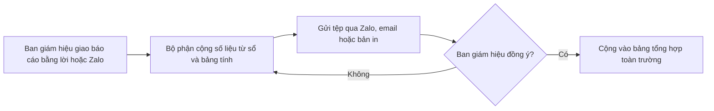
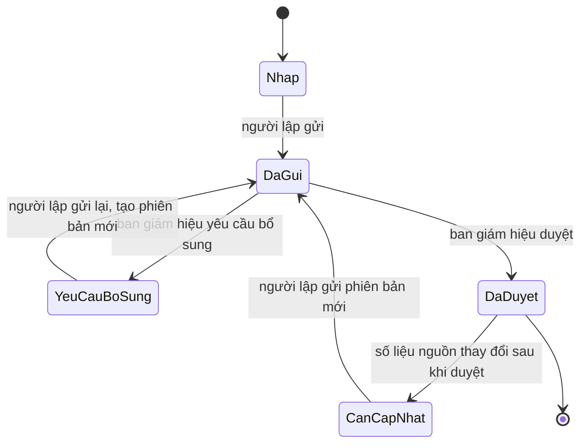

# 09. Lập, ghi chú và gửi báo cáo

> Hiện trạng mô phỏng tại Trường Mầm non Hoa Hướng Dương (tên giả định) theo kịch bản ở README §1. Nhóm chưa khảo sát trực tiếp tại trường. Mục 1–8 mô tả cách trường đang làm trong kịch bản, trừ nội dung có nhãn *(đề xuất)* hoặc được ghi rõ là phương án đề xuất. Cột **Loại** ở mục 7 ghi `Hiện trạng` khi trường đang làm như vậy trong kịch bản, `Hiện trạng có bổ sung` khi trường đang làm và hệ thống mới thêm kiểm tra, lưu vết hoặc tự động hóa, `Đề xuất` khi quy tắc chỉ có ở hệ thống mới. Mục 9 là đề xuất cho hệ thống mới. Điểm cần xác nhận khi có cơ sở thực tế được ghi ở phần câu hỏi xác minh. Căn cứ trình bày gồm *HuongdanXDHTTTQLv1_1 (1).pdf*, trang 5–7, và *Checklist_BTL_HTTTQL_v2026 (1).xlsx*, trang tính **Nhóm 02 người**, mục 3.1 và 3.3.

## 1. Mục đích nghiệp vụ

Các bộ phận (giáo viên, văn phòng, kế toán, bếp) lập báo cáo định kỳ hoặc đột xuất về công việc của mình, giải thích số liệu bất thường và nộp cho Ban giám hiệu. Ban giám hiệu xem, yêu cầu sửa khi cần và cộng số liệu thành báo cáo toàn trường để họp hoặc gửi cấp trên.

## 2. Đối tượng tham gia

| Đối tượng | Công việc |
| --- | --- |
| Người lập báo cáo (giáo viên, văn phòng, kế toán, bếp) | Cộng số liệu từ sổ và bảng tính của bộ phận, nhập vào mẫu Word hoặc Excel, gửi Ban giám hiệu và sửa khi được yêu cầu. |
| Ban giám hiệu | Giao loại báo cáo và hạn nộp. Đọc báo cáo, yêu cầu sửa, cộng số liệu toàn trường. |

## 3. Quy trình nghiệp vụ hiện tại

| Bước | Ai, ở đâu và khi nào | Công việc và cách thực hiện | Kết quả |
| --- | --- | --- | --- |
| 1. Giao báo cáo | Ban giám hiệu, đầu năm học hoặc khi cần | Thông báo trong cuộc họp hoặc nhóm Zalo các loại báo cáo và hạn nộp. | Danh sách báo cáo phải nộp, thường không có văn bản. |
| 2. Lập báo cáo | Từng bộ phận tại văn phòng hoặc lớp, cuối tuần hoặc cuối tháng | Cộng số liệu từ sổ điểm danh, sổ thu tiền, sổ suất ăn hoặc bảng tính. Nhập vào mẫu Word hoặc Excel. Giải thích số bất thường bằng lời khi họp. | Tệp báo cáo hoặc bản in. |
| 3. Gửi | Người lập, trước hạn | Gửi tệp qua Zalo, email hoặc nộp bản in cho ban giám hiệu. | Báo cáo nằm rải rác ở nhiều kênh. |
| 4. Xem và phản hồi | Ban giám hiệu, sau khi nhận | Đọc báo cáo, nhắn lại hoặc gọi người lập khi cần sửa. Người lập gửi lại tệp mới. | Nhiều phiên bản tệp, khó biết bản nào cuối. |
| 5. Tổng hợp | Ban giám hiệu hoặc văn phòng, cuối tháng | Cộng số liệu từ các báo cáo vào bảng tổng hợp toàn trường để họp hoặc báo cáo cấp trên. | Báo cáo toàn trường. |

**Câu hỏi xác minh khi phỏng vấn ban giám hiệu và các bộ phận**

- Mỗi bộ phận đang nộp những báo cáo nào, theo kỳ nào và hạn nộp là ngày mấy?
- Báo cáo đang dùng mẫu nào? Có mẫu do phòng giáo dục quy định không?
- Ban giám hiệu phản hồi báo cáo bằng cách nào? Có lưu lại các bản đã sửa không?
- Báo cáo toàn trường gửi lên cấp trên gồm những chỉ tiêu nào và lấy số từ báo cáo bộ phận nào?

## 4. Dữ liệu đầu vào

| Nhóm dữ liệu | Trường cần khảo sát | Nguồn |
| --- | --- | --- |
| Danh mục loại báo cáo | Mã loại, tên, bộ phận lập, kỳ (tuần, tháng, đột xuất), hạn gửi, các chỉ tiêu | Ban giám hiệu quy định |
| Số liệu chuyên cần, tình hình trẻ | Lớp, kỳ, số ngày có mặt, vắng có phép, không phép, đến muộn | Nghiệp vụ 03 và 08, số đã chốt |
| Số liệu tuyển sinh, sĩ số | Kỳ, số hồ sơ tiếp nhận, chờ bổ sung, sĩ số và biến động theo lớp | Nghiệp vụ 01 và 02, số đã chốt |
| Số liệu nhân sự, phân công | Kỳ, nhân sự vào làm, nghỉ việc, chứng chỉ sắp hết hạn, số ca đứng lớp và dạy thay | Nghiệp vụ 04 và 05 |
| Số liệu thu học phí | Kỳ, phải thu, đã thu, còn nợ, miễn giảm, hoàn tiền | Nghiệp vụ 06 |
| Số liệu suất ăn | Kỳ, lớp, bữa, số suất đã chốt và đã giao | Nghiệp vụ 07 |
| Ghi chú và minh chứng | Ghi chú chung, ghi chú theo dòng, tệp đính kèm | Người lập |
| Phản hồi | Nội dung, người phản hồi, thời điểm | Ban giám hiệu |

## 5. Dữ liệu đầu ra

Hiện trạng chỉ có tệp báo cáo của từng bộ phận và bảng tổng hợp toàn trường cộng tay (mục 3). Các đầu ra có nhãn *(đề xuất)* thuộc luồng báo cáo của hệ thống mới ở mục 9.

| Đầu ra | Nội dung chính | Nơi sử dụng |
| --- | --- | --- |
| Báo cáo bộ phận | Hiện trạng: tệp Word hoặc Excel có số liệu và giải thích. *(Đề xuất)* Thông tin chung, số liệu chụp tại lúc gửi, ghi chú, trạng thái, phiên bản | Ban giám hiệu xem và duyệt |
| Hộp báo cáo nhận được *(đề xuất)* | Danh sách báo cáo theo bộ phận, loại, kỳ, trạng thái, hạn gửi | Ban giám hiệu |
| Lịch sử phản hồi và phiên bản *(đề xuất)* | Các phiên bản đã gửi, phản hồi gắn với từng phiên bản | Người lập và ban giám hiệu đối chiếu |
| Danh sách báo cáo trễ hạn *(đề xuất)* | Bộ phận, loại, kỳ, hạn gửi, số ngày trễ | Ban giám hiệu nhắc |
| Báo cáo tổng hợp toàn trường | Hiện trạng: bảng cộng tay từ các báo cáo. *(Đề xuất)* Chỉ tiêu toàn trường ghép từ các báo cáo đã duyệt, đánh dấu kỳ chưa đầy đủ, xuất Excel hoặc PDF | Ban giám hiệu họp hoặc gửi cấp trên |

## 6. Biểu mẫu và hồ sơ sử dụng

Phụ lục mô phỏng: [Mẫu 05 · Báo cáo tổng hợp tháng](forms/mau-05-bao-cao-thang.md), minh họa BC-05 và các nhóm chỉ tiêu nhận từ báo cáo đã duyệt của từng bộ phận.

| Mã tham chiếu | Biểu mẫu hoặc hồ sơ cần xin | Nội dung cần đối chiếu |
| --- | --- | --- |
| BC-01 | Mẫu báo cáo chuyên cần hoặc tình hình lớp của giáo viên | Chỉ tiêu, kỳ, cách ghi chú trẻ vắng nhiều hoặc sự việc cần lưu ý. |
| BC-02 | Mẫu báo cáo sĩ số, tuyển sinh, nhân sự của văn phòng | Chỉ tiêu, kỳ, cách thể hiện biến động. |
| BC-03 | Mẫu báo cáo thu học phí và công nợ của kế toán | Phải thu, đã thu, còn nợ, miễn giảm, chữ ký. |
| BC-04 | Mẫu báo cáo suất ăn của bếp | Số suất theo lớp và bữa, thực phẩm đã dùng nếu có. |
| BC-05 | Báo cáo tổng hợp toàn trường gửi cấp trên | Chỉ tiêu, nguồn số liệu, kỳ, người ký. |

Khi phỏng vấn, xin mẫu trắng hoặc bản đã che thông tin cá nhân. Xin một báo cáo đã bị yêu cầu sửa để đối chiếu cách phản hồi.

## 7. Quy tắc nghiệp vụ

| Mã | Loại | Quy tắc cần xác nhận | Trường hợp cần thử |
| --- | --- | --- | --- |
| QT-BC-01 | Đề xuất | Ban giám hiệu chỉ thấy báo cáo ở trạng thái đã gửi trở đi. Báo cáo nháp chỉ người lập thấy. | Giáo viên lưu nháp, Ban giám hiệu không thấy trong hộp báo cáo. |
| QT-BC-02 | Đề xuất | Người lập chỉ lấy được số liệu trong phạm vi của mình. | Giáo viên lớp A không tạo được báo cáo chuyên cần lớp B. |
| QT-BC-03 | Đề xuất | Sau khi gửi, nội dung bị khóa. Muốn sửa phải được yêu cầu bổ sung và gửi lại thành phiên bản mới. Giữ đủ các phiên bản cũ và phản hồi. | Kế toán phát hiện sai sau khi gửi. |
| QT-BC-04 | Đề xuất | Số liệu được chụp tại lúc gửi. Nếu dữ liệu gốc thay đổi sau đó (ví dụ điều chỉnh điểm danh), báo cáo đã gửi hoặc đã duyệt không tự đổi; hệ thống cảnh báo người lập. Báo cáo đang ở `Đã gửi` được Ban giám hiệu xử lý như yêu cầu bổ sung nếu cần. Báo cáo đã duyệt chuyển sang `Cần cập nhật` để người lập gửi phiên bản mới từ số liệu hiện hành. | Điểm danh được sửa sau khi báo cáo chuyên cần đã gửi. Một quyết định chuyển lớp ghi hồi tố sau khi báo cáo sĩ số tháng đã duyệt. |
| QT-BC-05 | Đề xuất | Tổng hợp toàn trường chỉ dùng phiên bản đã duyệt mới nhất của từng báo cáo. Kỳ còn bộ phận chưa duyệt được đánh dấu chưa đầy đủ. Kỳ có báo cáo ở trạng thái `Cần cập nhật` được đánh dấu số liệu đang cập nhật cho tới khi phiên bản mới được duyệt. | Kế toán chưa gửi báo cáo tháng. Báo cáo chuyên cần lớp Mầm 1 đã duyệt nhưng có điều chỉnh được duyệt sau đó. |
| QT-BC-06 | Đề xuất | Với báo cáo định kỳ, mỗi bộ phận có tối đa một báo cáo cho mỗi loại, phạm vi và kỳ. Mỗi sự việc đột xuất có mã báo cáo riêng và bộ phiên bản riêng. Báo cáo gửi sau hạn vẫn được nhận nhưng được đánh dấu trễ hạn. | Văn phòng gửi báo cáo sĩ số tháng 10 vào ngày 8 tháng 11 khi hạn là ngày 5. |

## 8. Hạn chế của quy trình hiện tại

- Báo cáo được gửi qua tin nhắn hoặc giấy, Ban giám hiệu khó biết bộ phận nào đã gửi, gửi bản nào.
- Không có chỗ ghi chú nên số liệu bất thường phải giải thích riêng bằng lời.
- Số liệu được cộng tay từ sổ, dễ lệch với số đã chốt ở các bộ phận khác.
- Nếu Ban giám hiệu tự xem dữ liệu thô thay cho báo cáo, không có xác nhận của bộ phận về số liệu.

## 9. Yêu cầu đối với hệ thống mới

Trong hệ thống mới, báo cáo đi **từ bộ phận lên Ban giám hiệu**. Mỗi bộ phận tự lập báo cáo trong phạm vi của mình từ **số liệu đã chốt**, thêm ghi chú rồi **gửi**. Ban giám hiệu **không có báo cáo sẵn** của các bộ phận: Ban giám hiệu chỉ nhận các báo cáo đã gửi, xem, phản hồi, yêu cầu bổ sung hoặc duyệt. Số liệu toàn trường được tổng hợp từ các báo cáo đã duyệt, nên mỗi con số đều có bộ phận đứng tên xác nhận.

### 9.1. Loại báo cáo theo hệ thống con

| Hệ thống con | Báo cáo | Kỳ | Hạn gửi đề xuất |
| --- | --- | --- | --- |
| Giáo viên | Chuyên cần của lớp, gồm đến muộn và trả muộn. Tình hình trẻ trong lớp (sức khỏe, sự việc cần lưu ý). | Tuần hoặc tháng; đột xuất khi có sự việc | Thứ hai tuần sau hoặc ngày 5 tháng sau; đột xuất trong ngày |
| Văn phòng | Tuyển sinh, hồ sơ chờ bổ sung. Sĩ số và biến động. Nhân sự (vào làm, nghỉ việc, chứng chỉ hết hạn). Phân công và dạy thay. | Tháng | Ngày 5 tháng sau |
| Kế toán | Thu học phí: phải thu, đã thu, còn nợ. Danh sách nợ quá hạn. Miễn giảm, hoàn tiền. | Tháng | Ngày 5 tháng sau |
| Bếp | Số suất ăn đã chốt, đã giao và chênh lệch theo lớp và bữa. | Tuần hoặc tháng | Thứ hai tuần sau hoặc ngày 5 tháng sau |

Mỗi bộ phận chỉ thấy loại báo cáo của mình. Ví dụ, kế toán không có báo cáo suất ăn hay báo cáo chuyên cần. Hạn gửi là giả định, chờ ban giám hiệu xác nhận.

### 9.2. Trạng thái của báo cáo

| Trạng thái | Ý nghĩa | Ai được sửa |
| --- | --- | --- |
| Nháp | Người lập đang soạn, Ban giám hiệu chưa thấy. | Người lập |
| Đã gửi | Đã gửi cho Ban giám hiệu, khóa nội dung. | Không ai |
| Yêu cầu bổ sung | Ban giám hiệu trả lại kèm phản hồi. | Người lập sửa rồi gửi lại |
| Đã duyệt | Ban giám hiệu chấp nhận, được dùng để tổng hợp toàn trường. | Không ai |
| Cần cập nhật | Báo cáo đã duyệt nhưng số liệu nguồn thay đổi sau đó (QT-BC-04). Phiên bản đã duyệt vẫn được giữ và dùng cho tổng hợp, có đánh dấu đang cập nhật. | Người lập tạo phiên bản mới từ số liệu hiện hành rồi gửi lại |

### 9.3. Quy trình đề xuất

| Bước | Ai, khi nào | Công việc | Kết quả |
| --- | --- | --- | --- |
| 1. Tạo báo cáo | Người lập, cuối kỳ hoặc khi có sự việc | Chọn loại báo cáo và kỳ. Hệ thống lấy **số liệu đã chốt** trong phạm vi của người lập (ví dụ giáo viên chỉ lấy được lớp mình). Với chuyên cần, hiển thị riêng lượt chờ xác minh và đánh dấu kỳ còn lượt chưa khóa hoặc điều chỉnh đang chờ duyệt. | Báo cáo nháp có số liệu. |
| 2. Ghi chú | Người lập | Thêm **ghi chú chung** cho cả báo cáo và **ghi chú theo từng dòng** (ví dụ giải thích vì sao một trẻ vắng nhiều, vì sao một khoản còn nợ). Đính kèm minh chứng nếu cần. | Báo cáo nháp có ghi chú. |
| 3. Gửi | Người lập | Xem lại rồi bấm "Gửi Ban giám hiệu". Hệ thống lưu **ảnh chụp số liệu tại lúc gửi**, ghi người gửi, thời điểm và khóa nội dung. | Báo cáo đã gửi, xuất hiện trong hộp báo cáo của Ban giám hiệu. |
| 4. Xem và phản hồi | Ban giám hiệu | Mở báo cáo trong hộp báo cáo nhận được, lọc theo bộ phận, loại, kỳ và trạng thái. Đọc số liệu và ghi chú, viết phản hồi. | Phản hồi gắn với báo cáo. |
| 5. Yêu cầu bổ sung hoặc duyệt | Ban giám hiệu | Nếu cần sửa, chọn "Yêu cầu bổ sung" kèm nội dung; người lập nhận thông báo, sửa và gửi lại thành **phiên bản mới**. Nếu đạt, chọn "Duyệt". | Báo cáo đã duyệt hoặc chờ bổ sung. |
| 6. Tổng hợp | Ban giám hiệu | Xem bảng tổng hợp toàn trường được ghép từ phiên bản **đã duyệt** mới nhất của từng báo cáo. Theo dõi bộ phận chưa gửi, gửi trễ hạn hoặc có báo cáo `Cần cập nhật`. | Báo cáo toàn trường. |

### 9.4. Dữ liệu của một báo cáo

| Nhóm | Trường |
| --- | --- |
| Thông tin chung | Mã báo cáo, loại, kỳ, bộ phận, phạm vi (lớp, khối hoặc toàn trường), người lập |
| Số liệu | Các dòng số liệu lấy từ dữ liệu đã chốt, chụp lại tại thời điểm gửi |
| Ghi chú | Ghi chú chung; ghi chú theo dòng; tệp đính kèm |
| Luồng xử lý | Trạng thái, phiên bản, thời điểm gửi, hạn gửi, trễ hạn hay không, người duyệt, thời điểm duyệt |
| Phản hồi | Người phản hồi, nội dung, thời điểm, gắn với phiên bản nào |

### 9.5. Yêu cầu

| Mã | Yêu cầu đề xuất |
| --- | --- |
| YC-BC-01 | Ở mỗi hệ thống con: mục "Báo cáo của tôi" để tạo báo cáo theo loại và kỳ từ số liệu đã chốt, lưu nháp, ghi chú chung và theo dòng, đính kèm và gửi. |
| YC-BC-02 | Ở hệ thống con Ban giám hiệu: "Hộp báo cáo nhận được" có lọc theo bộ phận, loại, kỳ, trạng thái; xem, phản hồi, yêu cầu bổ sung, duyệt. |
| YC-BC-03 | Lưu phiên bản, lịch sử phản hồi và ảnh chụp số liệu tại lúc gửi. Thông báo cho người lập khi có phản hồi hoặc yêu cầu bổ sung. Khi số liệu nguồn của báo cáo đã duyệt thay đổi, chuyển báo cáo sang `Cần cập nhật`, báo người lập và đánh dấu kỳ trên bảng tổng hợp theo QT-BC-04, QT-BC-05. |
| YC-BC-04 | Theo dõi hạn gửi, cảnh báo báo cáo trễ hạn. Tổng hợp toàn trường từ báo cáo đã duyệt và xuất Excel hoặc PDF. |
| YC-BC-05 | Ban giám hiệu quản lý danh mục loại báo cáo: bộ phận lập, kỳ, hạn gửi và các chỉ tiêu. |
