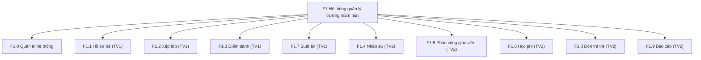

# Khảo sát nghiệp vụ và phân chia hệ thống con

> Hồ sơ khảo sát theo kịch bản mô phỏng. Cách chia hệ thống con là phương án của nhóm. Căn cứ trình bày gồm *HuongdanXDHTTTQLv1_1 (1).pdf*, trang 5–7, và *Checklist_BTL_HTTTQL_v2026 (1).xlsx*, trang tính **Nhóm 02 người**, mục 3.1 và 3.3.

## Đặt vấn đề và ý nghĩa của hệ thống

**Đặt vấn đề.** Trong kịch bản, Trường Mầm non Hoa Hướng Dương có 135 trẻ, 5 lớp và 18 nhân sự. Thông tin được ghi ở nhiều nơi: sổ giấy cho điểm danh, giao nhận trẻ và báo cơm, Excel cho lớp và học phí, Zalo và điện thoại cho báo nghỉ và nhận trẻ hộ. Cách làm này gây ra các vấn đề sau:

- Cùng một sự việc được ghi nhiều lần ở nhiều sổ nên số liệu lệch nhau: trẻ đã đón vẫn bị ghi vắng, số báo bếp khác số có mặt, danh sách lớp in sẵn chưa cập nhật chuyển lớp.
- Kế toán tính tiền ăn bằng tay từ sổ điểm danh, dễ sai khi có ngày nghỉ, chuyển lớp hoặc ngày chưa chốt.
- Việc giao trẻ dựa vào trí nhớ của giáo viên, khó kiểm soát khi người nhận lạ hoặc giáo viên dạy thay không biết mặt phụ huynh.
- Lưu ý dị ứng, phân công giáo viên và hồ sơ nhân sự không có một nơi cập nhật chung, nên bộ phận khác dễ dùng thông tin cũ.
- Báo cáo gửi qua tin nhắn hoặc giấy, Ban giám hiệu khó biết bản nào là bản cuối và số liệu do ai xác nhận.

**Ý nghĩa của hệ thống.** Hệ thống thông tin quản lý nhà trẻ giúp trường:

- Có **một nguồn dữ liệu** cho mỗi loại thông tin, các bộ phận nhận số liệu đã chốt thay vì chép lại.
- **Giao trẻ an toàn hơn** nhờ kiểm tra người nhận theo danh sách còn hiệu lực và lưu vết mọi ngoại lệ.
- **Tính tiền đúng và giải thích được** nhờ đối soát tiền ăn theo chuyên cần đã khóa và giữ căn cứ trên từng dòng.
- **Tra lại lịch sử** lớp, phân công, hồ sơ và điều chỉnh tại một ngày bất kỳ.
- **Báo cáo có người chịu trách nhiệm**, tổng hợp toàn trường từ các báo cáo đã duyệt.

## 1. Thông tin khảo sát

Do nhóm chưa thể khảo sát trực tiếp tại trường, phần hiện trạng mô tả quy trình giả định. Các ngày, tên và xác nhận trong biểu mẫu phục vụ minh họa và đối soát giữa các nghiệp vụ.

| Mục | Nội dung |
| --- | --- |
| Cơ sở mô phỏng | Trường Mầm non Hoa Hướng Dương (tên giả định), một trường tư thục tại Hà Nội. |
| Quy mô | 135 trẻ. Năm lớp gồm Nhà trẻ 1 (20 trẻ), Mầm 1 (25), Mầm 2 (25), Chồi 1 (32) và Lá 1 (33). |
| Nhân sự | 18 người gồm 1 hiệu trưởng, 1 phó hiệu trưởng chuyên môn kiêm điều phối nhân sự (có bằng giáo dục mầm non, dạy thay khi thiếu giáo viên), 1 nhân viên văn phòng kiêm kế toán, 10 giáo viên, 3 cấp dưỡng và 2 bảo vệ hỗ trợ tại cổng. Giáo viên ghi nhận giao nhận trong các mẫu. |
| Người thực hiện | TV1, TV2 |
| Công cụ trong kịch bản | Sổ giấy để theo dõi giao nhận trẻ và suất ăn. Excel để theo dõi lớp và học phí. Zalo hoặc điện thoại để nhận báo nghỉ và thông tin người nhận trẻ hộ. |
| Phương pháp xây dựng hồ sơ | Tổng hợp mô tả quy trình đã có, dựng biểu mẫu và kiểm tra chéo theo mã trẻ, lớp, ngày và kỳ. Vai trò kiêm nhiệm thuộc kịch bản mô phỏng. Phương án tính tiền ăn của đồ án nêu tại NV06. |

**Phụ lục biểu mẫu mô phỏng**

| Mẫu | Nghiệp vụ có thể đối chiếu | Nội dung minh họa |
| --- | --- | --- |
| [01. Hồ sơ trẻ](forms/mau-01-ho-so-tre.md) | 01, 02, 07, 08 | Tiếp nhận, mốc bắt đầu học, lưu ý ăn uống và người được ủy quyền nhận trẻ. Với 02, mẫu chỉ minh họa đầu vào bàn giao xếp lớp. |
| [02. Điểm danh và giao nhận](forms/mau-02-diem-danh-giao-nhan.md) | 03, 08 | Số bàn giao lúc 08:30, kết quả cuối ngày, đến muộn và xác minh người nhận trẻ hộ. |
| [03. Báo suất và giao nhận](forms/mau-03-bao-suat-va-giao-nhan.md) | 07 | Số chốt riêng theo bữa, điều chỉnh sau chốt và số thực nhận. |
| [04. Thông báo phải thu và biên lai](forms/mau-04-hoc-phi-va-bien-lai.md) | 06 | Tạm thu theo lịch học, giảm trừ kỳ trước và một lần thanh toán chuyển khoản. |
| [05. Báo cáo tổng hợp tháng](forms/mau-05-bao-cao-thang.md) | 02, 09 | Tổng hợp chỉ tiêu từ các bản nguồn đã duyệt trong kịch bản. |
| [06. Hồ sơ nhân sự và biến động](forms/mau-06-ho-so-nhan-su.md) | 04, 05 | Hồ sơ kèm bằng cấp, chứng chỉ, giấy tờ và một lần tạm nghỉ làm thiếu giáo viên. |
| [07. Phân công và dạy thay](forms/mau-07-phan-cong-va-day-thay.md) | 05, 03, 08 | Bảng phân công năm học, phiếu dạy thay khi không có giáo viên trống ca và tổng hợp ca tháng. |

Các mẫu trên cung cấp dữ liệu kiểm tra cho phân tích. Mẫu 02, 03 và 05 có thêm phần ghi theo luồng của hệ thống mới, được ghi rõ ở đầu từng mẫu.

**Tình trạng minh chứng.** Tất cả biểu mẫu trong phụ lục do nhóm mô phỏng. Tại tiêu chí **biểu mẫu thật** (checklist mục 3.1), hồ sơ chưa có biểu mẫu thu trực tiếp từ cơ sở. Việc còn mở: xin mẫu trắng hoặc bản đã che thông tin của các mẫu có mã HS, DD, SA, HP, NS và PC ghi ở mục 6 từng nghiệp vụ, rồi đối chiếu với phụ lục mô phỏng.

## 2. Danh sách nghiệp vụ khảo sát

| STT | Nghiệp vụ | Thành viên | Tài liệu |
| --- | --- | --- | --- |
| 01 | Tiếp nhận và quản lý hồ sơ trẻ | TV1 | [01-tiep-nhan-va-quan-ly-ho-so-tre.md](01-tiep-nhan-va-quan-ly-ho-so-tre.md) |
| 02 | Xếp lớp và quản lý biến động sĩ số | TV1 | [02-xep-lop-va-quan-ly-bien-dong-si-so.md](02-xep-lop-va-quan-ly-bien-dong-si-so.md) |
| 03 | Điểm danh và theo dõi chuyên cần | TV1 | [03-diem-danh-va-theo-doi-chuyen-can.md](03-diem-danh-va-theo-doi-chuyen-can.md) |
| 04 | Quản lý hồ sơ giáo viên và nhân viên | TV2 | [04-staff-management.md](04-staff-management.md) |
| 05 | Phân công giáo viên theo lớp và thời gian | TV2 | [05-teacher-assignment.md](05-teacher-assignment.md) |
| 06 | Lập khoản phải thu và thu học phí | TV2 | [06-tuition-management.md](06-tuition-management.md) |
| 07 | Quản lý suất ăn và chế độ ăn của trẻ | TV1 | [07-quan-ly-suat-an-va-che-do-an-cua-tre.md](07-quan-ly-suat-an-va-che-do-an-cua-tre.md) |
| 08 | Đón trẻ, trả trẻ và tự động ghi nhận có mặt | TV2 | [08-child-drop-off-and-pick-up.md](08-child-drop-off-and-pick-up.md) |
| 09 | Lập, ghi chú và gửi báo cáo | TV2 | [09-reporting.md](09-reporting.md) |

Tất cả tài liệu khảo sát của hai thành viên nằm chung trong thư mục `docs/survey/`.

## 3. Thuật ngữ

| Thuật ngữ | Nghĩa trong tài liệu |
| --- | --- |
| Đón trẻ | Giáo viên nhận trẻ từ phụ huynh vào lớp, thường buổi sáng. Từ "đón" chỉ dùng cho chiều trẻ vào trường: lượt đón, khung đón, đã đón. |
| Trả trẻ | Giáo viên giao trẻ cho người nhận trẻ. Chiều trẻ ra về dùng "nhận trẻ": người nhận trẻ, nhận trẻ hộ, nhận trẻ về sớm. Riêng "người đưa đón" chỉ chung những người được đưa và nhận trẻ, đăng ký tại NV01. |
| Nhận trẻ hộ | Một người ngoài danh sách người nhận trẻ đang có hiệu lực đến nhận trẻ cho một lượt trả, phải qua xác minh và duyệt ngoại lệ theo QT-DT-04. |
| Người nhận trẻ | Người giám hộ chính hoặc người có ủy quyền cố định còn hiệu lực theo NV01, hoặc người được duyệt nhận trẻ hộ cho một lượt theo NV08. Người nhận trên lượt trả là người thực tế đã nhận trẻ. |
| Mốc bàn giao buổi sáng | Mặc định 08:30, kết thúc khung đón chính 07:00–08:30 và lưu số buổi sáng gửi NV07. Giờ đến thực tế từ mốc này được đánh dấu đến muộn. |
| Mốc khóa chuyên cần | Mặc định 09:00. Từ mốc này, NV03 thay đổi kết quả qua luồng điều chỉnh có duyệt. NV08 tiếp tục ghi giao nhận thực tế. Khung trả thường lệ là 16:00–17:30. |
| Đã chốt | Số liệu đã được người có quyền xác nhận và khóa. Bộ phận khác chỉ dùng số đã chốt. Muốn sửa phải theo quy trình điều chỉnh. |
| Ngày hiệu lực | Ngày một quyết định bắt đầu có tác dụng, ghi riêng với thời điểm nhập. Dùng chung quy ước của QT-XL-02: ngày bắt đầu tính hiệu lực, ngày kết thúc là ngày đầu tiên không còn hiệu lực. **Ngoại lệ duy nhất** là ủy quyền cố định nhận trẻ (QT-HS-05): trên giấy tờ và màn hình ghi `Đến ngày` là ngày cuối còn hiệu lực, vì người giám hộ ký theo cách viết "có giá trị đến hết ngày". Khi lưu, ngày kết thúc theo quy ước chung bằng `Đến ngày` cộng một ngày để mọi phép so sánh hiệu lực dùng cùng một cách. |
| Ghi hồi tố | Nhập một thay đổi sau ngày hiệu lực của nó. Cần lý do, người duyệt và đối chiếu dữ liệu đã chốt. |
| Dạy thay | Phân công có thời hạn cho một giáo viên đứng lớp khác thay giáo viên vắng. |
| Kỳ thu | Khoảng thời gian lập một bảng phải thu, mặc định là tháng. |
| Người phân công | Người lập phương án phân công giáo viên ở nghiệp vụ 05. Phương án đề xuất là nhân viên văn phòng được giao, chờ xác nhận. |

## 4. Nguyên tắc chia hệ thống con

Mỗi hệ thống con phục vụ **một bộ phận** và chỉ chứa những chức năng mà bộ phận đó thực sự làm trong công việc hằng ngày. Một chức năng không thuộc nhiệm vụ của bộ phận thì **không xuất hiện** trong hệ thống con của bộ phận đó, kể cả dưới dạng chỉ xem, trừ khi bộ phận cần dữ liệu đó làm căn cứ.

- **Làm chủ dữ liệu:** mỗi loại dữ liệu chỉ có một hệ thống con được tạo và sửa. Ví dụ, thực đơn chỉ do hệ thống con Bếp tạo, điểm danh chỉ do hệ thống con Giáo viên tạo.
- **Nhận căn cứ, không nhận chức năng:** khi cần dữ liệu của bộ phận khác, hệ thống con chỉ nhận **số liệu đã chốt** ở dạng chỉ đọc, không nhận màn hình nghiệp vụ của bộ phận đó. Ví dụ, Kế toán cần số ngày có mặt để tính tiền ăn, nên chỉ nhận con số ngày có mặt đã chốt. Kế toán không có màn hình điểm danh và không có màn hình thực đơn.
- **Báo cáo đi lên, không có sẵn ở trên:** mỗi hệ thống con tự lập báo cáo trong phạm vi của mình, ghi chú và gửi cho Ban giám hiệu. Ban giám hiệu không tự sinh báo cáo của bộ phận khác. Quy trình chi tiết ở nghiệp vụ 09.
- **Một người, nhiều vai trò:** nếu một người kiêm nhiều bộ phận (ví dụ văn phòng kiêm kế toán), người đó được cấp nhiều hệ thống con. Không gộp chức năng của hai bộ phận vào một hệ thống con.

## 5. Các hệ thống con và chức năng

### 5.1. Hệ thống con Ban giám hiệu (quản trị)

| Có | Không có |
| --- | --- |
| Quản lý tài khoản và phân quyền người dùng. Khóa tài khoản khi nhân sự nghỉ việc (nghiệp vụ 04). | Nhập điểm danh, đón trả trẻ. |
| Danh mục dùng chung: năm học, nhóm tuổi, ca làm việc, định mức giáo viên theo nhóm tuổi (mục 6). | Lập bảng phải thu, ghi thu tiền, in biên lai. |
| Duyệt: tiếp nhận hồ sơ trẻ, lưu ý chăm sóc của trẻ (phó hiệu trưởng chuyên môn xác nhận), phương án xếp lớp, phân công giáo viên, biểu phí và miễn giảm, thực đơn, biến động nhân sự. | Lập thực đơn, chốt suất ăn. Ghi hoặc sửa lưu ý chăm sóc. |
| Duyệt hoặc từ chối yêu cầu nhận trẻ hộ đột xuất sau khi đối chiếu căn cứ xác minh (NV08). Có thể giao quyền duyệt ngoại lệ cho người được chỉ định. | Ghi lượt trả thuộc quyền giao nhận. |
| Hộp báo cáo nhận được từ các bộ phận: xem, phản hồi, yêu cầu bổ sung, duyệt (nghiệp vụ 09). | Tự sinh báo cáo thay cho bộ phận. |
| Bảng tổng hợp toàn trường lấy từ các báo cáo **đã duyệt**. | Lập phương án phân công (chỉ duyệt). |

### 5.2. Hệ thống con Văn phòng

| Có | Không có |
| --- | --- |
| Tiếp nhận và quản lý hồ sơ trẻ, danh sách người đưa đón trẻ, lưu ý chăm sóc của trẻ (dị ứng, ăn uống, sức khỏe) theo thông báo của phụ huynh hoặc đề nghị của giáo viên (nghiệp vụ 01). | Thu tiền, công nợ. |
| Xếp lớp, chuyển lớp, thôi học (nghiệp vụ 02). | Thực đơn, suất ăn. |
| Hồ sơ giáo viên và nhân viên (nghiệp vụ 04). Lập phương án phân công và sắp xếp dạy thay (nghiệp vụ 05). | Điểm danh từng trẻ. |
| Ghi nhận báo nghỉ của phụ huynh khi phụ huynh báo qua văn phòng (nghiệp vụ 08). Xem tình hình đón trả toàn trường. | |
| Lập, ghi chú và gửi báo cáo tuyển sinh, sĩ số, nhân sự, phân công. | |

### 5.3. Hệ thống con Giáo viên

Chỉ thấy **lớp mình được phân công trong ngày** (nghiệp vụ 05).

| Có | Không có |
| --- | --- |
| Đón, trả trẻ theo nhóm. Khi trả, xác nhận riêng người nhận thực tế và giờ giao từng trẻ. Ghi báo nghỉ, tiếp nhận và trình duyệt nhận trẻ hộ (NV08). | Học phí, công nợ, biên lai, thông báo học phí. |
| Ghi có mặt từ lượt đón theo mốc khóa. Xác minh vắng và đề nghị điều chỉnh chuyên cần (nghiệp vụ 03). | Lập thực đơn. Chỉ xem thực đơn của lớp mình và lưu ý dị ứng của trẻ. |
| Xác nhận danh sách ăn và số suất của lớp (nghiệp vụ 07). Gửi đề nghị cập nhật lưu ý chăm sóc của trẻ lớp mình (nghiệp vụ 01). | Hồ sơ nhân sự, xếp lớp. Sửa trực tiếp lưu ý chăm sóc. |
| Xem lịch phân công của mình, gửi báo nghỉ của bản thân (nghiệp vụ 05). | Lập phân công. |
| Lập, ghi chú và gửi báo cáo lớp: chuyên cần, tình hình trẻ. | |

### 5.4. Hệ thống con Kế toán

| Có | Không có |
| --- | --- |
| Biểu phí, danh mục miễn giảm (trình duyệt). | **Thực đơn, chế độ ăn, chốt suất ăn.** |
| Lập bảng phải thu theo kỳ, phát hành thông báo học phí cho phụ huynh (nghiệp vụ 06). | Điểm danh, đón trả trẻ. |
| Ghi thu tiền, biên lai, điều chỉnh, hoàn tiền, công nợ. | Hồ sơ trẻ, xếp lớp, phân công giáo viên. |
| Nhận **chỉ đọc** lịch học, danh sách trẻ thuộc diện đi học trong kỳ và số ngày có mặt đã xác nhận để tạm thu và đối soát tiền ăn. | |
| Lập, ghi chú và gửi báo cáo thu, công nợ. | |

### 5.5. Hệ thống con Bếp và dinh dưỡng

| Có | Không có |
| --- | --- |
| Lập thực đơn theo ngày, bữa, trình duyệt (nghiệp vụ 07). | Tiền ăn, học phí, công nợ. |
| Tổng hợp số suất từ các lớp, giao nhận suất ăn. | Điểm danh, đón trả trẻ. |
| Xem danh sách trẻ dị ứng hoặc chế độ ăn riêng, gồm cảnh báo lưu ý đang chờ xác nhận. | Hồ sơ nhân sự. Ghi hoặc sửa lưu ý chăm sóc. |
| Lập, ghi chú và gửi báo cáo suất ăn. | |

### 5.6. Đối tượng ngoài hệ thống

Phụ huynh **không có hệ thống con** trong phạm vi đề xuất. Mọi thông tin từ phụ huynh được nhân viên nhà trường nhập vào hệ thống:

| Thông tin từ phụ huynh | Kênh hiện tại | Ai nhập vào hệ thống |
| --- | --- | --- |
| Hồ sơ trẻ, người đưa đón | Nộp tại văn phòng | Văn phòng (nghiệp vụ 01) |
| Dị ứng, chế độ ăn, lưu ý sức khỏe | Nộp tại văn phòng hoặc báo giáo viên | Văn phòng ghi. Giáo viên chỉ gửi đề nghị cập nhật (nghiệp vụ 01) |
| Báo nghỉ cho trẻ | Zalo, điện thoại, sổ liên lạc | Giáo viên lớp, hoặc văn phòng nếu phụ huynh báo qua văn phòng (nghiệp vụ 08) |
| Báo nhận trẻ hộ đột xuất | Điện thoại hoặc tin nhắn qua kênh đã đăng ký | Giáo viên hoặc nhân sự trực được giao quyền NV08 ghi nhận căn cứ và chuyển duyệt |
| Đơn miễn giảm | Nộp tại văn phòng hoặc kế toán | Kế toán (nghiệp vụ 06) |
| Nộp học phí | Tiền mặt, chuyển khoản | Kế toán (nghiệp vụ 06) |

Thông tin gửi tới phụ huynh (thông báo học phí, biên lai, thực đơn) do bộ phận làm chủ dữ liệu phát hành, in hoặc gửi qua kênh liên lạc của trường.

## 6. Dữ liệu dùng chung và tài khoản

Các danh mục này không thuộc riêng nghiệp vụ nào nhưng nhiều nghiệp vụ dùng tới. Mỗi danh mục vẫn chỉ có một nơi tạo và sửa.

| Dữ liệu | Tạo và sửa | Duyệt | Nghiệp vụ dùng |
| --- | --- | --- | --- |
| Năm học, kỳ học, lịch nghỉ của trường | Ban giám hiệu | — | 02, 03, 05, 06 |
| Nhóm tuổi | Ban giám hiệu | — | 02, 05, 06 |
| Lớp | Văn phòng (nghiệp vụ 02) | Ban giám hiệu | 03, 05, 06, 07, 08 |
| Ca làm việc và khung giờ | Ban giám hiệu | — | 05 |
| Định mức giáo viên theo lớp hoặc nhóm tuổi | Ban giám hiệu | — | 05 |
| Khung đón, mốc bàn giao buổi sáng, giờ khóa chuyên cần, khung trả và giờ chốt từng bữa | Ban giám hiệu | — | 03, 07, 08 theo từng mốc |
| Biểu phí, danh mục miễn giảm | Kế toán (nghiệp vụ 06) | Ban giám hiệu | 06 |
| Tài khoản và vai trò người dùng | Ban giám hiệu | — | Tất cả |
| Lưu ý chăm sóc của trẻ (dị ứng, chế độ ăn, sức khỏe) | Văn phòng (NV01). Giáo viên gửi đề nghị cập nhật | Phó hiệu trưởng chuyên môn (Ban giám hiệu) | NV07 và giáo viên lớp xem theo QT-HS-06 |
| Người giám hộ và ủy quyền cố định nhận trẻ | Văn phòng (NV01) | Theo quy trình xác nhận hồ sơ NV01 | NV08 tra quyền tại thời điểm trả |
| Hồ sơ nhận trẻ hộ đột xuất và lượt trả | Giáo viên hoặc nhân sự trực được giao quyền (NV08) | Ban giám hiệu hoặc người được giao duyệt đối với yêu cầu nhận trẻ hộ đột xuất | NV08, NV09 dùng số liệu tổng hợp theo quyền |

**Tài khoản gắn với hồ sơ nhân sự.** Mỗi tài khoản thuộc một hồ sơ nhân sự ở nghiệp vụ 04. Khi nhân sự tạm nghỉ hoặc nghỉ việc có hiệu lực, Ban giám hiệu khóa tài khoản từ ngày hiệu lực. Hệ thống con được cấp theo vị trí công việc.

## 7. Ma trận nghiệp vụ và hệ thống con

Ký hiệu: **T** tạo và sửa, **D** duyệt, **X** chỉ xem hoặc nhận số liệu đã chốt, **—** không có.

| Nghiệp vụ | Ban giám hiệu | Văn phòng | Giáo viên | Kế toán | Bếp |
| --- | --- | --- | --- | --- | --- |
| 00 Danh mục dùng chung, tài khoản | T | T (lớp) | — | T (biểu phí) | — |
| 01 Hồ sơ trẻ | D (gồm xác nhận lưu ý chăm sóc) | T (gồm lưu ý chăm sóc) | X (lớp mình), T (đề nghị cập nhật lưu ý) | — | X (dị ứng, chế độ ăn riêng) |
| 02 Xếp lớp | D | T | X (lớp mình) | X | — |
| 03 Điểm danh | X, D (điều chỉnh sau khóa) | X | T (xác minh, đề nghị điều chỉnh cho lớp mình) | X (tổng hợp chuyên cần theo kỳ) | X (căn cứ bàn giao cho NV07) |
| 04 Hồ sơ nhân sự | D | T | — | — | — |
| 05 Phân công giáo viên | D | T | X (lịch mình), T (báo nghỉ của mình) | — | — |
| 06 Học phí | D (biểu phí, miễn giảm, điều chỉnh) | — | — | T | — |
| 07 Suất ăn, thực đơn | D (thực đơn) | X (tổng hợp suất khi cần) | T (xác nhận suất lớp) | — | T |
| 08 Đón trả trẻ | X, D (duyệt hoặc từ chối ngoại lệ) | X, T (báo nghỉ qua văn phòng) | T (giao nhận, xác minh và trình duyệt trong phạm vi lớp) | — | — |
| 09 Báo cáo | Nhận, D | T, gửi | T, gửi | T, gửi | T, gửi |

Quyền bổ sung tại NV08 được cấp theo nhiệm vụ. Nhân sự trực được giao quyền giao nhận chỉ thao tác trong phạm vi lớp và thời gian được giao. Người được giao duyệt ngoại lệ có quyền D trong phạm vi được giao. Hai quyền này được cấp riêng.

**Câu hỏi xác minh khi phỏng vấn ban giám hiệu**

- Trường có những bộ phận nào? Một người có kiêm nhiều vai trò không (ví dụ văn phòng kiêm kế toán)?
- Ai phân công giáo viên: văn phòng hay phó hiệu trưởng chuyên môn? Nếu là phó hiệu trưởng, người đó được cấp thêm hệ thống con Văn phòng để lập phân công, còn việc duyệt do hiệu trưởng.
- Tổng hợp chuyên cần theo trẻ và kỳ cần kèm thông tin nào để kế toán tra cứu căn cứ chênh lệch tiền ăn?
- Trường có muốn phụ huynh tự báo nghỉ hoặc xem học phí qua ứng dụng không? Nếu có, cần thêm hệ thống con Phụ huynh ở giai đoạn sau.

## 8. Đối chiếu với checklist (mục 3.1 và 3.3)

Phần này là bản nháp để hai thành viên thống nhất. Mã chức năng dùng dạng `F1.x.y`, với `x` là số nghiệp vụ. TV1 bổ sung chức năng lá cho các nhánh của mình.

### 8.1. Sơ đồ phân rã chức năng (BFD) đề xuất

| Nhánh cấp 2 | Chức năng lá (cấp 3) | Hệ thống con |
| --- | --- | --- |
| F1.0 Quản trị hệ thống | F1.0.1 Quản lý tài khoản và vai trò. F1.0.2 Quản lý danh mục dùng chung. | Ban giám hiệu |
| F1.4 Nhân sự | F1.4.1 Lập hồ sơ nhân sự. F1.4.2 Quản lý bằng cấp, chứng chỉ, giấy tờ. F1.4.3 Ghi nhận biến động nhân sự. F1.4.4 Tra cứu và xuất danh sách nhân sự. | Văn phòng, Ban giám hiệu duyệt |
| F1.5 Phân công giáo viên | F1.5.1 Lập phương án phân công. F1.5.2 Duyệt phân công. F1.5.3 Báo nghỉ và phân công dạy thay. F1.5.4 Tra cứu lịch sử và tổng hợp ca. | Văn phòng, Ban giám hiệu, Giáo viên |
| F1.6 Học phí | F1.6.1 Quản lý biểu phí và miễn giảm. F1.6.2 Lập bảng phải thu. F1.6.3 Thu tiền và in biên lai. F1.6.4 Điều chỉnh và hoàn tiền. F1.6.5 Theo dõi công nợ. | Kế toán, Ban giám hiệu duyệt |
| F1.8 Đón trả trẻ | F1.8.1 Ghi nhận báo nghỉ. F1.8.2 Đón trẻ và chuyển lượt đón sang NV03. F1.8.3 Xác minh và duyệt nhận trẻ hộ. F1.8.4 Trả trẻ. F1.8.5 Tra cứu đón trả. | Giáo viên, Văn phòng, Ban giám hiệu và nhân sự có quyền NV08 |
| F1.9 Báo cáo | F1.9.1 Lập và ghi chú báo cáo. F1.9.2 Gửi báo cáo. F1.9.3 Xem, phản hồi, duyệt. F1.9.4 Tổng hợp toàn trường. | Mọi hệ thống con, Ban giám hiệu duyệt |

Checklist yêu cầu ≥6 nhánh cấp 2, mỗi thành viên ≥3. Bản đề xuất có 4 nhánh của TV1 và 5 nhánh của TV2.

### 8.2. Use case cốt lõi của TV2

Checklist yêu cầu ≥8 use case cho cả nhóm, mỗi thành viên ≥4, trong đó ≥4 giao dịch phức hợp và ≥2 luồng liên phân hệ TV1↔TV2.

| Mã | Use case | Tác nhân | Giao dịch phức hợp | Liên phân hệ |
| --- | --- | --- | --- | --- |
| UC-04 | Lập và cập nhật hồ sơ nhân sự | Văn phòng | Có: hồ sơ kèm danh sách chứng chỉ, giấy tờ | — |
| UC-05 | Lập phân công giáo viên | Văn phòng, Ban giám hiệu | Có: kết thúc phân công cũ và mở phân công mới trong một lần | Dùng danh sách lớp của nghiệp vụ 02 (TV1) |
| UC-06 | Lập bảng phải thu theo kỳ | Kế toán | Có: tạm thu tiền ăn và bù trừ kỳ trước cho nhiều trẻ | Dùng lịch trường và NV02, NV03 (TV1). NV07 tổng hợp suất ăn cho báo cáo vận hành. |
| UC-07 | Ghi thu tiền và in biên lai | Kế toán | Có: biên lai, cập nhật công nợ | — |
| UC-08 | Đón trẻ theo nhóm | Giáo viên | Có: ghi đón nhiều trẻ trong một lần xác nhận | Tạo kết quả có mặt cho nghiệp vụ 03 (TV1) |
| UC-09 | Trả trẻ theo nhóm | Giáo viên, nhân sự trực được cấp quyền. Ban giám hiệu hoặc người được giao quyền duyệt ngoại lệ. | Có: kiểm tra người nhận và giờ trả từng trẻ, ghi các lượt hợp lệ và giữ dòng chờ xử lý | Tra quyền nhận trẻ theo NV01 (TV1) |
| UC-10 | Gửi, phản hồi và duyệt báo cáo | Mọi bộ phận, Ban giám hiệu | Có: lưu phiên bản và ảnh chụp số liệu | Lấy số liệu đã chốt từ nghiệp vụ của TV1 |

### 8.3. Quy tắc nghiệp vụ liên phân hệ

Checklist yêu cầu ≥8 quy tắc cho cả nhóm, mỗi thành viên ≥4, trong đó ≥2 quy tắc nối TV1↔TV2. Các quy tắc của TV2 nối với phân hệ TV1:

| Quy tắc | Phân hệ TV2 | Phân hệ TV1 | Nội dung nối |
| --- | --- | --- | --- |
| QT-PC-01 | 05 Phân công | 02 Xếp lớp | Chỉ phân công vào lớp đang hoạt động tại ngày hiệu lực. |
| QT-HP-02, QT-HP-05, QT-DD-07 | 06 Học phí | 02 Xếp lớp, 03 Điểm danh | Tạm thu tiền ăn theo lịch học và diện đi học. Cuối kỳ đối soát theo số ngày có mặt đã xác nhận và bù trừ có tham chiếu kỳ phát sinh. Chỉ đề nghị điều chỉnh chờ duyệt có thể đổi kết quả có mặt mới làm treo đối soát của trẻ liên quan. |
| QT-DT-01 | 08 Đón trả trẻ | 03 Điểm danh | Đón trẻ là nguồn duy nhất tạo kết quả có mặt. |
| QT-DT-04, QT-HS-05 | 08 Đón trả trẻ | 01 Hồ sơ trẻ | Kiểm tra hiệu lực quyền nhận trẻ tại thời điểm trả. Người ngoài danh sách đang có hiệu lực phải qua xác minh và duyệt cho từng lượt. |
| QT-DT-05 | 08 Đón trả trẻ, 05 Phân công | 03 Điểm danh | NV08 dùng phân công hoặc quyền trực được giao để kiểm tra giao nhận. NV03 kiểm tra quyền làm việc trên lớp theo quy tắc chuyên cần. |

**Luồng thống nhất cho hệ thống mới.** NV08 ghi báo nghỉ và lượt giao nhận thực tế. NV03 dùng báo nghỉ để xác minh vắng và dùng lượt đón làm nguồn tạo có mặt. Trước giờ khóa, chuyên cần cập nhật trực tiếp. Từ giờ khóa, lượt đón phát sinh đề nghị điều chỉnh có duyệt. Danh sách trả căn cứ vào lượt đón và lượt trả. Quy trình ghi sổ thủ công thuộc hiện trạng mô phỏng ở mục 3 của từng nghiệp vụ.

## 9. Phạm vi hệ thống mới

**Trong phạm vi**

| Nội dung | Phạm vi |
| --- | --- |
| Đơn vị sử dụng | Một trường mầm non, nhiều lớp, dữ liệu theo năm học |
| Nghiệp vụ | 9 nghiệp vụ ở mục 2, cùng quản trị tài khoản và danh mục dùng chung (F1.0) |
| Người dùng | Nhân sự của trường qua 5 hệ thống con ở mục 5. Một người kiêm nhiều vai trò được cấp nhiều hệ thống con. |
| Dữ liệu từ phụ huynh | Do nhân viên nhà trường nhập theo mục 5.6 |
| Đầu ra cho phụ huynh | Thông báo học phí, biên lai và thực đơn được in hoặc gửi qua kênh liên lạc hiện có của trường |

**Ngoài phạm vi**

| Nội dung | Lý do hoặc cách xử lý |
| --- | --- |
| Ứng dụng hoặc cổng thông tin cho phụ huynh | Phụ huynh không có hệ thống con. Có thể bổ sung ở giai đoạn sau (mục 7, câu hỏi xác minh). |
| Lương, chấm công, bảo hiểm và hợp đồng lao động | NV04 chỉ quản lý hồ sơ, chứng chỉ và trạng thái làm việc. NV05 chỉ tổng hợp số ca đứng lớp làm căn cứ. |
| Kho thực phẩm, nhập xuất nguyên liệu, định lượng dinh dưỡng | NV07 dừng ở thực đơn, số suất và giao nhận suất ăn. |
| Theo dõi sức khỏe định kỳ, cân đo, tiêm chủng | NV01 chỉ lưu lưu ý chăm sóc cần cho vận hành hằng ngày. |
| Chương trình học và đánh giá sự phát triển của trẻ | Không thuộc các nghiệp vụ đã khảo sát. |
| Kết nối ngân hàng, cổng thanh toán, hóa đơn điện tử | Kế toán đối chiếu chuyển khoản thủ công theo mã nội dung (YC-HP-03). |
| Liên thông cơ sở dữ liệu ngành giáo dục | Không thuộc phạm vi đồ án. |
| Phí trông trẻ muộn | Chưa đưa vào biểu phí, chờ xác minh theo câu hỏi ở NV08. |

## 10. Yêu cầu phi chức năng

| Mã | Nhóm | Yêu cầu | Căn cứ |
| --- | --- | --- | --- |
| NFR-01 | Phân quyền | Mỗi người dùng chỉ thấy và thao tác chức năng của hệ thống con được cấp, trong phạm vi lớp, ngày hoặc dữ liệu được giao. Quyền được kiểm tra ở tầng nghiệp vụ, không chỉ ẩn nút trên giao diện. Tối thiểu 3 vai trò. | Mục 4, 5, 7. Checklist 1.1, 3.3 |
| NFR-02 | Bảo mật | Mật khẩu lưu dạng băm. Tài khoản gắn với hồ sơ nhân sự và bị khóa từ ngày tạm nghỉ hoặc nghỉ việc có hiệu lực. | YC-NS-05. Checklist 2.2 |
| NFR-03 | Riêng tư | Số CCCD được che trên danh sách và báo cáo thông thường. Thông tin nhân sự nhạy cảm chỉ người được phân quyền xem. | YC-HS-05, QT-NS-04 |
| NFR-04 | Truy vết | Không xóa cứng hồ sơ, biên lai, lượt giao nhận và kết quả đã chốt. Mọi sửa đổi lưu giá trị trước và sau, lý do, người thực hiện, người duyệt và thời điểm. | QT-HS-04, QT-DD-03, QT-HP-04, QT-BC-03 |
| NFR-05 | Toàn vẹn giao dịch | Các thao tác ghi nhiều bản ghi cùng lúc (chuyển lớp hai đầu, thay phân công, đón hoặc trả theo nhóm, lập bảng phải thu, phân bổ thanh toán) thành công trọn vẹn hoặc hoàn tác toàn bộ. | QT-XL-03, QT-PC-04, QT-DT-03, QT-HP-07. Checklist 2.2 |
| NFR-06 | Kiểm tra dữ liệu | Dữ liệu sai được chặn ở cả giao diện và tầng nghiệp vụ, kể cả dữ liệu đi qua ranh giới giữa hai phân hệ. | Checklist 2.1 |
| NFR-07 | Hiệu năng | Đón hoặc trả một lớp đông nhất (33 trẻ) trong một lần xác nhận. Tra cứu, lọc và báo cáo trên dữ liệu một năm học của toàn trường phản hồi không gây treo giao diện. | YC-DT-02. Checklist 2.3 |
| NFR-08 | Cấu hình | Mốc giờ, bữa ăn, ca làm việc, định mức và biểu phí được cấu hình bởi người có quyền, không phải sửa chương trình. Chuỗi kết nối và tham số chung đặt trong một tệp cấu hình duy nhất. | Mục 6. Checklist 2.3 |
| NFR-09 | Định dạng | Tiền hiển thị dạng `#,##0` đồng, ngày `dd/MM/yyyy`, giờ `HH:mm`. Xuất Excel hoặc PDF không lỗi phông tiếng Việt. | Checklist 1.2, 2.1 |
| NFR-10 | Tính dễ dùng | Giao diện các hệ thống con dùng chung bố cục và cách thao tác. Thao tác nhiều trẻ dùng một cách chọn rồi xác nhận duy nhất. | NV08 §9.3. Checklist 2.1 |
