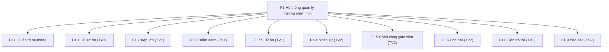

# Khảo sát nghiệp vụ và phân chia hệ thống con

> Bản khảo sát sơ bộ. Cách phân chia hệ thống con dưới đây là phương án đề xuất, chờ cơ sở khảo sát xác nhận vai trò thực tế của từng bộ phận. Căn cứ lập hồ sơ khảo sát gồm *HuongdanXDHTTTQLv1_1 (1).pdf*, trang 5–7, và *Checklist_BTL_HTTTQL_v2026 (1).xlsx*, trang tính **Nhóm 02 người**, mục 3.1 và 3.3.

## 1. Thông tin khảo sát

Điền sau mỗi buổi phỏng vấn. Khi một giả định trong các tài liệu nghiệp vụ được xác nhận hoặc bác bỏ, cập nhật tài liệu đó và ghi lại ở bảng nhật ký.

| Mục | Nội dung |
| --- | --- |
| Cơ sở khảo sát | *(tên trường, địa chỉ)* |
| Quy mô | *(số lớp, số trẻ, số giáo viên, số nhân viên)* |
| Người thực hiện | TV1, TV2 |
| Phương pháp | Phỏng vấn trực tiếp, xin biểu mẫu trắng, quan sát giờ đón trả trẻ |

**Nhật ký phỏng vấn**

| Ngày | Người được phỏng vấn (vai trò) | Nghiệp vụ | Nội dung đã xác nhận hoặc thay đổi | Biểu mẫu đã nhận |
| --- | --- | --- | --- | --- |
| *(dd/MM/yyyy)* | *(ví dụ: phó hiệu trưởng)* | *(ví dụ: 05)* | | *(ví dụ: PC-01)* |

## 2. Danh sách nghiệp vụ khảo sát

| STT | Nghiệp vụ | Thành viên | Tài liệu |
| --- | --- | --- | --- |
| 01 | Tiếp nhận và quản lý hồ sơ trẻ | TV1 | [01-tiep-nhan-va-quan-ly-ho-so-tre.md](01-tiep-nhan-va-quan-ly-ho-so-tre.md) |
| 02 | Xếp lớp và quản lý biến động sĩ số | TV1 | [02-xep-lop-va-quan-ly-bien-dong-si-so.md](02-xep-lop-va-quan-ly-bien-dong-si-so.md) |
| 03 | Điểm danh và theo dõi chuyên cần | TV1 | [03-diem-danh-va-theo-doi-chuyen-can.md](03-diem-danh-va-theo-doi-chuyen-can.md) |
| 04 | Quản lý hồ sơ giáo viên và nhân viên | TV2 | [04-staff-management.md](04-staff-management.md) |
| 05 | Phân công giáo viên theo lớp và thời gian | TV2 | [05-teacher-assignment.md](05-teacher-assignment.md) |
| 06 | Lập khoản phải thu và thu học phí | TV2 | [06-tuition-management.md](06-tuition-management.md) |
| 07 | Quản lý suất ăn và chế độ ăn của trẻ | TV1 | [07-quan-ly-suat-an-va-che-do-an-cua-tre.md](07-quan-ly-suat-an-va-che-do-an-cua-tre.md) |
| 08 | Đón trẻ, trả trẻ và tự động ghi nhận có mặt | TV2 | [08-child-drop-off-and-pick-up.md](08-child-drop-off-and-pick-up.md) |
| 09 | Lập, ghi chú và gửi báo cáo | TV2 | [09-reporting.md](09-reporting.md) |

Tất cả tài liệu khảo sát của hai thành viên nằm chung trong thư mục `docs/survey/`.

## 3. Thuật ngữ

| Thuật ngữ | Nghĩa trong tài liệu |
| --- | --- |
| Đón trẻ | Giáo viên nhận trẻ từ phụ huynh vào lớp, thường buổi sáng. |
| Trả trẻ | Giáo viên giao trẻ cho người đón về. |
| Người đón | Phụ huynh hoặc người được ủy quyền đến đón trẻ về, thuộc danh sách người đưa đón ở nghiệp vụ 01. |
| Giờ chốt | Mốc trong ngày mà trẻ chưa được đón bị chuyển sang vắng, đồng thời là mốc chốt số báo bếp ở nghiệp vụ 03 và 07. |
| Đã chốt | Số liệu đã được người có quyền xác nhận và khóa. Bộ phận khác chỉ dùng số đã chốt. Muốn sửa phải theo quy trình điều chỉnh. |
| Ngày hiệu lực | Ngày một quyết định bắt đầu có tác dụng, ghi riêng với thời điểm nhập. Dùng chung quy ước của QT-XL-02: ngày bắt đầu tính hiệu lực, ngày kết thúc là ngày đầu tiên không còn hiệu lực. |
| Ghi hồi tố | Nhập một thay đổi sau ngày hiệu lực của nó. Cần lý do, người duyệt và đối chiếu dữ liệu đã chốt. |
| Dạy thay | Phân công có thời hạn cho một giáo viên đứng lớp khác thay giáo viên vắng. |
| Kỳ thu | Khoảng thời gian lập một bảng phải thu, mặc định là tháng. |
| Người phân công | Người lập phương án phân công giáo viên ở nghiệp vụ 05. Phương án đề xuất là nhân viên văn phòng được giao, chờ xác nhận. |

## 4. Nguyên tắc chia hệ thống con

Mỗi hệ thống con phục vụ **một bộ phận** và chỉ chứa những chức năng mà bộ phận đó thực sự làm trong công việc hằng ngày. Một chức năng không thuộc nhiệm vụ của bộ phận thì **không xuất hiện** trong hệ thống con của bộ phận đó, kể cả dưới dạng chỉ xem, trừ khi bộ phận cần dữ liệu đó làm căn cứ.

- **Làm chủ dữ liệu:** mỗi loại dữ liệu chỉ có một hệ thống con được tạo và sửa. Ví dụ, thực đơn chỉ do hệ thống con Bếp tạo, điểm danh chỉ do hệ thống con Giáo viên tạo.
- **Nhận căn cứ, không nhận chức năng:** khi cần dữ liệu của bộ phận khác, hệ thống con chỉ nhận **số liệu đã chốt** ở dạng chỉ đọc, không nhận màn hình nghiệp vụ của bộ phận đó. Ví dụ, Kế toán cần số ngày có mặt để tính tiền ăn, nên chỉ nhận con số ngày có mặt đã chốt. Kế toán không có màn hình điểm danh và không có màn hình thực đơn.
- **Báo cáo đi lên, không có sẵn ở trên:** mỗi hệ thống con tự lập báo cáo trong phạm vi của mình, ghi chú và gửi cho Ban giám hiệu. Ban giám hiệu không tự sinh báo cáo của bộ phận khác. Quy trình chi tiết ở nghiệp vụ 09.
- **Một người, nhiều vai trò:** nếu một người kiêm nhiều bộ phận (ví dụ văn phòng kiêm kế toán), người đó được cấp nhiều hệ thống con. Không gộp chức năng của hai bộ phận vào một hệ thống con.

## 5. Các hệ thống con và chức năng

### 5.1. Hệ thống con Ban giám hiệu (quản trị)

| Có | Không có |
| --- | --- |
| Quản lý tài khoản và phân quyền người dùng. Khóa tài khoản khi nhân sự nghỉ việc (nghiệp vụ 04). | Nhập điểm danh, đón trả trẻ. |
| Danh mục dùng chung: năm học, nhóm tuổi, ca làm việc, định mức giáo viên theo nhóm tuổi (mục 6). | Lập bảng phải thu, ghi thu tiền, in biên lai. |
| Duyệt: tiếp nhận hồ sơ trẻ, phương án xếp lớp, phân công giáo viên, biểu phí và miễn giảm, thực đơn, biến động nhân sự. | Lập thực đơn, chốt suất ăn. |
| Hộp báo cáo nhận được từ các bộ phận: xem, phản hồi, yêu cầu bổ sung, duyệt (nghiệp vụ 09). | Tự sinh báo cáo thay cho bộ phận. |
| Bảng tổng hợp toàn trường lấy từ các báo cáo **đã duyệt**. | Lập phương án phân công (chỉ duyệt). |

### 5.2. Hệ thống con Văn phòng

| Có | Không có |
| --- | --- |
| Tiếp nhận và quản lý hồ sơ trẻ, danh sách người đưa đón trẻ (nghiệp vụ 01). | Thu tiền, công nợ. |
| Xếp lớp, chuyển lớp, thôi học (nghiệp vụ 02). | Thực đơn, suất ăn. |
| Hồ sơ giáo viên và nhân viên (nghiệp vụ 04). Lập phương án phân công và sắp xếp dạy thay (nghiệp vụ 05). | Điểm danh từng trẻ. |
| Ghi nhận báo nghỉ của phụ huynh khi phụ huynh báo qua văn phòng (nghiệp vụ 08). Xem tình hình đón trả toàn trường. | |
| Lập, ghi chú và gửi báo cáo tuyển sinh, sĩ số, nhân sự, phân công. | |

### 5.3. Hệ thống con Giáo viên

Chỉ thấy **lớp mình được phân công trong ngày** (nghiệp vụ 05).

| Có | Không có |
| --- | --- |
| Đón trẻ, trả trẻ bằng cách chọn trẻ rồi xác nhận một lần. Ghi nhận báo nghỉ của phụ huynh lớp mình (nghiệp vụ 08). | Học phí, công nợ, biên lai, thông báo học phí. |
| Điểm danh được tự động ghi nhận từ đón trẻ. Xác minh vắng, chốt điểm danh (nghiệp vụ 03). | Lập thực đơn. Chỉ xem thực đơn của lớp mình và lưu ý dị ứng của trẻ. |
| Xác nhận danh sách ăn và số suất của lớp (nghiệp vụ 07). | Hồ sơ nhân sự, xếp lớp. |
| Xem lịch phân công của mình, gửi báo nghỉ của bản thân (nghiệp vụ 05). | Lập phân công. |
| Lập, ghi chú và gửi báo cáo lớp: chuyên cần, tình hình trẻ. | |

### 5.4. Hệ thống con Kế toán

| Có | Không có |
| --- | --- |
| Biểu phí, danh mục miễn giảm (trình duyệt). | **Thực đơn, chế độ ăn, chốt suất ăn.** |
| Lập bảng phải thu theo kỳ, phát hành thông báo học phí cho phụ huynh (nghiệp vụ 06). | Điểm danh, đón trả trẻ. |
| Ghi thu tiền, biên lai, điều chỉnh, hoàn tiền, công nợ. | Hồ sơ trẻ, xếp lớp, phân công giáo viên. |
| Nhận **chỉ đọc**: danh sách trẻ theo lớp trong kỳ, số ngày có mặt đã chốt, số suất ăn đã chốt. | |
| Lập, ghi chú và gửi báo cáo thu, công nợ. | |

### 5.5. Hệ thống con Bếp và dinh dưỡng

| Có | Không có |
| --- | --- |
| Lập thực đơn theo ngày, bữa, trình duyệt (nghiệp vụ 07). | Tiền ăn, học phí, công nợ. |
| Tổng hợp số suất từ các lớp, giao nhận suất ăn. | Điểm danh, đón trả trẻ. |
| Xem danh sách trẻ dị ứng hoặc chế độ ăn riêng. | Hồ sơ nhân sự. |
| Lập, ghi chú và gửi báo cáo suất ăn. | |

### 5.6. Đối tượng ngoài hệ thống

Phụ huynh **không có hệ thống con** trong phạm vi đề xuất. Mọi thông tin từ phụ huynh được nhân viên nhà trường nhập vào hệ thống:

| Thông tin từ phụ huynh | Kênh hiện tại | Ai nhập vào hệ thống |
| --- | --- | --- |
| Hồ sơ trẻ, người đưa đón | Nộp tại văn phòng | Văn phòng (nghiệp vụ 01) |
| Báo nghỉ cho trẻ | Zalo, điện thoại, sổ liên lạc | Giáo viên lớp, hoặc văn phòng nếu phụ huynh báo qua văn phòng (nghiệp vụ 08) |
| Đơn miễn giảm | Nộp tại văn phòng hoặc kế toán | Kế toán (nghiệp vụ 06) |
| Nộp học phí | Tiền mặt, chuyển khoản | Kế toán (nghiệp vụ 06) |

Thông tin gửi tới phụ huynh (thông báo học phí, biên lai, thực đơn) do bộ phận làm chủ dữ liệu phát hành, in hoặc gửi qua kênh liên lạc của trường.

## 6. Dữ liệu dùng chung và tài khoản

Các danh mục này không thuộc riêng nghiệp vụ nào nhưng nhiều nghiệp vụ dùng tới. Mỗi danh mục vẫn chỉ có một nơi tạo và sửa.

| Dữ liệu | Tạo và sửa | Duyệt | Nghiệp vụ dùng |
| --- | --- | --- | --- |
| Năm học, kỳ học, lịch nghỉ của trường | Ban giám hiệu | — | 02, 03, 05, 06 |
| Nhóm tuổi | Ban giám hiệu | — | 02, 05, 06 |
| Lớp | Văn phòng (nghiệp vụ 02) | Ban giám hiệu | 03, 05, 06, 07, 08 |
| Ca làm việc và khung giờ | Ban giám hiệu | — | 05 |
| Định mức giáo viên theo lớp hoặc nhóm tuổi | Ban giám hiệu | — | 05 |
| Giờ chốt đón trẻ và báo bếp | Ban giám hiệu | — | 03, 07, 08 |
| Biểu phí, danh mục miễn giảm | Kế toán (nghiệp vụ 06) | Ban giám hiệu | 06 |
| Tài khoản và vai trò người dùng | Ban giám hiệu | — | Tất cả |

**Tài khoản gắn với hồ sơ nhân sự.** Mỗi tài khoản thuộc một hồ sơ nhân sự ở nghiệp vụ 04. Khi nhân sự tạm nghỉ hoặc nghỉ việc có hiệu lực, Ban giám hiệu khóa tài khoản từ ngày hiệu lực. Hệ thống con được cấp theo vị trí công việc.

## 7. Ma trận nghiệp vụ và hệ thống con

Ký hiệu: **T** tạo và sửa, **D** duyệt, **X** chỉ xem hoặc nhận số liệu đã chốt, **—** không có.

| Nghiệp vụ | Ban giám hiệu | Văn phòng | Giáo viên | Kế toán | Bếp |
| --- | --- | --- | --- | --- | --- |
| 00 Danh mục dùng chung, tài khoản | T | T (lớp) | — | T (biểu phí) | — |
| 01 Hồ sơ trẻ | D | T | X (lớp mình) | — | X (dị ứng) |
| 02 Xếp lớp | D | T | X (lớp mình) | X | — |
| 03 Điểm danh | X | X | T (lớp mình) | X (số ngày đã chốt) | — |
| 04 Hồ sơ nhân sự | D | T | — | — | — |
| 05 Phân công giáo viên | D | T | X (lịch mình), T (báo nghỉ của mình) | — | — |
| 06 Học phí | D (biểu phí, miễn giảm, điều chỉnh) | — | — | T | — |
| 07 Suất ăn, thực đơn | D (thực đơn) | — | T (xác nhận suất lớp) | X (số suất đã chốt) | T |
| 08 Đón trả trẻ | — | X, T (báo nghỉ qua văn phòng) | T (lớp mình) | — | — |
| 09 Báo cáo | Nhận, D | T, gửi | T, gửi | T, gửi | T, gửi |

**Câu hỏi xác minh khi phỏng vấn ban giám hiệu**

- Trường có những bộ phận nào? Một người có kiêm nhiều vai trò không (ví dụ văn phòng kiêm kế toán)?
- Ai phân công giáo viên: văn phòng hay phó hiệu trưởng chuyên môn? Nếu là phó hiệu trưởng, người đó được cấp thêm hệ thống con Văn phòng để lập phân công, còn việc duyệt do hiệu trưởng.
- Kế toán có cần xem chi tiết điểm danh từng ngày không, hay chỉ cần tổng số ngày có mặt đã chốt?
- Trường có muốn phụ huynh tự báo nghỉ hoặc xem học phí qua ứng dụng không? Nếu có, cần thêm hệ thống con Phụ huynh ở giai đoạn sau.

## 8. Đối chiếu với checklist (mục 3.1 và 3.3)

Phần này là bản nháp để hai thành viên thống nhất. Mã chức năng dùng dạng `F1.x.y`, với `x` là số nghiệp vụ. TV1 bổ sung chức năng lá cho các nhánh của mình.

### 8.1. Sơ đồ phân rã chức năng (BFD) đề xuất

| Nhánh cấp 2 | Chức năng lá (cấp 3) | Hệ thống con |
| --- | --- | --- |
| F1.0 Quản trị hệ thống | F1.0.1 Quản lý tài khoản và vai trò. F1.0.2 Quản lý danh mục dùng chung. | Ban giám hiệu |
| F1.4 Nhân sự | F1.4.1 Lập hồ sơ nhân sự. F1.4.2 Quản lý bằng cấp, chứng chỉ, giấy tờ. F1.4.3 Ghi nhận biến động nhân sự. F1.4.4 Tra cứu và xuất danh sách nhân sự. | Văn phòng, Ban giám hiệu duyệt |
| F1.5 Phân công giáo viên | F1.5.1 Lập phương án phân công. F1.5.2 Duyệt phân công. F1.5.3 Báo nghỉ và phân công dạy thay. F1.5.4 Tra cứu lịch sử và tổng hợp ca. | Văn phòng, Ban giám hiệu, Giáo viên |
| F1.6 Học phí | F1.6.1 Quản lý biểu phí và miễn giảm. F1.6.2 Lập bảng phải thu. F1.6.3 Thu tiền và in biên lai. F1.6.4 Điều chỉnh và hoàn tiền. F1.6.5 Theo dõi công nợ. | Kế toán, Ban giám hiệu duyệt |
| F1.8 Đón trả trẻ | F1.8.1 Ghi nhận báo nghỉ. F1.8.2 Đón trẻ. F1.8.3 Chốt đón. F1.8.4 Trả trẻ. F1.8.5 Tra cứu đón trả. | Giáo viên, Văn phòng |
| F1.9 Báo cáo | F1.9.1 Lập và ghi chú báo cáo. F1.9.2 Gửi báo cáo. F1.9.3 Xem, phản hồi, duyệt. F1.9.4 Tổng hợp toàn trường. | Mọi hệ thống con, Ban giám hiệu duyệt |

Checklist yêu cầu ≥6 nhánh cấp 2, mỗi thành viên ≥3. Bản đề xuất có 4 nhánh của TV1 và 5 nhánh của TV2.

### 8.2. Use case cốt lõi của TV2

Checklist yêu cầu ≥8 use case cho cả nhóm, mỗi thành viên ≥4, trong đó ≥4 giao dịch phức hợp và ≥2 luồng liên phân hệ TV1↔TV2.

| Mã | Use case | Tác nhân | Giao dịch phức hợp | Liên phân hệ |
| --- | --- | --- | --- | --- |
| UC-04 | Lập và cập nhật hồ sơ nhân sự | Văn phòng | Có: hồ sơ kèm danh sách chứng chỉ, giấy tờ | — |
| UC-05 | Lập phân công giáo viên | Văn phòng, Ban giám hiệu | Có: kết thúc phân công cũ và mở phân công mới trong một lần | Dùng danh sách lớp của nghiệp vụ 02 (TV1) |
| UC-06 | Lập bảng phải thu theo kỳ | Kế toán | Có: tính nhiều khoản cho nhiều trẻ | Dùng nghiệp vụ 02, 03, 07 (TV1) |
| UC-07 | Ghi thu tiền và in biên lai | Kế toán | Có: biên lai, cập nhật công nợ | — |
| UC-08 | Đón trẻ theo nhóm | Giáo viên | Có: ghi đón nhiều trẻ trong một lần xác nhận | Tạo kết quả có mặt cho nghiệp vụ 03 (TV1) |
| UC-09 | Trả trẻ theo nhóm | Giáo viên | Có | — |
| UC-10 | Gửi, phản hồi và duyệt báo cáo | Mọi bộ phận, Ban giám hiệu | Có: lưu phiên bản và ảnh chụp số liệu | Lấy số liệu đã chốt từ nghiệp vụ của TV1 |

### 8.3. Quy tắc nghiệp vụ liên phân hệ

Checklist yêu cầu ≥8 quy tắc cho cả nhóm, mỗi thành viên ≥4, trong đó ≥2 quy tắc nối TV1↔TV2. Các quy tắc của TV2 nối với phân hệ TV1:

| Quy tắc | Phân hệ TV2 | Phân hệ TV1 | Nội dung nối |
| --- | --- | --- | --- |
| QT-PC-01 | 05 Phân công | 02 Xếp lớp | Chỉ phân công vào lớp đang hoạt động tại ngày hiệu lực. |
| QT-HP-02 | 06 Học phí | 02 Xếp lớp, 03 Điểm danh | Khoản tính theo ngày chỉ dùng ngày có mặt đã chốt và khoảng thời gian trẻ thuộc lớp. |
| QT-DT-01 | 08 Đón trả trẻ | 03 Điểm danh | Đón trẻ là nguồn duy nhất tạo kết quả có mặt. |
| QT-DT-05 | 08 Đón trả trẻ, 05 Phân công | 03 Điểm danh | Chỉ giáo viên được phân công lớp trong ngày mới đón trả và điểm danh lớp đó. |

**Cần thống nhất với TV1.** Nghiệp vụ 03, bước 2, đang mô tả giáo viên tự ghi có mặt vào sổ hoặc phần mềm. Nghiệp vụ 08 đề xuất có mặt được ghi tự động từ đón trẻ (QT-DT-01). Hai tài liệu cần thống nhất: quy trình hiện tại giữ như nghiệp vụ 03 mô tả, còn hệ thống mới theo QT-DT-01.
